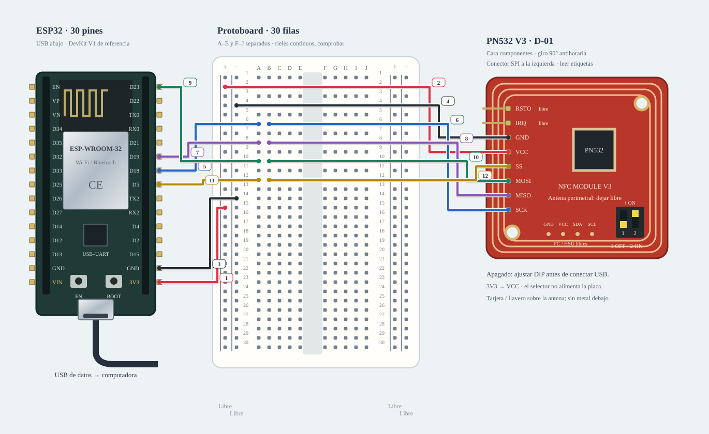

# M-10 · Montaje físico NFC: ESP32 + PN532

**Diseño para armar; sin ensayo físico.** Cabecera macho confirmada por Joaquín
al aprobar el plan. No confirma terminación ni calidad de soldadura.

Abrir `/montajes?guia=nfc` o «Abrir montaje físico NFC» en el banco NFC. Abre en
memoria: no sobrescribe el guardado hasta «Guardar revisión local». El banco
lógico sigue separado en `?banco=nfc`. El editor permite resaltar las seis redes,
recorrer 12 cables, deshacer, guardar/importar/exportar JSON y descargar el SVG
completo aunque se esté viendo un paso parcial.



[JSON importable en el editor](esquemas/nfc-fisico.json). Es un montaje v1, no el
JSON de colección de bancos. Generar ambos archivos desde web con
`node scripts/export-nfc-assembly.mjs`: catálogo/receta en `src/hardware/nfc.ts`,
geometría y componente compartidos con la web. El dibujo no está a escala y las
líneas no demuestran alcance real de cables ni continuidad de contactos.

## Piezas y orientación

- ESP32 A-01 **o** B-02, asociar placa física/propietario/puerto; referencia
  DEVKIT V1 / ESP-WROOM-32 de 30 pines, USB abajo. No usar el pinout de 38 pines.
- D-01 PN532 serigrafiado ELECHOUSE NFC MODULE V3, cabecera **macho** declarada;
  D-11 según accesorios usados. Soldadura en curso/terminación por revisar.
- D-02 tarjeta y D-03 llavero, uno por vez al probar.
- Protoboard A-04 o B-01. **12 jumpers macho–hembra** del material disponible
  C-08 (~16 declarados; revisar cuántos están libres y su largo). Cero H–H.
- Cable USB de datos A-03 o D-10; sin pantalla, amplificador, sensores o actuadores.

PN532: cara de componentes girada **90° antihoraria** respecto de la foto del
manual V3, con conector SPI a la izquierda. De arriba abajo: **RSTO, IRQ, GND,
VCC, SS, MOSI, MISO, SCK**. La referencia frontal sin girar tiene SPI arriba,
de izquierda a derecha SCK/MISO/MOSI/SS/VCC/GND/IRQ/RSTO. Comparar etiquetas en
la pieza real, nunca copiar posición desde el reverso. La ficha es una
ilustración del diseño V3 compatible visualmente, no prueba de autenticidad.
Dejar accesible la antena perimetral y evitar metal debajo. La ilustración no
requiere insertar por fuerza las placas en la protoboard.

## Selector y alimentación: cosas diferentes

**USB desconectado y módulo sin alimentación:** poner canal **1 OFF / 2 ON**
para SPI, leyendo números y marca ON. El selector ya viene en D-01; no comprar
otro. No copiar «arriba/abajo» si la placa está girada. El manual indica HSU
OFF/OFF e I²C ON/OFF; no usarlos con esta receta SPI.

El selector elige comunicación, no regula ni cambia la fuente. Esta receta usa
**ESP32 3V3 → PN532 VCC y GND → GND**, según el rango VCC 3,3–5 V y SPI de
3,3 V del diseño Elechouse V3. No conectar VCC a VIN/5 V ni añadir otra fuente,
resistencia o puente. Los rieles laterales quedan libres. Confirmar las marcas
de D-01 antes de energizar; no inferir funcionamiento de un clon por el dibujo.

## Conectar apagado, cable por cable

La **hembra** de cada jumper abraza un pin macho de placa. La punta **macho**
entra al agujero indicado. Cada fila de esta tabla son dos cables físicos.

| Cables | Color | Primer cable | Segundo cable |
|---|---|---|---|
| 1 y 2 | Rojo | ESP32 3V3 → A2 | B2 → PN532 VCC |
| 3 y 4 | Negro | ESP32 GND derecho → A4 | B4 → PN532 GND |
| 5 y 6 | Azul | ESP32 D18 / GPIO18 → A6 | B6 → PN532 SCK |
| 7 y 8 | Violeta | ESP32 D19 / GPIO19 → A8 | B8 → PN532 MISO |
| 9 y 10 | Verde | ESP32 D23 / GPIO23 → A10 | B10 → PN532 MOSI |
| 11 y 12 | Amarillo | ESP32 D5 / GPIO5 → A12 | B12 → PN532 SS |

A y B de la **misma fila** ya comparten cobre dentro de la protoboard A–E:
no añadir puente, ni compartir agujero. No hay unión interna de A–E a F–J.
Las seis filas no se unen entre sí. Rieles +/− a ambos lados libres; IRQ/RSTO,
conector I²C/HSU y terminales restantes sin cables. Los cruces dibujados con
borde blanco no son conexiones. Si no hay colores iguales, conservar números
y extremos; el color del plástico no determina la señal.

## Preparar y ejecutar el ensayo

1. Revisar visualmente pines firmes, sin puentes de soldadura y terminales bien
   abrazados. Montar sin USB; registrar placa y cableado real.
2. Antes de cualquier carga, identificar puerto/chip/placa física, preservar el
   respaldo privado existente y comprobar sketch/perfil. No publicar flash/NVS.
   El visor solo diseña; no carga firmware. Si falta identificar placa/respaldo,
   dejar la carga pendiente, sin borrar ni reemplazar datos.
3. Usar [firmware/nfc_bench](../../firmware/nfc_bench/README.md), ya existente,
   SPI 18/19/23/5, core y dependencias fijados allí. Compilar sin placa:

   ```sh
   arduino-cli compile --fqbn esp32:esp32:esp32doit-devkit-v1 --jobs 2 --build-path /tmp/classai-nfc-bench-build firmware/nfc_bench
   bash scripts/ci/bench-host.sh
   ```

4. Tras completar los pasos previos y cargar en el puerto identificado, abrir
   Serial **115200**. Debe informar PN532 y su versión; no basta un LED encendido.
5. Presentar tarjeta y mantenerla: debe contar una vez. Retirarla hasta ver
   «Retirada detectada» y volver a presentar. Hacer diez presentaciones con
   tarjeta y diez con llavero. Los UID no se imprimen ni publican.
6. Registrar resultados reales en [montajes](montajes.md), incluidos fallos.
   Antes de mover cables, volver a desconectar USB.

| Prueba | Resultado esperado | Resultado observado |
|---|---|---|
| Versión | PN532 responde al arranque | Pendiente |
| Tarjeta mantenida | Una detección mientras permanece estable | Pendiente |
| Tarjeta retirar/presentar ×10 | Diez detecciones con retirada entre ellas | Pendiente |
| Llavero retirar/presentar ×10 | Diez detecciones con retirada entre ellas | Pendiente |

La retirada se infiere de dos consultas sin target. Una pérdida de RF puede
parecer retirada; no es garantía de deduplicación por estudiante/sesión.

## Diagnóstico sin multímetro

| Síntoma | Revisar con USB desconectado, salvo observación Serial |
|---|---|
| No aparece puerto/Serial | Cable USB de datos, puerto, controlador USB y velocidad 115200; identificar ESP32 antes de atribuirlo al PN532 |
| «PN532 no encontrado» | DIP 1 OFF/2 ON; SCK18/MISO19/MOSI23/SS5; 3V3/GND; etiquetas y soldaduras; reiniciar después de reconectar |
| Versión sí, tarjeta no | Una tarjeta cerca de antena, sin metal; alternar D-02 y D-03; anotar si falla una o ambas |
| Detecciones repetidas sin retirar | Estabilidad de tarjeta, contactos y alimentación; pérdidas RF pueden rearmar el contador |
| Reinicios/fallo de configuración | Parar el ensayo, revisar conexiones y soldaduras y registrar log sin secretos; no subir tensión como prueba |

Sin instrumentos no se inventan medidas ni se exige comprar un multímetro para
leer el diseño. Si persiste una incertidumbre de alimentación o soldadura, se
registra y se pide revisión de esa conexión concreta antes de seguir.

## Fuentes y límites

- [Manual Elechouse PN532 V3](https://www.elechouse.com/elechouse/images/product/PN532_module_V3/PN532_%20Manual_V3.pdf), foto frontal p. 2, interfaces/selector p. 3. Base del orden físico y modo SPI.
- [Video ESP32 + PN532 y Android](https://www.youtube.com/watch?v=5ZUEixO19r0): subtítulos automáticos recuperados durante planificación; muestra I²C y HCE/AID. No trasladar sus pines a nuestra receta SPI.
- [Video de modos PN532 con Arduino](https://www.youtube.com/watch?v=pNngRs0cBgg): subtítulos automáticos recuperados; explica HSU/I²C/SPI. No trasladar pines Arduino/5 V al ESP32 ni tomar todas sus cifras técnicas como verificadas.

No se publica transcripción completa. Este banco no prueba Android HCE/APDU,
identidad de estudiantes, MQTT, persistencia ni pantalla. La prueba de HCE será
posterior a tarjeta/llavero. No se declara simulación de RF ni ausencia garantizada
de daño. Estado actual: diseño y comprobaciones software; hardware pendiente.
