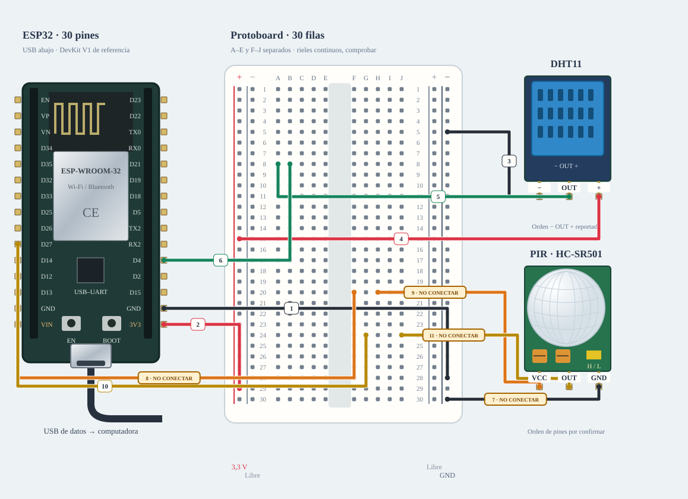

# M-04/05 · DHT11 + PIR

Conservar el banco ya dibujado: temperatura/humedad y movimiento, sin hembra–hembra.

**Montaje condicionado · revisar pendientes.** Diseño de referencia, sin ensayo físico nuevo.



[JSON de montaje importable](ambiente-fisico.json) · [SVG físico](ambiente-fisico.svg). ESP32 USB abajo; orientación de referencia, cotejar serigrafía. Terminales rotulados por función donde el conector aún no está identificado.

## Materiales

- B-03: DHT11 ×1
- B-04 o D-06: un PIR
- B-01 o A-04: protoboard

Cables: 11 M–H + 0 M–M dibujados; cero H–H. Se reutilizan entre bancos; no se exige montarlos todos simultáneamente. Preservar B-02/NFC; comprobar material libre en la otra placa.

## Conexiones funcionales

| Desde | Hasta | Vía | Estado |
|---|---|---|---|
| ESP32 · 3V3 | DHT11 · + | 3,3 V | Pendiente; no conectar |
| DHT11 · − | ESP32 · GND | — | Referencia |
| DHT11 · OUT | ESP32 · GPIO4 | — | Referencia |
| ESP32 · VIN/5V | PIR · VCC | 5 V del USB solo si A-01 confirma ese pin | Pendiente; no conectar |
| PIR · GND | ESP32 · GND | — | Referencia |
| PIR · OUT | ESP32 · GPIO27 | Orden y nivel pendientes | Pendiente; no conectar |

## Armado cable por cable · USB desconectado

12 jumpers: 11 macho–hembra y 1 macho–macho. PIR se conecta por nodos independientes de la protoboard; sin empalmes ni H–H. ESP32 DEVKITV1 30 pines fotografiado, ID A/B por asociar; terminales PIR aún no legibles y VIN sin medir. Propuesta, no ensayo físico. R-027 elimina la fuente externa no disponible. PIR queda condicionado al pin VIN/5V alimentado por USB de una A-01 identificada. Guía UTEC aportada: breakout DHT11 con pull-up integrado; se elimina R externa.

| Nº | Color | Tipo | Origen | Destino | Condición |
|---|---|---|---|---|---|
| 1 | black | M–H | esp1:GND | bb:RN28 | GND derecho del ESP32 → RN28. Riel derecho − para ambos sensores; comprobar continuidad, USB apagado. |
| 2 | red | M–H | esp1:3V3 | bb:LP29 | 3V3 → LP29. Riel izquierdo + solo 3,3 V; riel izquierdo − queda libre. |
| 3 | black | M–H | bb:RN5 | dht1:GND | RN5 → − del DHT11. M–H: hembra al módulo y macho a RN5. |
| 4 | red | M–H | bb:LP15 | dht1:VCC | M–H rojo: + del módulo DHT11 a 3,3 V. Pull-up integrado, según guía UTEC aportada. |
| 5 | green | M–H | dht1:DATA | bb:A8 | Terminal OUT del DHT11 → A8. A8 y C8 pertenecen a la misma tira, lado A–E. |
| 6 | green | M–H | esp1:GPIO4 | bb:B8 | GPIO4 del ESP32 → B8; misma red de OUT y pata 1 de R1. |
| 7 | black | M–H | bb:RN30 | pir1:GND | NO conectar: Identificar PIR y VCC/OUT/GND reales, fuente y niveles. VIN USB no confirmado; no conectar aún. |
| 8 | orange | M–H | esp1:VIN | bb:F20 | NO conectar: A-01 no está identificada: confirmar que el pin serigrafiado VIN/5V expone los 5 V del USB antes de conectar el PIR. |
| 9 | orange | M–H | bb:H20 | pir1:VCC | NO conectar: Identificar PIR y VCC/OUT/GND reales, fuente y niveles. VIN USB no confirmado; no conectar aún. |
| 10 | yellow | M–H | esp1:GPIO27 | bb:G24 | D27 / GPIO27 → G24, M–H. Tira F24–J24 exclusiva de señal, separada de F20–J20. |
| 11 | yellow | M–H | bb:J24 | pir1:OUT | NO conectar: Identificar PIR y VCC/OUT/GND reales, fuente y niveles. VIN USB no confirmado; no conectar aún. |

M–H: hembra al conector macho del módulo/ESP32 y macho al agujero. M–M: ambos extremos en agujeros distintos. Nunca dos puntas en un agujero.

LP/LN: riel izquierdo +/−; RP/RN: derecho +/−. A–E y F–J son tiras separadas por fila. Confirmar continuidad/cortes de la protoboard real; los rieles opuestos no están unidos. Patas colocadas: módulos externos, conectores por verificar.

Cruces no unen redes. Las condiciones de cada tramo aparecen en esta tabla; un cable por verificar no cuenta como continuidad confirmada aunque se dibuje continuo. Colores son identificadores del dibujo: elegir cables reales y anotar equivalencias. SVG no demuestra alcance físico.

## Antes de energizar

1. Distribución física de ambiente: VCC PIR en F20/H20 y OUT en G24/J24; no confundir tiras.
2. Etiquetas del PIR no legibles en fotos: no inferir orden por lente o jumper amarillo.
3. Guía UTEC Anexo X: DHT11 de tres pines con pull-up integrado; sin resistencia externa. ESP32: alimentar a 3,3 V y cotejar +/OUT/−.
4. Sin fuente externa: identificar A-01 y confirmar que VIN/5V expone VBUS antes de alimentar el PIR.
5. Identificar A-01/puerto y preservar respaldo privado antes de cargar.
6. Comprobar protoboard real, tipos y alcance de jumpers, con USB desconectado.
7. DHT11 con pull-up integrado; cotejar etiquetas del PIR y fuente. Confirmar en A-01 que VIN/5V expone los 5 V del USB; no inferirlo por el dibujo.
8. No hace falta una fuente externa para esta referencia; sí identificar A-01 y cotejar VCC/OUT/GND del PIR.

Revisar agujero por agujero con USB retirado, polaridad y separación de fuentes. Sin multímetro, identificar por etiquetas y documentación exacta; una tensión o pin dudoso se mantiene desconectado. VIN no garantiza salida regulada de 5 V.

Firmware: firmware/ambient_bench; compilar sin carga; Serial 115200. Ver guía física.

## Compilar y cargar manualmente

Arduino CLI 1.5.1, ESP32 core 3.3.12; DHT sensor library 1.4.7 y Adafruit Unified Sensor 1.1.15 solo si el perfil utiliza DHT11. Actuadores usan ClassAIBench local y pantalla Adafruit GFX 1.12.6 + ST7735/ST7789 1.12.0.

```sh
arduino-cli compile --libraries firmware/libraries --fqbn esp32:esp32:esp32doit-devkit-v1 --jobs 2 --output-dir /tmp/classai-ambiente-build firmware/ambient_bench
```

Antes de cargar: identificar A-01 y puerto explícito, comprobar su FQBN, registrar cableado real y conservar respaldo privado verificado. Desconectar módulos ajenos y cerrar cualquier monitor. Solo después de resolver TODOS los pendientes eléctricos de esta receta:

```sh
# Sustituir PUERTO_A01 por el puerto reidentificado; no usar el de B-02/NFC.
arduino-cli upload --fqbn esp32:esp32:esp32doit-devkit-v1 --port PUERTO_A01 --input-dir /tmp/classai-ambiente-build firmware/ambient_bench
arduino-cli monitor --port PUERTO_A01 --config baudrate=115200
```

Cargar utiliza el binario del perfil recién compilado; no recompilar otro perfil entre compile/upload. Abrir Serial puede reiniciar la placa. No se ejecutaron estos comandos de carga/monitor durante esta entrega.

## Prueba guiada y fallos

Acción: Probar primero DHT11 y PIR separados; después ejecutar ambos.

Aprobación esperada: 20 lecturas DHT válidas y PIR LOW→HIGH→LOW→HIGH tras estabilización.

Diagnóstico: DHT inválido: revisar DATA/pull-up sin alimentación. PIR fijo: esperar, revisar etiquetas, modo y fuente.

Conflictos: PIR GPIO27 entra en conflicto con DC de la TFT.

Faltantes/confirmaciones:
- Identificar A-01/puerto y preservar respaldo privado antes de cargar.
- Comprobar protoboard real, tipos y alcance de jumpers, con USB desconectado.
- DHT11 con pull-up integrado; cotejar etiquetas del PIR y fuente. Confirmar en A-01 que VIN/5V expone los 5 V del USB; no inferirlo por el dibujo.
- No hace falta una fuente externa para esta referencia; sí identificar A-01 y cotejar VCC/OUT/GND del PIR.

## Registro de resultado

| Etapa | Resultado observado | Evidencia |
|---|---|---|
| Diseño | Referencia física; conservar condiciones | SVG/JSON y guía |
| Compilación | Consultar [resultados de esta entrega](../bancos-fisicos.md); no inferir PASS del comando | Log y tamaños por perfil |
| Simulación nueva | No ejecutada | — |
| Ensayo físico nuevo | Pendiente | Completar acción, salida, reinicios y evidencia tras ensayo |
| Desmontaje | Pendiente | Registrar qué cables/piezas quedan conectados |

- [Adafruit · DHT y pull-up](https://learn.adafruit.com/dht/connecting-to-a-dhtxx-sensor)
- [Joy-IT · HC-SR501](https://joy-it.net/en/products/SEN-HC-SR501)

[Índice](README.md). Generado desde missions.ts y sus registros físicos mediante web/scripts/export-hardware-missions.mjs.
