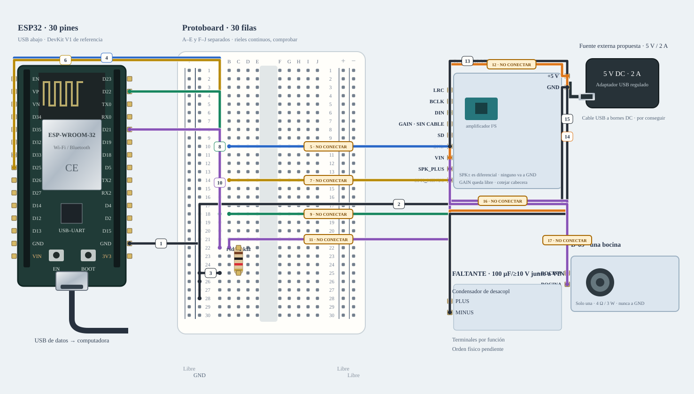

# M-07B · Audio · una bocina · adaptación condicional

Alternativa de compatibilidad; no es el montaje principal ni material ya recibido.

**Copia los cables numerados.** Diseño de referencia, sin ensayo físico nuevo.



[JSON de montaje importable](audio-salida-adaptado-fisico.json) · [SVG físico](audio-salida-adaptado-fisico.svg). ESP32 USB abajo; orientación de referencia, cotejar serigrafía. Terminales rotulados por función donde el conector aún no está identificado.

## Materiales

- esp1: A-01 · identificar antes de cargar
- amp1: D-08 · MAX98357A según inventario
- speaker1: D-09 · solo una de las dos · 4 Ω / 3 W
- c1: FALTANTE · 100 µF/≥10 V junto a VIN
- ps1: PROPUESTA · fuente DC 5 V/2 A + distribuidor; no inventariada
- rsd: C-01 · 1 kΩ pull-down SD

Cables: Consultar tabla completa de cables de esta alternativa.. Se reutilizan entre bancos; no se exige montarlos todos simultáneamente. Preservar B-02/NFC; comprobar material libre en la otra placa.

## Conexiones funcionales

| Desde | Hasta | Vía | Estado |
|---|---|---|---|


## Armado cable por cable · USB desconectado

Referencia física, sin escala métrica. USB desconectado al armar. Usar A-01 solo tras identificar placa/puerto y preservar respaldo; B-02/NFC permanece conservado. Cables reutilizados entre ensayos; cero H–H.

| Nº | Color | Tipo | Origen | Destino | Condición |
|---|---|---|---|---|---|
| 1 | black | M–H | esp1:GND | bb:LN28 | Cable 1 · M–H · esp1:GND → bb:LN28. Conectar sin USB; comprobar etiquetas y agujeros. |
| 2 | black | potencia | ps1:GND | bb:LN26 | Cable 2 · potencia DC por bornera, 22 AWG de referencia · ps1:GND → bb:LN26. Solo referencia de lógica; motor/altavoz retornan al distribuidor, no a la protoboard. |
| 3 | black | M–M | bb:A25 | bb:LN25 | Cable 3 · M–M · bb:A25 → bb:LN25. Conectar sin USB; comprobar etiquetas y agujeros. |
| 4 | blue | M–H | esp1:GPIO33 | bb:A10 | Cable 4 · M–H · esp1:GPIO33 → bb:A10. Conectar sin USB; comprobar etiquetas y agujeros. |
| 5 | blue | M–H | bb:B10 | amp1:BCLK | NO conectar: Cotejar terminal del breakout MAX98357A. |
| 6 | yellow | M–H | esp1:GPIO25 | bb:A14 | Cable 6 · M–H · esp1:GPIO25 → bb:A14. Conectar sin USB; comprobar etiquetas y agujeros. |
| 7 | yellow | M–H | bb:B14 | amp1:LRC | NO conectar: Cotejar terminal del breakout MAX98357A. |
| 8 | green | M–H | esp1:GPIO22 | bb:A18 | Cable 8 · M–H · esp1:GPIO22 → bb:A18. Conectar sin USB; comprobar etiquetas y agujeros. |
| 9 | green | M–H | bb:B18 | amp1:DIN | NO conectar: Cotejar terminal del breakout MAX98357A. |
| 10 | purple | M–H | esp1:GPIO21 | bb:A22 | Cable 10 · M–H · esp1:GPIO21 → bb:A22. Conectar sin USB; comprobar etiquetas y agujeros. |
| 11 | purple | M–H | bb:B22 | amp1:SD | NO conectar: Confirmar SD de shutdown/selección, no SD de datos del micrófono. |
| 12 | orange | potencia | ps1:PLUS | amp1:VIN | NO conectar: Confirmar D-08, fuente y cabecera montada. |
| 13 | black | potencia | ps1:GND | amp1:GND | Cable 13 · potencia DC por bornera, 22 AWG de referencia · ps1:GND → amp1:GND. Masa común de lógica/amplificador. |
| 14 | orange | potencia | ps1:PLUS | c1:PLUS | Cable 14 · potencia DC por bornera, 22 AWG de referencia · ps1:PLUS → c1:PLUS. Desacoplo junto a VIN. |
| 15 | black | potencia | ps1:GND | c1:MINUS | Cable 15 · potencia DC por bornera, 22 AWG de referencia · ps1:GND → c1:MINUS. Negativo a GND. |
| 16 | purple | altavoz | amp1:SPK_PLUS | speaker1:PLUS | NO conectar: Revisar bornera y adaptador de bocina; ningún SPK a GND. |
| 17 | purple | altavoz | amp1:SPK_MINUS | speaker1:MINUS | NO conectar: Revisar bornera y adaptador de bocina; ningún SPK a GND. |

M–H: hembra al conector macho del módulo/ESP32 y macho al agujero. M–M: ambos extremos en agujeros distintos. Nunca dos puntas en un agujero.

LP/LN: riel izquierdo +/−; RP/RN: derecho +/−. A–E y F–J son tiras separadas por fila. Confirmar continuidad/cortes de la protoboard real; los rieles opuestos no están unidos. Patas colocadas: rsd (C-01 · 1 kΩ pull-down SD): 1→C22, 2→C25.

Cruces no unen redes. Las condiciones de cada tramo aparecen en esta tabla; un cable por verificar no cuenta como continuidad confirmada aunque se dibuje continuo. Colores son identificadores del dibujo: elegir cables reales y anotar equivalencias. SVG no demuestra alcance físico.

## Antes de energizar

1. A-01/puerto identificados y respaldo privado preservado; B-02/NFC conservado.
2. Fuente 5 V/2 A propuesta y condensador 100 µF/≥10 V; revisar desacoplo de 100 nF del breakout y añadirlo si falta.
3. Confirmar D-08 MAX98357A, cabecera y adaptación D-09. GAIN libre solo bajo referencia documentada del módulo; SD21 y pull-down 1 kΩ deben estar conectados para silencio al boot; contrastar el pull-up interno del breakout.
4. Usa BCLK33, WS25, DIN22, alineado con #91; banco separado del micrófono. No modifica mascota/assets de Lando.

Revisar agujero por agujero con USB retirado, polaridad y separación de fuentes. Sin multímetro, identificar por etiquetas y documentación exacta; una tensión o pin dudoso se mantiene desconectado. VIN no garantiza salida regulada de 5 V.

Firmware: firmware/audio_output_bench

## Compilar y cargar manualmente

Arduino CLI 1.5.1, ESP32 core 3.3.12; DHT sensor library 1.4.7 y Adafruit Unified Sensor 1.1.15 solo si el perfil utiliza DHT11. Actuadores usan ClassAIBench local y pantalla Adafruit GFX 1.12.6 + ST7735/ST7789 1.12.0.

```sh
arduino-cli compile --libraries firmware/libraries --fqbn esp32:esp32:esp32doit-devkit-v1 --jobs 2 --output-dir /tmp/classai-audio-salida-adaptado-build firmware/audio_output_bench
```

Antes de cargar: identificar A-01 y puerto explícito, comprobar su FQBN, registrar cableado real y conservar respaldo privado verificado. Desconectar módulos ajenos y cerrar cualquier monitor. Solo después de resolver TODOS los pendientes eléctricos de esta receta:

```sh
# Sustituir PUERTO_A01 por el puerto reidentificado; no usar el de B-02/NFC.
arduino-cli upload --fqbn esp32:esp32:esp32doit-devkit-v1 --port PUERTO_A01 --input-dir /tmp/classai-audio-salida-adaptado-build firmware/audio_output_bench
arduino-cli monitor --port PUERTO_A01 --config baudrate=115200
```

Cargar utiliza el binario del perfil recién compilado; no recompilar otro perfil entre compile/upload. Abrir Serial puede reiniciar la placa. No se ejecutaron estos comandos de carga/monitor durante esta entrega.

## Prueba guiada y fallos

Acción: Enviar arm y tone para 440 Hz durante 300 ms, a amplitud digital inicial del 1 %. stop corta y desarma.

Aprobación esperada: Un tono breve en una sola bocina, sin sonido al arrancar; errores I²S explícitos.

Diagnóstico: Enviar stop ante un fallo. Desconectar ambas fuentes antes de revisar cada extremo, polaridad, masa común y material faltante; no cambiar pines en caliente.

Conflictos: BCLK33/WS25/DIN22/SD21; perfil mínimo separado de micrófono, TFT y mascota de Lando. GAIN libre = 9 dB bajo referencia MAX98357A.

Faltantes/confirmaciones:
- A-01/puerto identificados y respaldo privado preservado; B-02/NFC conservado.
- Fuente 5 V/2 A propuesta y condensador 100 µF/≥10 V; revisar desacoplo de 100 nF del breakout y añadirlo si falta.
- Confirmar D-08 MAX98357A, cabecera y adaptación D-09. GAIN libre solo bajo referencia documentada del módulo; SD21 y pull-down 1 kΩ deben estar conectados para silencio al boot; contrastar el pull-up interno del breakout.
- Usa BCLK33, WS25, DIN22, alineado con #91; banco separado del micrófono. No modifica mascota/assets de Lando.

## Registro de resultado

| Etapa | Resultado observado | Evidencia |
|---|---|---|
| Diseño | Referencia física; conservar condiciones | SVG/JSON y guía |
| Compilación | Consultar [resultados de esta entrega](../bancos-fisicos.md); no inferir PASS del comando | Log y tamaños por perfil |
| Simulación nueva | No ejecutada | — |
| Ensayo físico nuevo | Pendiente | Completar acción, salida, reinicios y evidencia tras ensayo |
| Desmontaje | Pendiente | Registrar qué cables/piezas quedan conectados |

- [Adafruit · MAX98357](https://learn.adafruit.com/adafruit-max98357-i2s-class-d-mono-amp/pinouts)
- [Material de la U y criterios de armado](https://github.com/joaquinsalinas06/ClassAI/blob/codex/physical-benches/docs/hardware/circuitos-referencia.md)

[Índice](README.md). Generado desde missions.ts y sus registros físicos mediante web/scripts/export-hardware-missions.mjs.
