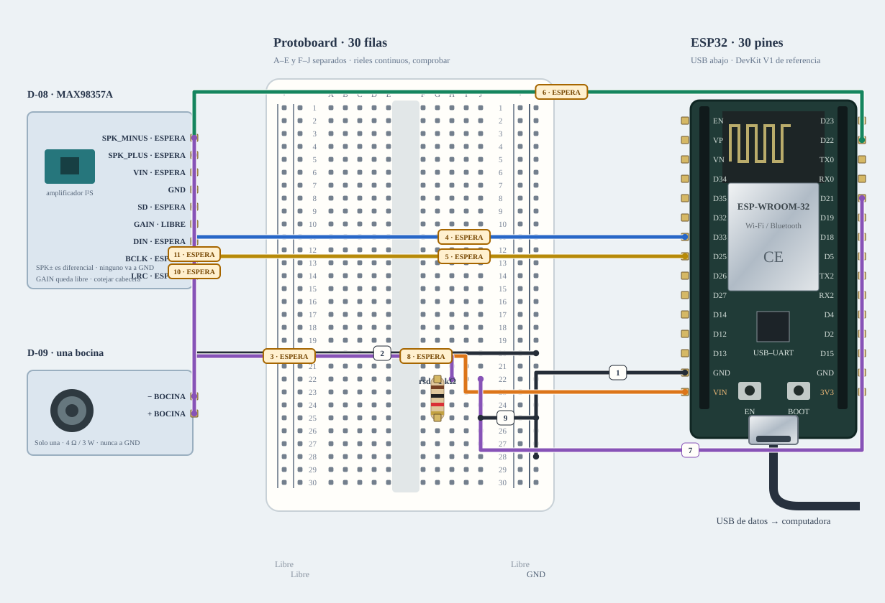

# M-07B · Audio · una bocina

Enviar arm y tone para 440 Hz durante 300 ms, a amplitud digital inicial del 1 %. stop corta y desarma.

**Ensayado · calidad de audio pendiente.** Ensayo físico del 25/10/2026; conservar los pendientes de calidad y medición.



[JSON de montaje importable](audio-salida-fisico.json) · [SVG físico](audio-salida-fisico.svg). ESP32 USB abajo; orientación de referencia, cotejar serigrafía. Terminales rotulados por función donde el conector aún no está identificado.

## Resultado físico observado · 25/10/2026

Una bocina de 4 Ω reprodujo el pitido y el archivo completo de unos 20 s. A 15 % de amplitud digital Joaquín confirmó mejor volumen, sin calentamiento perceptible. Variante privada I²S de 32 kHz/32 bits; pitido de 5 s. Cableado revisado con ESP32 de la universidad, SD21 y pull-down de 1 kΩ.

**Pendiente:** El pitido fue algo inestable y el ruido del audio más evidente. Calidad, alimentación USB/VIN y potencia sin medir. El 15 % es un nivel ensayado, no un máximo validado. La variante con el archivo no está incluida en el sketch público de tonos.

[Registro R-040–R-048](../montajes.md).

## Materiales

- esp1: B-02 · ESP32 universidad · ensayado 25/10/2026
- amp1: D-08 · MAX98357A
- speaker1: D-09 · usar solo una · 4 Ω / 3 W
- rsd: C-01 · 1 kΩ pull-down SD

Cables: 12 M–H + 1 M–M dibujados; cero H–H y un par de altavoz. Se reutilizan entre bancos; no se exige montarlos todos simultáneamente. B-02 fue reutilizada para estos ensayos; comprobar material libre y registrar cada cambio de banco.

## Conexiones funcionales

| Desde | Hasta | Vía | Estado |
|---|---|---|---|
| ESP32 · GND_L | Protoboard · RN28 | c1 · M–H | Referencia |
| Protoboard · RN20 | MAX98357A · GND | c2 · M–H | Referencia |
| ESP32 · VIN | Protoboard · J6 | c3 · M–H | Referencia |
| Protoboard · H6 | MAX98357A · VIN | c4 · M–H | Referencia |
| ESP32 · GPIO33 | Protoboard · J10 | c5 · M–H | Referencia |
| Protoboard · H10 | MAX98357A · BCLK | c6 · M–H | Referencia |
| ESP32 · GPIO25 | Protoboard · J14 | c7 · M–H | Referencia |
| Protoboard · H14 | MAX98357A · LRC | c8 · M–H | Referencia |
| ESP32 · GPIO22 | Protoboard · J18 | c9 · M–H | Referencia |
| Protoboard · H18 | MAX98357A · DIN | c10 · M–H | Referencia |
| ESP32 · GPIO21 | Protoboard · J22 | c11 · M–H | Referencia |
| Protoboard · H22 | MAX98357A · SD | c12 · M–H | Referencia |
| Protoboard · J25 | Protoboard · RN25 | c13 · M–M | Referencia |
| MAX98357A · SPK_PLUS | Bocina · PLUS | c14 · altavoz | Referencia |
| MAX98357A · SPK_MINUS | Bocina · MINUS | c15 · altavoz | Referencia |

## Armado cable por cable · USB desconectado

Referencia física, sin escala métrica. USB desconectado al armar. Ensayo realizado con ESP32 de la universidad B-02. Reidentificar placa/puerto y preservar respaldo antes de reutilizarla. Cables reutilizados entre ensayos; cero H–H. Audio sin H–H: 12 M–H y 1 M–M, más los dos conductores de la bocina con su adaptador soldado por revisar. Cada M–H une un pin macho a un agujero. VIN usa H6/J6; BCLK H10/J10; LRC H14/J14; DIN H18/J18; SD H22/J22 y resistencia en G22/G25. H y J de la misma fila están unidos; filas distintas no. GND conserva RN28/RN20 y el puente J25/RN25. USB/VIN sigue condicionado a identificar la ruta de alimentación real; el circuito de fuente separada se conserva en Compatibilidad.

| Nº | Color | Tipo | Origen | Destino | Condición |
|---|---|---|---|---|---|
| 1 | black | M–H | esp1:GND_L | bb:RN28 | Cable 1 · M–H · esp1:GND_L → bb:RN28. Conectar sin USB; comprobar etiquetas y agujeros. |
| 2 | black | M–H | bb:RN20 | amp1:GND | Cable 2 · M–H · bb:RN20 → amp1:GND. Conectar sin USB; comprobar etiquetas y agujeros. |
| 3 | orange | M–H | esp1:VIN | bb:J6 | Cable 3 · M–H · esp1:VIN → bb:J6. Conectar sin USB; comprobar etiquetas y agujeros. |
| 4 | orange | M–H | bb:H6 | amp1:VIN | Cable 4 · M–H · bb:H6 → amp1:VIN. Conectar sin USB; comprobar etiquetas y agujeros. |
| 5 | blue | M–H | esp1:GPIO33 | bb:J10 | Cable 5 · M–H · esp1:GPIO33 → bb:J10. Conectar sin USB; comprobar etiquetas y agujeros. |
| 6 | blue | M–H | bb:H10 | amp1:BCLK | Cable 6 · M–H · bb:H10 → amp1:BCLK. Conectar sin USB; comprobar etiquetas y agujeros. |
| 7 | yellow | M–H | esp1:GPIO25 | bb:J14 | Cable 7 · M–H · esp1:GPIO25 → bb:J14. Conectar sin USB; comprobar etiquetas y agujeros. |
| 8 | yellow | M–H | bb:H14 | amp1:LRC | Cable 8 · M–H · bb:H14 → amp1:LRC. Conectar sin USB; comprobar etiquetas y agujeros. |
| 9 | green | M–H | esp1:GPIO22 | bb:J18 | Cable 9 · M–H · esp1:GPIO22 → bb:J18. Conectar sin USB; comprobar etiquetas y agujeros. |
| 10 | green | M–H | bb:H18 | amp1:DIN | Cable 10 · M–H · bb:H18 → amp1:DIN. Conectar sin USB; comprobar etiquetas y agujeros. |
| 11 | purple | M–H | esp1:GPIO21 | bb:J22 | Cable 11 · M–H · esp1:GPIO21 → bb:J22. Conectar sin USB; comprobar etiquetas y agujeros. |
| 12 | purple | M–H | bb:H22 | amp1:SD | Cable 12 · M–H · bb:H22 → amp1:SD. Conectar sin USB; comprobar etiquetas y agujeros. |
| 13 | black | M–M | bb:J25 | bb:RN25 | Cable 13 · M–M · bb:J25 → bb:RN25. Conectar sin USB; comprobar etiquetas y agujeros. |
| 14 | purple | altavoz | amp1:SPK_PLUS | speaker1:PLUS | Conductor de bocina: SPK_PLUS → PLUS, mediante la bornera y el adaptador soldado, por revisar. No es un jumper H–H; ninguno de los dos conductores va a GND. |
| 15 | purple | altavoz | amp1:SPK_MINUS | speaker1:MINUS | Conductor de bocina: SPK_MINUS → MINUS, mediante la bornera y el adaptador soldado, por revisar. No es un jumper H–H; ninguno de los dos conductores va a GND. |

M–H: hembra al conector macho del módulo/ESP32 y macho al agujero. M–M: ambos extremos en agujeros distintos. Nunca dos puntas en un agujero.

LP/LN: riel izquierdo +/−; RP/RN: derecho +/−. A–E y F–J son tiras separadas por fila. Confirmar continuidad/cortes de la protoboard real; los rieles opuestos no están unidos. Patas colocadas: rsd (C-01 · 1 kΩ pull-down SD): 1→G22, 2→G25.

Cruces no unen redes. Las condiciones de cada tramo aparecen en esta tabla; un cable por verificar no cuenta como continuidad confirmada aunque se dibuje continuo. Colores son identificadores del dibujo: elegir cables reales y anotar equivalencias. SVG no demuestra alcance físico.

## Compatibilidad eléctrica

[Montaje alternativo con adaptación](audio-salida-adaptado.md). No se muestra como material obligatorio del montaje principal; usarlo si los niveles o la carga exigen esa etapa.

## Antes de energizar

1. Identificar la placa elegida y su puerto, preservar respaldo y armar sin alimentación. B-02 fue reutilizada tras el ensayo NFC; registrar cada cambio de banco.
2. MAX98357A: VIN al pin VIN/5V del ESP32 alimentado por USB, GND común, BCLK33, LRC25, DIN22 y SD21.
3. Usar solo 12 M–H y 1 M–M libres: señales y VIN por pares H/J de la misma fila. Contar disponibilidad y alcance reales antes de armar. El par de bocina requiere su bornera/adaptador soldado; no sustituirlo por empalmes al aire.
4. Ensayo inicial al 1 % con una sola bocina; detener ante reset, calentamiento o distorsión. El circuito con fuente separada queda en Compatibilidad.
5. Placa y puerto identificados y respaldo privado preservado; registrar cada cambio de banco en B-02.
6. Confirmar D-08 MAX98357A, cabecera y adaptación D-09. GAIN libre solo bajo referencia documentada del módulo; SD21 y pull-down 1 kΩ deben estar conectados para silencio al boot; contrastar el pull-up interno del breakout.
7. Usa BCLK33, WS25, DIN22, alineado con #91; banco separado del micrófono. No modifica mascota/assets de Lando.

Revisar agujero por agujero con USB retirado, polaridad y separación de fuentes. Sin multímetro, identificar por etiquetas y documentación exacta; una tensión o pin dudoso se mantiene desconectado. VIN no garantiza salida regulada de 5 V.

Firmware: firmware/audio_output_bench; compilar sin carga; Serial 115200. Ver guía física.

## Compilar y cargar manualmente

Arduino CLI 1.5.1, ESP32 core 3.3.12; DHT sensor library 1.4.7 y Adafruit Unified Sensor 1.1.15 solo si el perfil utiliza DHT11. Actuadores usan ClassAIBench local y pantalla Adafruit GFX 1.12.6 + ST7735/ST7789 1.12.0.

```sh
arduino-cli compile --libraries firmware/libraries --fqbn esp32:esp32:esp32doit-devkit-v1 --jobs 2 --output-dir /tmp/classai-audio-salida-build firmware/audio_output_bench
```

Antes de cargar: reidentificar la placa elegida y su puerto explícito, comprobar su FQBN, registrar cableado real y conservar respaldo privado verificado. Desconectar módulos ajenos y cerrar cualquier monitor. Solo después de resolver TODOS los pendientes eléctricos de esta receta:

```sh
# Sustituir PUERTO_VERIFICADO por el puerto reidentificado; no copiar un puerto histórico sin identificar la placa.
arduino-cli upload --fqbn esp32:esp32:esp32doit-devkit-v1 --port PUERTO_VERIFICADO --input-dir /tmp/classai-audio-salida-build firmware/audio_output_bench
arduino-cli monitor --port PUERTO_VERIFICADO --config baudrate=115200
```

Cargar utiliza el binario del perfil recién compilado; no recompilar otro perfil entre compile/upload. Abrir Serial puede reiniciar la placa. El ensayo registrado puede utilizar otro perfil o una variante privada; no confundirlo con este comando de compilación.

## Prueba guiada y fallos

Acción: Enviar arm y tone para 440 Hz durante 300 ms, a amplitud digital inicial del 1 %. stop corta y desarma.

Aprobación esperada: Un tono breve en una sola bocina, sin sonido al arrancar; errores I²S explícitos.

Diagnóstico: Enviar stop ante un fallo y retirar USB. Revisar VIN/5V, GND, BCLK, LRC, DIN, SD y el par SPK±; no cambiar pines ni soldar con alimentación.

Conflictos: BCLK33/WS25/DIN22/SD21; perfil mínimo separado de micrófono, TFT y mascota de Lando. GAIN libre = 9 dB bajo referencia MAX98357A.

Faltantes/confirmaciones:
- Identificar la placa elegida y su puerto, preservar respaldo y armar sin alimentación. B-02 fue reutilizada tras el ensayo NFC; registrar cada cambio de banco.
- MAX98357A: VIN al pin VIN/5V del ESP32 alimentado por USB, GND común, BCLK33, LRC25, DIN22 y SD21.
- Usar solo 12 M–H y 1 M–M libres: señales y VIN por pares H/J de la misma fila. Contar disponibilidad y alcance reales antes de armar. El par de bocina requiere su bornera/adaptador soldado; no sustituirlo por empalmes al aire.
- Ensayo inicial al 1 % con una sola bocina; detener ante reset, calentamiento o distorsión. El circuito con fuente separada queda en Compatibilidad.
- Placa y puerto identificados y respaldo privado preservado; registrar cada cambio de banco en B-02.
- Confirmar D-08 MAX98357A, cabecera y adaptación D-09. GAIN libre solo bajo referencia documentada del módulo; SD21 y pull-down 1 kΩ deben estar conectados para silencio al boot; contrastar el pull-up interno del breakout.
- Usa BCLK33, WS25, DIN22, alineado con #91; banco separado del micrófono. No modifica mascota/assets de Lando.

## Registro de resultado

| Etapa | Resultado observado | Evidencia |
|---|---|---|
| Diseño | Referencia física; conservar condiciones | SVG/JSON y guía |
| Compilación | Consultar [resultados de esta entrega](../bancos-fisicos.md); no inferir PASS del comando | Log y tamaños por perfil |
| Simulación nueva | No ejecutada | — |
| Ensayo físico | Una bocina de 4 Ω reprodujo el pitido y el archivo completo de unos 20 s. A 15 % de amplitud digital Joaquín confirmó mejor volumen, sin calentamiento perceptible. Variante privada I²S de 32 kHz/32 bits; pitido de 5 s. Cableado revisado con ESP32 de la universidad, SD21 y pull-down de 1 kΩ. | [R-040–R-048](../montajes.md) |
| Pendientes del ensayo | El pitido fue algo inestable y el ruido del audio más evidente. Calidad, alimentación USB/VIN y potencia sin medir. El 15 % es un nivel ensayado, no un máximo validado. La variante con el archivo no está incluida en el sketch público de tonos. | No equivale a validación completa |
| Desmontaje | Pendiente | Registrar qué cables/piezas quedan conectados |

- [Adafruit · MAX98357](https://learn.adafruit.com/adafruit-max98357-i2s-class-d-mono-amp/pinouts)
- [Material de la U y criterios de armado](https://github.com/joaquinsalinas06/ClassAI/blob/codex/physical-benches/docs/hardware/circuitos-referencia.md)

[Índice](README.md). Generado desde missions.ts y sus registros físicos mediante web/scripts/export-hardware-missions.mjs.
