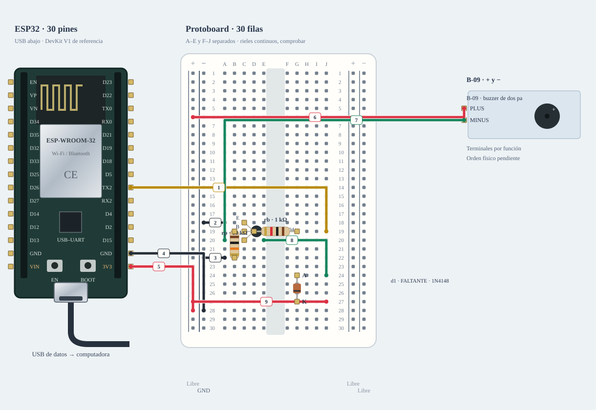

# M-08B · Buzzer · adaptación condicional

Alternativa de compatibilidad; no es el montaje principal ni material ya recibido.

**Montaje parcial · no conectar cables marcados.** Diseño de referencia, sin ensayo físico nuevo.



[JSON de montaje importable](buzzer-adaptado-fisico.json) · [SVG físico](buzzer-adaptado-fisico.svg). ESP32 USB abajo; orientación de referencia, cotejar serigrafía. Terminales rotulados por función donde el conector aún no está identificado.

## Materiales

- esp1: A-01 · identificar antes de cargar
- bz1: B-09 · + y −
- d1: FALTANTE · 1N4148
- q1: FALTANTE · onsemi 2N3904
- rb: C-01 · 1 kΩ
- rp: C-02 · 10 kΩ

Cables: Consultar tabla completa de cables de esta alternativa.. Se reutilizan entre bancos; no se exige montarlos todos simultáneamente. Preservar B-02/NFC; comprobar material libre en la otra placa.

## Conexiones funcionales

| Desde | Hasta | Vía | Estado |
|---|---|---|---|


## Armado cable por cable · USB desconectado

Referencia física, sin escala métrica. USB desconectado al armar. Usar A-01 solo tras identificar placa/puerto y preservar respaldo; B-02/NFC permanece conservado. Cables reutilizados entre ensayos; cero H–H.

| Nº | Color | Tipo | Origen | Destino | Condición |
|---|---|---|---|---|---|
| 1 | yellow | M–H | esp1:GPIO17 | bb:J19 | Cable 1 · M–H · esp1:GPIO17 → bb:J19. Conectar sin USB; comprobar etiquetas y agujeros. |
| 2 | black | M–M | bb:A18 | bb:LN18 | Cable 2 · M–M · bb:A18 → bb:LN18. Conectar sin USB; comprobar etiquetas y agujeros. |
| 3 | black | M–M | bb:A22 | bb:LN22 | Cable 3 · M–M · bb:A22 → bb:LN22. Conectar sin USB; comprobar etiquetas y agujeros. |
| 4 | black | M–H | esp1:GND | bb:LN28 | Cable 4 · M–H · esp1:GND → bb:LN28. Conectar sin USB; comprobar etiquetas y agujeros. |
| 5 | red | M–H | esp1:3V3 | bb:LP28 | NO conectar: Confirmar ensayo previo a 3,3 V y consumo del buzzer ≤10 mA; si no consta, mantener PLUS desconectado. |
| 6 | red | M–H | bb:LP6 | bz1:PLUS | NO conectar: Buzzer nominal 3,3 V y consumo ≤10 mA; no usar 5 V por ensayo/error. |
| 7 | green | M–H | bz1:MINUS | bb:A20 | Cable 7 · M–H · bz1:MINUS → bb:A20. Conectar sin USB; comprobar etiquetas y agujeros. |
| 8 | green | M–M | bb:E20 | bb:J24 | Cable 8 · M–M · bb:E20 → bb:J24. Conectar sin USB; comprobar etiquetas y agujeros. |
| 9 | red | M–M | bb:J27 | bb:LP27 | Cable 9 · M–M · bb:J27 → bb:LP27. Conectar sin USB; comprobar etiquetas y agujeros. |

M–H: hembra al conector macho del módulo/ESP32 y macho al agujero. M–M: ambos extremos en agujeros distintos. Nunca dos puntas en un agujero.

LP/LN: riel izquierdo +/−; RP/RN: derecho +/−. A–E y F–J son tiras separadas por fila. Confirmar continuidad/cortes de la protoboard real; los rieles opuestos no están unidos. Patas colocadas: d1 (FALTANTE · 1N4148): A→G24, K→G27; q1 (FALTANTE · onsemi 2N3904): E→C18, B→C19, C→C20; rb (C-01 · 1 kΩ): 1→G19, 2→D19; rp (C-02 · 10 kΩ): 1→B19, 2→B22.

Cruces no unen redes. Las condiciones de cada tramo aparecen en esta tabla; un cable por verificar no cuenta como continuidad confirmada aunque se dibuje continuo. Colores son identificadores del dibujo: elegir cables reales y anotar equivalencias. SVG no demuestra alcance físico.

## Antes de energizar

1. A-01/puerto identificados y respaldo privado preservado; B-02/NFC conservado.
2. Referencia 3,3 V según uso reportado; no hay tensión/corriente medidas. El diseño requiere buzzer ≤10 mA y presupuesto de 3V3 disponible.
3. Conseguir 2N3904 onsemi TO-92 y 1N4148; usar C-01 1 kΩ y C-02 10 kΩ. Confirmar E/B/C y banda del diodo.

Revisar agujero por agujero con USB retirado, polaridad y separación de fuentes. Sin multímetro, identificar por etiquetas y documentación exacta; una tensión o pin dudoso se mantiene desconectado. VIN no garantiza salida regulada de 5 V.

Firmware: firmware/buzzer_bench

## Compilar y cargar manualmente

Arduino CLI 1.5.1, ESP32 core 3.3.12; DHT sensor library 1.4.7 y Adafruit Unified Sensor 1.1.15 solo si el perfil utiliza DHT11. Actuadores usan ClassAIBench local y pantalla Adafruit GFX 1.12.6 + ST7735/ST7789 1.12.0.

```sh
arduino-cli compile --libraries firmware/libraries --fqbn esp32:esp32:esp32doit-devkit-v1 --jobs 2 --output-dir /tmp/classai-buzzer-adaptado-build firmware/buzzer_bench
```

Antes de cargar: identificar A-01 y puerto explícito, comprobar su FQBN, registrar cableado real y conservar respaldo privado verificado. Desconectar módulos ajenos y cerrar cualquier monitor. Solo después de resolver TODOS los pendientes eléctricos de esta receta:

```sh
# Sustituir PUERTO_A01 por el puerto reidentificado; no usar el de B-02/NFC.
arduino-cli upload --fqbn esp32:esp32:esp32doit-devkit-v1 --port PUERTO_A01 --input-dir /tmp/classai-buzzer-adaptado-build firmware/buzzer_bench
arduino-cli monitor --port PUERTO_A01 --config baudrate=115200
```

Cargar utiliza el binario del perfil recién compilado; no recompilar otro perfil entre compile/upload. Abrir Serial puede reiniciar la placa. No se ejecutaron estos comandos de carga/monitor durante esta entrega.

## Prueba guiada y fallos

Acción: Enviar arm y active para pulso de 120 ms; o passive para tono 2 kHz/120 ms. stop siempre apaga/desarma.

Aprobación esperada: Pulso o tono breve, sin zumbido permanente al arrancar; activo y pasivo comparten la etapa Q1.

Diagnóstico: Enviar stop ante un fallo. Desconectar ambas fuentes antes de revisar cada extremo, polaridad, masa común y material faltante; no cambiar pines en caliente.

Conflictos: GPIO17 puede depender del módulo ESP32; no usar referencia WROVER sin revisar.

Faltantes/confirmaciones:
- A-01/puerto identificados y respaldo privado preservado; B-02/NFC conservado.
- Referencia 3,3 V según uso reportado; no hay tensión/corriente medidas. El diseño requiere buzzer ≤10 mA y presupuesto de 3V3 disponible.
- Conseguir 2N3904 onsemi TO-92 y 1N4148; usar C-01 1 kΩ y C-02 10 kΩ. Confirmar E/B/C y banda del diodo.

## Registro de resultado

| Etapa | Resultado observado | Evidencia |
|---|---|---|
| Diseño | Referencia física; conservar condiciones | SVG/JSON y guía |
| Compilación | Consultar [resultados de esta entrega](../bancos-fisicos.md); no inferir PASS del comando | Log y tamaños por perfil |
| Simulación nueva | No ejecutada | — |
| Ensayo físico nuevo | Pendiente | Completar acción, salida, reinicios y evidencia tras ensayo |
| Desmontaje | Pendiente | Registrar qué cables/piezas quedan conectados |

- [Espressif · ESP32](https://www.espressif.com/sites/default/files/documentation/esp32_datasheet_en.pdf)
- [Material de la U y criterios de armado](https://github.com/joaquinsalinas06/ClassAI/blob/codex/physical-benches/docs/hardware/circuitos-referencia.md)

[Índice](README.md). Generado desde missions.ts y sus registros físicos mediante web/scripts/export-hardware-missions.mjs.
