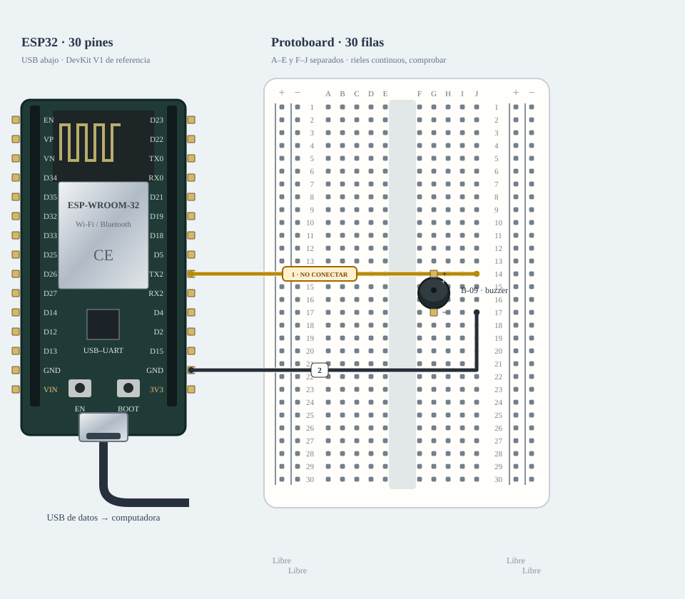

# M-08B · Buzzer

Enviar arm y active para pulso de 120 ms; o passive para tono 2 kHz/120 ms. stop siempre apaga/desarma.

**Montaje parcial · no conectar cables marcados.** Diseño de referencia, sin ensayo físico nuevo.



[JSON de montaje importable](buzzer-fisico.json) · [SVG físico](buzzer-fisico.svg). ESP32 USB abajo; orientación de referencia, cotejar serigrafía. Terminales rotulados por función donde el conector aún no está identificado.

## Materiales

- esp1: A-01 · identificar antes de cargar
- bz1: B-09 · dos patas

Cables: 2 M–H + 0 M–M dibujados; cero H–H. Se reutilizan entre bancos; no se exige montarlos todos simultáneamente. Preservar B-02/NFC; comprobar material libre en la otra placa.

## Conexiones funcionales

| Desde | Hasta | Vía | Estado |
|---|---|---|---|
| ESP32 · GPIO17 | Protoboard · J14 | c1 · M–H | Pendiente; no conectar |
| ESP32 · GND | Protoboard · J17 | c2 · M–H | Referencia |

## Armado cable por cable · USB desconectado

Referencia física, sin escala métrica. USB desconectado al armar. Usar A-01 solo tras identificar placa/puerto y preservar respaldo; B-02/NFC permanece conservado. Cables reutilizados entre ensayos; cero H–H. Buzzer insertado en dos tiras distintas: ajustar filas al paso real sin forzar las patas ni unir + y −. Dibujo no métrico.

| Nº | Color | Tipo | Origen | Destino | Condición |
|---|---|---|---|---|---|
| 1 | yellow | M–H | esp1:GPIO17 | bb:J14 | NO conectar: Conexión directa condicionada a tipo y consumo compatibles con GPIO 3,3 V; si no, usar adaptación. |
| 2 | black | M–H | esp1:GND | bb:J17 | Cable 2 · M–H · esp1:GND → bb:J17. Conectar sin USB; comprobar etiquetas y agujeros. |

M–H: hembra al conector macho del módulo/ESP32 y macho al agujero. M–M: ambos extremos en agujeros distintos. Nunca dos puntas en un agujero.

LP/LN: riel izquierdo +/−; RP/RN: derecho +/−. A–E y F–J son tiras separadas por fila. Confirmar continuidad/cortes de la protoboard real; los rieles opuestos no están unidos. Patas colocadas: bz1 (B-09 · dos patas): PLUS→G14, MINUS→G17.

Cruces no unen redes. Las condiciones de cada tramo aparecen en esta tabla; un cable por verificar no cuenta como continuidad confirmada aunque se dibuje continuo. Colores son identificadores del dibujo: elegir cables reales y anotar equivalencias. SVG no demuestra alcance físico.

## Compatibilidad eléctrica

[Montaje alternativo con adaptación](buzzer-adaptado.md). No se muestra como material obligatorio del montaje principal; usarlo si los niveles o la carga exigen esa etapa.

## Antes de energizar

1. Identificar placa A-01/puerto, preservar respaldo y armar sin alimentación. B-02/NFC se conserva.
2. Dos redes: señal a + y masa a −. Las dos patas y el uso previo desde alimentación Arduino no certifican consumo admisible desde GPIO.
3. Directo únicamente con piezo/entrada compatible y consumo dentro del presupuesto GPIO; de lo contrario, ver transistor en Compatibilidad. No energizar el tramo condicionado.

Revisar agujero por agujero con USB retirado, polaridad y separación de fuentes. Sin multímetro, identificar por etiquetas y documentación exacta; una tensión o pin dudoso se mantiene desconectado. VIN no garantiza salida regulada de 5 V.

Firmware: firmware/buzzer_bench; compilar sin carga; Serial 115200. Ver guía física.

## Compilar y cargar manualmente

Arduino CLI 1.5.1, ESP32 core 3.3.12; DHT sensor library 1.4.7 y Adafruit Unified Sensor 1.1.15 solo si el perfil utiliza DHT11. Actuadores usan ClassAIBench local y pantalla Adafruit GFX 1.12.6 + ST7735/ST7789 1.12.0.

```sh
arduino-cli compile --libraries firmware/libraries --fqbn esp32:esp32:esp32doit-devkit-v1 --jobs 2 --output-dir /tmp/classai-buzzer-build firmware/buzzer_bench
```

Antes de cargar: identificar A-01 y puerto explícito, comprobar su FQBN, registrar cableado real y conservar respaldo privado verificado. Desconectar módulos ajenos y cerrar cualquier monitor. Solo después de resolver TODOS los pendientes eléctricos de esta receta:

```sh
# Sustituir PUERTO_A01 por el puerto reidentificado; no usar el de B-02/NFC.
arduino-cli upload --fqbn esp32:esp32:esp32doit-devkit-v1 --port PUERTO_A01 --input-dir /tmp/classai-buzzer-build firmware/buzzer_bench
arduino-cli monitor --port PUERTO_A01 --config baudrate=115200
```

Cargar utiliza el binario del perfil recién compilado; no recompilar otro perfil entre compile/upload. Abrir Serial puede reiniciar la placa. No se ejecutaron estos comandos de carga/monitor durante esta entrega.

## Prueba guiada y fallos

Acción: Enviar arm y active para pulso de 120 ms; o passive para tono 2 kHz/120 ms. stop siempre apaga/desarma.

Aprobación esperada: Pulso o tono breve y apagado tras 120 ms; sin zumbido permanente al arrancar. Tipo y consumo deben corresponder al montaje elegido.

Diagnóstico: Enviar stop ante un fallo. Desconectar ambas fuentes antes de revisar cada extremo, polaridad, masa común y material faltante; no cambiar pines en caliente.

Conflictos: GPIO17 puede depender del módulo ESP32; no usar referencia WROVER sin revisar.

Faltantes/confirmaciones:
- Identificar placa A-01/puerto, preservar respaldo y armar sin alimentación. B-02/NFC se conserva.
- Dos redes: señal a + y masa a −. Las dos patas y el uso previo desde alimentación Arduino no certifican consumo admisible desde GPIO.
- Directo únicamente con piezo/entrada compatible y consumo dentro del presupuesto GPIO; de lo contrario, ver transistor en Compatibilidad. No energizar el tramo condicionado.

## Registro de resultado

| Etapa | Resultado observado | Evidencia |
|---|---|---|
| Diseño | Referencia física; conservar condiciones | SVG/JSON y guía |
| Compilación | Consultar [resultados de esta entrega](../bancos-fisicos.md); no inferir PASS del comando | Log y tamaños por perfil |
| Simulación nueva | No ejecutada | — |
| Ensayo físico nuevo | Pendiente | Completar acción, salida, reinicios y evidencia tras ensayo |
| Desmontaje | Pendiente | Registrar qué cables/piezas quedan conectados |

- [Espressif · ESP32](https://www.espressif.com/sites/default/files/documentation/esp32_datasheet_en.pdf)
- [Material de la U y criterios de armado](https://github.com/joaquinsalinas06/ClassAI/blob/codex/physical-benches/docs/hardware/circuitos-referencia.md)

[Índice](README.md). Generado desde missions.ts y sus registros físicos mediante web/scripts/export-hardware-missions.mjs.
