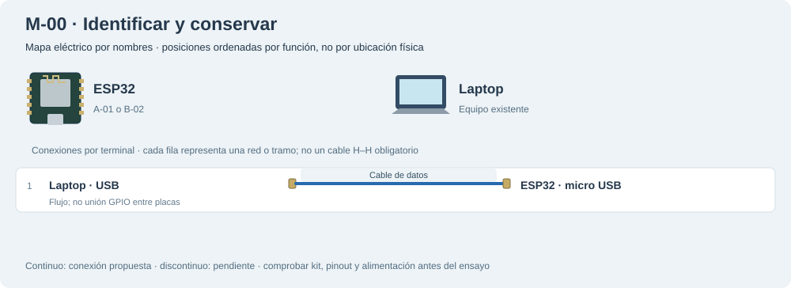

# M-00 · Identificar y conservar

Una placa cada vez: asociar propietario, puerto y firmware previo antes de conectar dos ESP32.

**Propuesta, sin ensayo físico. Antes de cualquier carga.**

Mapa eléctrico por nombres: las posiciones se ordenan por función, no corresponden a una fotografía ni certifican el orden físico de los conectores. Las líneas representan redes o tramos, no cables H–H obligatorios. Los tramos discontinuos son pendientes.

## Materiales

- A-01 o B-02, una placa
- A-03 o D-10: USB de datos

Cables: Sin jumpers; 1 USB por placa. No reservar material ya usado en otro banco.

## Conexiones

| Desde | Hasta | Vía / condición | Estado |
|---|---|---|---|
| Laptop · USB | ESP32 · micro USB | Cable de datos | Propuesto |

## Antes de conectar

1. Asociar la placa fotografiada a A-01/B-02 sin atribuir propietario por apariencia.
2. Preservar el respaldo privado existente; anotar tamaño/hash, sin publicarlo.
3. Con dos placas, seleccionar puerto explícito; no usar autodetección.

Resultado esperado: Reconocer cada puerto y placa; el respaldo se registra por separado de su restauración probada.

Firmware: Sin carga de firmware.

Conflictos: E-01 sigue pedido; no contar una tercera placa recibida.

- [Espressif · ESP32](https://www.espressif.com/sites/default/files/documentation/esp32_datasheet_en.pdf)

[Volver al índice](README.md). Generado por web/scripts/export-hardware-missions.mjs desde web/src/hardware/missions.ts.
