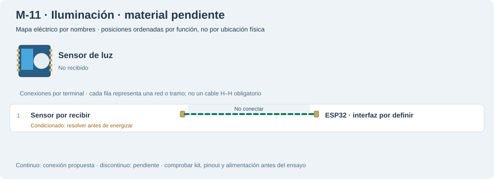

# M-11 · Iluminación · material pendiente

No hay BH1750 ni LDR recibido en el inventario. Los LEDs son salidas, no sensores de lux.

**Sin sensor recibido.** Diseño de referencia, sin ensayo físico nuevo.

Este mapa lógico no acredita posiciones físicas ni autoriza conexiones pendientes.

## Materiales

- Falta un sensor de iluminación identificado y su breakout; para #5 se requiere BH1750.
- La posible LDR del kit pedido no está recibida ni mide lux sin caracterización.

Cables: Pendiente de identificar sensor; no reservar cables. Se reutilizan entre bancos; no se exige montarlos todos simultáneamente. Preservar B-02/NFC; comprobar material libre en la otra placa.

## Conexiones funcionales

| Desde | Hasta | Vía | Estado |
|---|---|---|---|
| Sensor por recibir | ESP32 · interfaz por definir | No conectar | Pendiente; no conectar |

## Antes de energizar

1. Confirmar recepción y variante antes de asignar VCC/GPIO o librería.

Revisar agujero por agujero con USB retirado, polaridad y separación de fuentes. Sin multímetro, identificar por etiquetas y documentación exacta; una tensión o pin dudoso se mantiene desconectado. VIN no garantiza salida regulada de 5 V.

Firmware: Sin sketch de hardware no recibido.

## Prueba guiada y fallos

Acción: No hay BH1750 ni LDR recibido en el inventario. Los LEDs son salidas, no sensores de lux.

Aprobación esperada: Pendiente: respuesta a tres condiciones de iluminación con sensor identificado.

Diagnóstico: No completar #5 ni generar lux sintéticos como evidencia física.

Conflictos: No completar #5 ni generar lux sintéticos como evidencia física.

## Registro de resultado

| Etapa | Resultado observado | Evidencia |
|---|---|---|
| Diseño | Referencia funcional; conservar condiciones | SVG/JSON y guía |
| Compilación | Consultar [resultados de esta entrega](../bancos-fisicos.md); no inferir PASS del comando | Log y tamaños por perfil |
| Simulación nueva | No ejecutada | — |
| Ensayo físico nuevo | Pendiente | Completar acción, salida, reinicios y evidencia tras ensayo |
| Desmontaje | Pendiente | Registrar qué cables/piezas quedan conectados |

[Índice](README.md). Generado desde missions.ts y sus registros físicos mediante web/scripts/export-hardware-missions.mjs.
