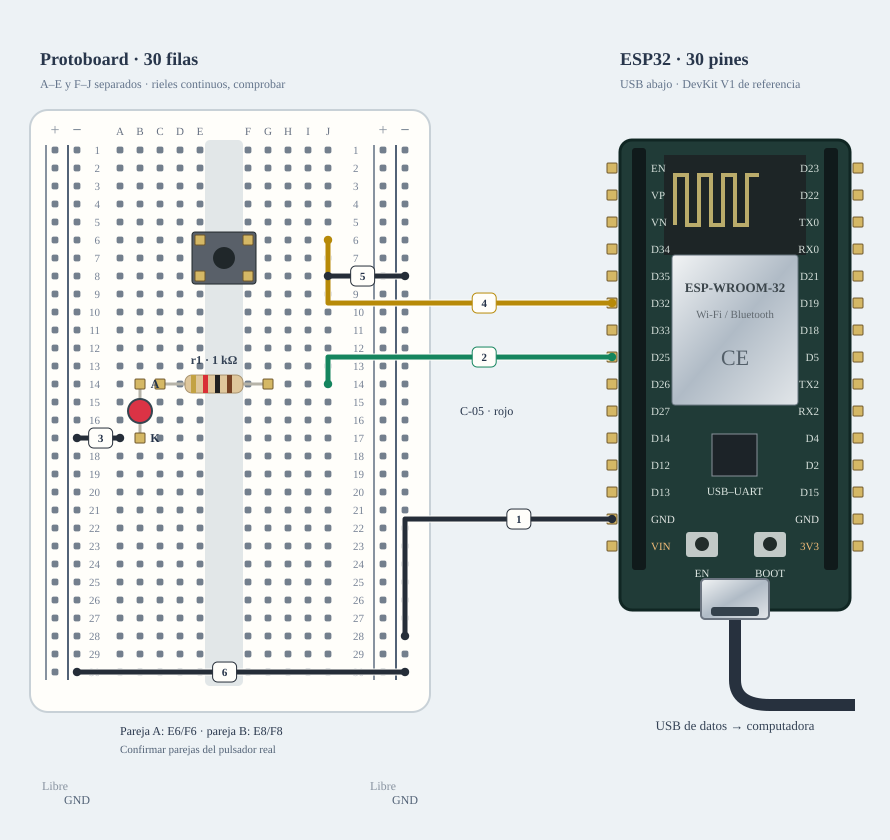

# M-01 · LED + botón

Banco mínimo para comprobar un GPIO de salida y una pulsación, sin cargas de potencia.

**Diseño y sketch · ensayo físico pendiente.** Diseño de referencia, sin ensayo físico nuevo.



[JSON de montaje importable](led-boton-fisico.json) · [SVG físico](led-boton-fisico.svg). ESP32 USB abajo; orientación de referencia, cotejar serigrafía. Terminales rotulados por función donde el conector aún no está identificado.

## Materiales

- C-05: LED rojo ×1
- C-01: resistencia 1 kΩ ×1
- C-04: pulsador ×1
- B-01 o A-04: protoboard

Cables: 3 M–H + 2 M–M dibujados; cero H–H. Se reutilizan entre bancos; no se exige montarlos todos simultáneamente. Preservar B-02/NFC; comprobar material libre en la otra placa.

## Conexiones funcionales

| Desde | Hasta | Vía | Estado |
|---|---|---|---|
| ESP32 · GPIO25 | LED · ánodo (+) | R1 · 1 kΩ en serie | Referencia |
| LED · cátodo (−) | ESP32 · GND | — | Referencia |
| ESP32 · GPIO32 | Pulsador · contacto A | INPUT_PULLUP | Referencia |
| Pulsador · contacto B | ESP32 · GND | — | Referencia |

## Armado cable por cable · USB desconectado

Referencia física, sin escala métrica. USB desconectado al armar. Usar A-01 solo tras identificar placa/puerto y preservar respaldo; B-02/NFC permanece conservado. Cables reutilizados entre ensayos; cero H–H.

| Nº | Color | Tipo | Origen | Destino | Condición |
|---|---|---|---|---|---|
| 1 | black | M–H | esp1:GND | bb:LN28 | Cable 1 · M–H · esp1:GND → bb:LN28. Conectar sin USB; comprobar etiquetas y agujeros. |
| 2 | green | M–H | esp1:GPIO25 | bb:A8 | Cable 2 · M–H · esp1:GPIO25 → bb:A8. Conectar sin USB; comprobar etiquetas y agujeros. |
| 3 | black | M–M | bb:J11 | bb:LN11 | Cable 3 · M–M · bb:J11 → bb:LN11. Conectar sin USB; comprobar etiquetas y agujeros. |
| 4 | yellow | M–H | esp1:GPIO32 | bb:A18 | Cable 4 · M–H · esp1:GPIO32 → bb:A18. Conectar sin USB; comprobar etiquetas y agujeros. |
| 5 | black | M–M | bb:J18 | bb:LN18 | Cable 5 · M–M · bb:J18 → bb:LN18. Conectar sin USB; comprobar etiquetas y agujeros. |

M–H: hembra al conector macho del módulo/ESP32 y macho al agujero. M–M: ambos extremos en agujeros distintos. Nunca dos puntas en un agujero.

LP/LN: riel izquierdo +/−; RP/RN: derecho +/−. A–E y F–J son tiras separadas por fila. Confirmar continuidad/cortes de la protoboard real; los rieles opuestos no están unidos. Patas colocadas: r1 (C-01 · 1 kΩ): 1→C8, 2→G8; led1 (C-05 · rojo): A→H8, K→H11; button1 (C-04): A1→E18, A2→E20, B1→F18, B2→F20.

Cruces no unen redes. Las líneas discontinuas están pendientes y no cuentan como continuidad confirmada. Colores son identificadores del dibujo: elegir cables reales y anotar equivalencias. SVG no demuestra alcance físico.

## Antes de energizar

1. Identificar ánodo/cátodo y bandas de la resistencia; no omitir R1.
2. Las cuatro patas del botón forman dos parejas; conectar contactos de parejas distintas.
3. Montar apagado. Elegir placa/puerto y conservar respaldo antes de cargar.
4. Identificar A-01/puerto y preservar respaldo privado antes de cargar.
5. Comprobar protoboard real, tipos y alcance de jumpers, con USB desconectado.

Revisar agujero por agujero con USB retirado, polaridad y separación de fuentes. Sin multímetro, identificar por etiquetas y documentación exacta; una tensión o pin dudoso se mantiene desconectado. VIN no garantiza salida regulada de 5 V.

Firmware: firmware/led_button_bench; compilar sin carga; Serial 115200. Ver guía física.

## Compilar y cargar manualmente

Arduino CLI 1.5.1, ESP32 core 3.3.12; DHT sensor library 1.4.7 y Adafruit Unified Sensor 1.1.15 solo si el perfil utiliza DHT11. Otros sketches nuevos usan el core sin bibliotecas adicionales.

```sh
arduino-cli compile --fqbn esp32:esp32:esp32doit-devkit-v1 --jobs 2 --output-dir /tmp/classai-led-boton-build firmware/led_button_bench
```

Antes de cargar: identificar A-01 y puerto explícito, comprobar su FQBN, registrar cableado real y conservar respaldo privado verificado. Desconectar módulos ajenos y cerrar cualquier monitor. Solo después de resolver TODOS los pendientes eléctricos de esta receta:

```sh
# Sustituir PUERTO_A01 por el puerto reidentificado; no usar el de B-02/NFC.
arduino-cli upload --fqbn esp32:esp32:esp32doit-devkit-v1 --port PUERTO_A01 --input-dir /tmp/classai-led-boton-build firmware/led_button_bench
arduino-cli monitor --port PUERTO_A01 --config baudrate=115200
```

Cargar utiliza el binario del perfil recién compilado; no recompilar otro perfil entre compile/upload. Abrir Serial puede reiniciar la placa. No se ejecutaron estos comandos de carga/monitor durante esta entrega.

## Prueba guiada y fallos

Acción: Pulsar, mantener y soltar; repetir.

Aprobación esperada: Una alternancia del LED por pulsación; mantener no repite. Serial 115200.

Diagnóstico: LED apagado: A/K, R1 y filas. Botón fijo: identificar parejas; no puentear las dos entradas.

Conflictos: GPIO25 se propone también para WS de audio: ensayos aislados.

Faltantes/confirmaciones:
- Identificar A-01/puerto y preservar respaldo privado antes de cargar.
- Comprobar protoboard real, tipos y alcance de jumpers, con USB desconectado.

## Registro de resultado

| Etapa | Resultado observado | Evidencia |
|---|---|---|
| Diseño | Referencia física; conservar condiciones | SVG/JSON y guía |
| Compilación | Consultar [resultados de esta entrega](../bancos-fisicos.md); no inferir PASS del comando | Log y tamaños por perfil |
| Simulación nueva | No ejecutada | — |
| Ensayo físico nuevo | Pendiente | Completar acción, salida, reinicios y evidencia tras ensayo |
| Desmontaje | Pendiente | Registrar qué cables/piezas quedan conectados |

- [Espressif · ESP32](https://www.espressif.com/sites/default/files/documentation/esp32_datasheet_en.pdf)

[Índice](README.md). Generado desde missions.ts y sus registros físicos mediante web/scripts/export-hardware-missions.mjs.
