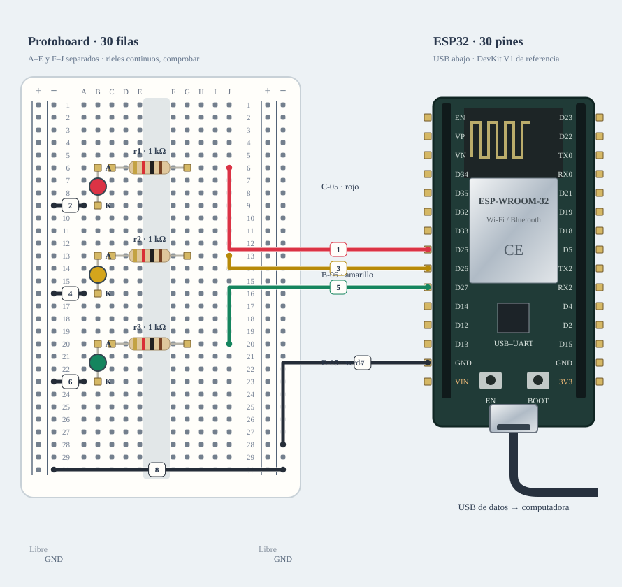

# M-01B · LEDs de estado

Rojo, amarillo y verde separados, cada uno con resistencia de 1 kΩ. Ensayo aislado.

**Diseño y sketch · ensayo físico pendiente.** Diseño de referencia, sin ensayo físico nuevo.



[JSON de montaje importable](leds-fisico.json) · [SVG físico](leds-fisico.svg). ESP32 USB abajo; orientación de referencia, cotejar serigrafía. Terminales rotulados por función donde el conector aún no está identificado.

## Materiales

- C-05 rojo
- B-06 amarillo
- B-05 verde
- C-01: tres resistencias de 1 kΩ; confirmar cantidad
- Protoboard y jumpers recibidos

Cables: 4 M–H + 4 M–M dibujados; cero H–H. Se reutilizan entre bancos; no se exige montarlos todos simultáneamente. Preservar B-02/NFC; comprobar material libre en la otra placa.

## Conexiones funcionales

| Desde | Hasta | Vía | Estado |
|---|---|---|---|
| ESP32 · GPIO25 | LED rojo · A | 1 kΩ en serie | Referencia |
| ESP32 · GPIO26 | LED amarillo · A | 1 kΩ en serie | Referencia |
| ESP32 · GPIO27 | LED verde · A | 1 kΩ en serie | Referencia |
| LEDs · K | ESP32 · GND | — | Referencia |

## Armado cable por cable · USB desconectado

Referencia física, sin escala métrica. USB desconectado al armar. Usar A-01 solo tras identificar placa/puerto y preservar respaldo; B-02/NFC permanece conservado. Cables reutilizados entre ensayos; cero H–H.

| Nº | Color | Tipo | Origen | Destino | Condición |
|---|---|---|---|---|---|
| 1 | red | M–H | esp1:GPIO25 | bb:J6 | Cable 1 · M–H · esp1:GPIO25 → bb:A6. Conectar sin USB; comprobar etiquetas y agujeros. |
| 2 | black | M–M | bb:A9 | bb:LN9 | Cable 2 · M–M · bb:J9 → bb:LN9. Conectar sin USB; comprobar etiquetas y agujeros. |
| 3 | yellow | M–H | esp1:GPIO26 | bb:J13 | Cable 3 · M–H · esp1:GPIO26 → bb:A13. Conectar sin USB; comprobar etiquetas y agujeros. |
| 4 | black | M–M | bb:A16 | bb:LN16 | Cable 4 · M–M · bb:J16 → bb:LN16. Conectar sin USB; comprobar etiquetas y agujeros. |
| 5 | green | M–H | esp1:GPIO27 | bb:J20 | Cable 5 · M–H · esp1:GPIO27 → bb:A20. Conectar sin USB; comprobar etiquetas y agujeros. |
| 6 | black | M–M | bb:A23 | bb:LN23 | Cable 6 · M–M · bb:J23 → bb:LN23. Conectar sin USB; comprobar etiquetas y agujeros. |
| 7 | black | M–H | esp1:GND_L | bb:RN28 | M–H negro: GND izquierdo del ESP32 al riel negativo derecho cercano RN28. |
| 8 | black | M–M | bb:LN30 | bb:RN30 | M–M negro: puente corto LN30–RN30 para compartir masa entre rieles; no rodear ESP32 ni pulsador. |

M–H: hembra al conector macho del módulo/ESP32 y macho al agujero. M–M: ambos extremos en agujeros distintos. Nunca dos puntas en un agujero.

LP/LN: riel izquierdo +/−; RP/RN: derecho +/−. A–E y F–J son tiras separadas por fila. Confirmar continuidad/cortes de la protoboard real; los rieles opuestos no están unidos. Patas colocadas: r1 (C-01 · confirmar tres unidades): 1→G6, 2→C6; led1 (C-05 · rojo): A→B6, K→B9; r2 (C-01 · confirmar tres unidades): 1→G13, 2→C13; led2 (B-06 · amarillo): A→B13, K→B16; r3 (C-01 · confirmar tres unidades): 1→G20, 2→C20; led3 (B-05 · verde): A→B20, K→B23.

Cruces no unen redes. Las condiciones de cada tramo aparecen en esta tabla; un cable por verificar no cuenta como continuidad confirmada aunque se dibuje continuo. Colores son identificadores del dibujo: elegir cables reales y anotar equivalencias. SVG no demuestra alcance físico.

## Antes de energizar

1. Confirmar tres resistencias libres y polaridad de cada LED.
2. USB desconectado al armar; A-01 identificada y respaldo preservado antes de carga.
3. Identificar A-01/puerto y preservar respaldo privado antes de cargar.
4. Comprobar protoboard real, tipos y alcance de jumpers, con USB desconectado.
5. Confirmar tres resistencias C-01 de 1 kΩ libres; cantidad no contada.

Revisar agujero por agujero con USB retirado, polaridad y separación de fuentes. Sin multímetro, identificar por etiquetas y documentación exacta; una tensión o pin dudoso se mantiene desconectado. VIN no garantiza salida regulada de 5 V.

Firmware: firmware/status_led_bench; compilar sin carga; Serial 115200. Ver guía física.

## Compilar y cargar manualmente

Arduino CLI 1.5.1, ESP32 core 3.3.12; DHT sensor library 1.4.7 y Adafruit Unified Sensor 1.1.15 solo si el perfil utiliza DHT11. Actuadores usan ClassAIBench local y pantalla Adafruit GFX 1.12.6 + ST7735/ST7789 1.12.0.

```sh
arduino-cli compile --libraries firmware/libraries --fqbn esp32:esp32:esp32doit-devkit-v1 --jobs 2 --output-dir /tmp/classai-leds-build firmware/status_led_bench
```

Antes de cargar: identificar A-01 y puerto explícito, comprobar su FQBN, registrar cableado real y conservar respaldo privado verificado. Desconectar módulos ajenos y cerrar cualquier monitor. Solo después de resolver TODOS los pendientes eléctricos de esta receta:

```sh
# Sustituir PUERTO_A01 por el puerto reidentificado; no usar el de B-02/NFC.
arduino-cli upload --fqbn esp32:esp32:esp32doit-devkit-v1 --port PUERTO_A01 --input-dir /tmp/classai-leds-build firmware/status_led_bench
arduino-cli monitor --port PUERTO_A01 --config baudrate=115200
```

Cargar utiliza el binario del perfil recién compilado; no recompilar otro perfil entre compile/upload. Abrir Serial puede reiniciar la placa. No se ejecutaron estos comandos de carga/monitor durante esta entrega.

## Prueba guiada y fallos

Acción: Enviar red, yellow, green y off por Serial.

Aprobación esperada: Solo un LED activo; off apaga los tres.

Diagnóstico: Color equivocado: cotejar GPIO25/26/27 y extremos de cada resistencia.

Conflictos: GPIO26/27 compartidos con otros bancos; ensayos separados.

Faltantes/confirmaciones:
- Identificar A-01/puerto y preservar respaldo privado antes de cargar.
- Comprobar protoboard real, tipos y alcance de jumpers, con USB desconectado.
- Confirmar tres resistencias C-01 de 1 kΩ libres; cantidad no contada.

## Registro de resultado

| Etapa | Resultado observado | Evidencia |
|---|---|---|
| Diseño | Referencia física; conservar condiciones | SVG/JSON y guía |
| Compilación | Consultar [resultados de esta entrega](../bancos-fisicos.md); no inferir PASS del comando | Log y tamaños por perfil |
| Simulación nueva | No ejecutada | — |
| Ensayo físico nuevo | Pendiente | Completar acción, salida, reinicios y evidencia tras ensayo |
| Desmontaje | Pendiente | Registrar qué cables/piezas quedan conectados |

- [Espressif · ESP32](https://www.espressif.com/sites/default/files/documentation/esp32_datasheet_en.pdf)

[Índice](README.md). Generado desde missions.ts y sus registros físicos mediante web/scripts/export-hardware-missions.mjs.
