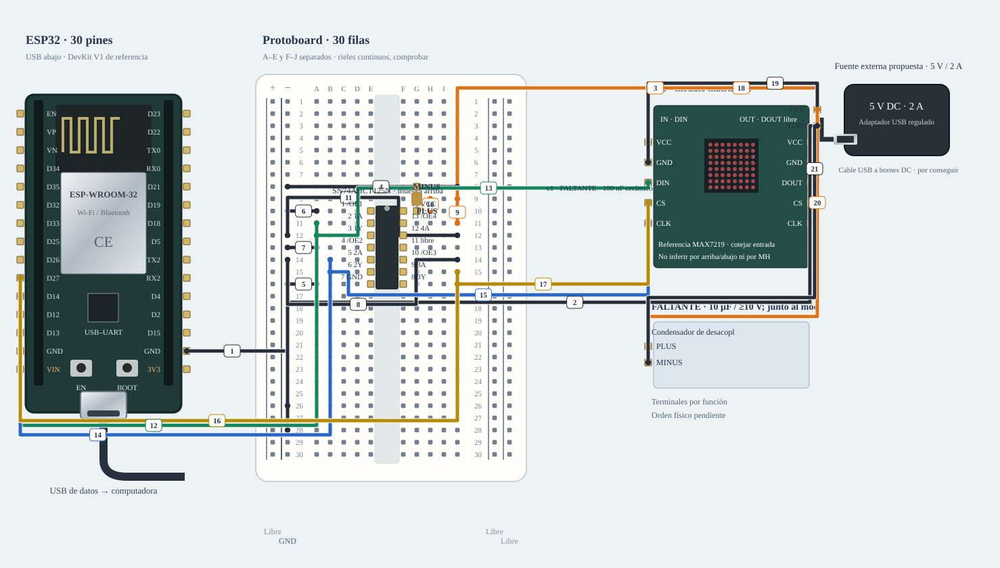

# M-08A · Matriz 8 × 8 · adaptación condicional

Alternativa de compatibilidad; no es el montaje principal ni material ya recibido.

**Montaje condicionado · revisar pendientes.** Diseño de referencia, sin ensayo físico nuevo.



[JSON de montaje importable](matriz-adaptado-fisico.json) · [SVG físico](matriz-adaptado-fisico.svg). ESP32 USB abajo; orientación de referencia, cotejar serigrafía. Terminales rotulados por función donde el conector aún no está identificado.

## Materiales

- esp1: A-01 · identificar antes de cargar
- u1: FALTANTE · TI SN74AHCT125N
- matrix1: B-10 · 8×8, dos cabeceras ×5
- c1: FALTANTE · 100 nF cerámico
- c2: FALTANTE · 10 µF / ≥10 V; junto al módulo
- ps1: PROPUESTA · fuente DC 5 V/2 A + distribuidor; no inventariada

Cables: Consultar tabla completa de cables de esta alternativa.. Se reutilizan entre bancos; no se exige montarlos todos simultáneamente. Preservar B-02/NFC; comprobar material libre en la otra placa.

## Conexiones funcionales

| Desde | Hasta | Vía | Estado |
|---|---|---|---|


## Armado cable por cable · USB desconectado

Referencia física, sin escala métrica. USB desconectado al armar. Usar A-01 solo tras identificar placa/puerto y preservar respaldo; B-02/NFC permanece conservado. Cables reutilizados entre ensayos; cero H–H.

| Nº | Color | Tipo | Origen | Destino | Condición |
|---|---|---|---|---|---|
| 1 | black | M–H | esp1:GND | bb:LN28 | Cable 1 · M–H · esp1:GND → bb:LN28. Conectar sin USB; comprobar etiquetas y agujeros. |
| 2 | black | potencia | ps1:GND | bb:LN26 | Cable 2 · potencia DC por bornera, 22 AWG de referencia · ps1:GND → bb:LN26. Solo referencia de lógica; motor/altavoz retornan al distribuidor, no a la protoboard. |
| 3 | orange | potencia | ps1:PLUS | bb:J10 | Cable 3 · potencia DC por bornera, 22 AWG de referencia · ps1:PLUS → bb:J10. 5 V a pin 14 de U1; no a ESP32. |
| 4 | black | M–M | bb:J8 | bb:LN8 | Cable 4 · M–M · bb:J8 → bb:LN8. Conectar sin USB; comprobar etiquetas y agujeros. |
| 5 | black | M–M | bb:A16 | bb:LN16 | Cable 5 · M–M · bb:A16 → bb:LN16. Conectar sin USB; comprobar etiquetas y agujeros. |
| 6 | black | M–M | bb:A10 | bb:LN10 | Cable 6 · M–M · bb:A10 → bb:LN10. Conectar sin USB; comprobar etiquetas y agujeros. |
| 7 | black | M–M | bb:A13 | bb:LN13 | Cable 7 · M–M · bb:A13 → bb:LN13. Conectar sin USB; comprobar etiquetas y agujeros. |
| 8 | black | M–M | bb:J14 | bb:LN14 | Cable 8 · M–M · bb:J14 → bb:LN14. Conectar sin USB; comprobar etiquetas y agujeros. |
| 9 | orange | M–M | bb:J11 | bb:J9 | Cable 9 · M–M · bb:J11 → bb:J9. Conectar sin USB; comprobar etiquetas y agujeros. |
| 10 | orange | M–M | bb:H9 | bb:H10 | Cable 10 · M–M · bb:H9 → bb:H10. Conectar sin USB; comprobar etiquetas y agujeros. |
| 11 | black | M–M | bb:J12 | bb:LN12 | Cable 11 · M–M · bb:J12 → bb:LN12. Conectar sin USB; comprobar etiquetas y agujeros. |
| 12 | green | M–H | esp1:GPIO13 | bb:A11 | Cable 12 · M–H · esp1:GPIO13 → bb:A11. Conectar sin USB; comprobar etiquetas y agujeros. |
| 13 | green | M–H | bb:A12 | matrix1:DIN | NO conectar: Cotejar cabecera de ENTRADA y confirmar controlador compatible MAX7219. |
| 14 | blue | M–H | esp1:GPIO14 | bb:B14 | Cable 14 · M–H · esp1:GPIO14 → bb:B14. Conectar sin USB; comprobar etiquetas y agujeros. |
| 15 | blue | M–H | bb:B15 | matrix1:CLK | NO conectar: Cotejar cabecera de ENTRADA y confirmar controlador compatible MAX7219. |
| 16 | yellow | M–H | esp1:GPIO27 | bb:J15 | Cable 16 · M–H · esp1:GPIO27 → bb:J15. Conectar sin USB; comprobar etiquetas y agujeros. |
| 17 | yellow | M–H | bb:J16 | matrix1:CS | NO conectar: Cotejar cabecera de ENTRADA y confirmar controlador compatible MAX7219. |
| 18 | orange | potencia | ps1:PLUS | matrix1:VCC | NO conectar: Fuente/materiales propuestos y controlador de B-10 por confirmar. |
| 19 | black | potencia | ps1:GND | matrix1:GND | Cable 19 · potencia DC por bornera, 22 AWG de referencia · ps1:GND → matrix1:GND. Retorno de matriz directo al distribuidor. |
| 20 | orange | potencia | ps1:PLUS | c2:PLUS | Cable 20 · potencia DC por bornera, 22 AWG de referencia · ps1:PLUS → c2:PLUS. 10 µF junto a VCC matriz. |
| 21 | black | potencia | ps1:GND | c2:MINUS | Cable 21 · potencia DC por bornera, 22 AWG de referencia · ps1:GND → c2:MINUS. Negativo del electrolítico a GND. |

M–H: hembra al conector macho del módulo/ESP32 y macho al agujero. M–M: ambos extremos en agujeros distintos. Nunca dos puntas en un agujero.

LP/LN: riel izquierdo +/−; RP/RN: derecho +/−. A–E y F–J son tiras separadas por fila. Confirmar continuidad/cortes de la protoboard real; los rieles opuestos no están unidos. Patas colocadas: u1 (FALTANTE · TI SN74AHCT125N): OE1→E10, A1→E11, Y1→E12, OE2→E13, A2→E14, Y2→E15, GND→E16, Y3→F16, A3→F15, OE3→F14, Y4→F13, A4→F12, OE4→F11, VCC→F10; c1 (FALTANTE · 100 nF cerámico): PLUS→G10, MINUS→G8.

Cruces no unen redes. Las condiciones de cada tramo aparecen en esta tabla; un cable por verificar no cuenta como continuidad confirmada aunque se dibuje continuo. Colores son identificadores del dibujo: elegir cables reales y anotar equivalencias. SVG no demuestra alcance físico.

## Antes de energizar

1. A-01/puerto identificados y respaldo privado preservado; B-02/NFC conservado.
2. Referencia MAX7219 explícita; confirmar IN/DIN frente a DOUT del módulo real.
3. Conseguir SN74AHCT125N PDIP-14, 100 nF y 10 µF/≥10 V; U1 pin 11 libre, A4=GND y OE4=5 V.
4. Fuente externa regulada 5 V/2 A propuesta; no medida ni certificada para la pieza real. CS27 evita el pin de arranque GPIO15; banco aislado de PIR/TFT. Sin pull-up de 5 V hacia ESP32.

Revisar agujero por agujero con USB retirado, polaridad y separación de fuentes. Sin multímetro, identificar por etiquetas y documentación exacta; una tensión o pin dudoso se mantiene desconectado. VIN no garantiza salida regulada de 5 V.

Firmware: firmware/matrix_bench

## Compilar y cargar manualmente

Arduino CLI 1.5.1, ESP32 core 3.3.12; DHT sensor library 1.4.7 y Adafruit Unified Sensor 1.1.15 solo si el perfil utiliza DHT11. Actuadores usan ClassAIBench local y pantalla Adafruit GFX 1.12.6 + ST7735/ST7789 1.12.0.

```sh
arduino-cli compile --libraries firmware/libraries --fqbn esp32:esp32:esp32doit-devkit-v1 --jobs 2 --output-dir /tmp/classai-matriz-adaptado-build firmware/matrix_bench
```

Antes de cargar: identificar A-01 y puerto explícito, comprobar su FQBN, registrar cableado real y conservar respaldo privado verificado. Desconectar módulos ajenos y cerrar cualquier monitor. Solo después de resolver TODOS los pendientes eléctricos de esta receta:

```sh
# Sustituir PUERTO_A01 por el puerto reidentificado; no usar el de B-02/NFC.
arduino-cli upload --fqbn esp32:esp32:esp32doit-devkit-v1 --port PUERTO_A01 --input-dir /tmp/classai-matriz-adaptado-build firmware/matrix_bench
arduino-cli monitor --port PUERTO_A01 --config baudrate=115200
```

Cargar utiliza el binario del perfil recién compilado; no recompilar otro perfil entre compile/upload. Abrir Serial puede reiniciar la placa. No se ejecutaron estos comandos de carga/monitor durante esta entrega.

## Prueba guiada y fallos

Acción: Tras confirmar MAX7219/adaptador, enviar arm y pattern; para barrido, scan. stop apaga y desarma.

Aprobación esperada: Patrón de baja intensidad y un LED por paso; paro inmediato y sin otros periféricos inicializados.

Diagnóstico: Enviar stop ante un fallo. Desconectar ambas fuentes antes de revisar cada extremo, polaridad, masa común y material faltante; no cambiar pines en caliente.

Conflictos: Referencia MAX7219 con SN74AHCT125N a 5 V; GPIO13/14/27, CS27 evita el pin de arranque GPIO15; ensayo aislado de PIR/TFT. DOUT no recibe datos del ESP32.

Faltantes/confirmaciones:
- A-01/puerto identificados y respaldo privado preservado; B-02/NFC conservado.
- Referencia MAX7219 explícita; confirmar IN/DIN frente a DOUT del módulo real.
- Conseguir SN74AHCT125N PDIP-14, 100 nF y 10 µF/≥10 V; U1 pin 11 libre, A4=GND y OE4=5 V.
- Fuente externa regulada 5 V/2 A propuesta; no medida ni certificada para la pieza real. CS27 evita el pin de arranque GPIO15; banco aislado de PIR/TFT. Sin pull-up de 5 V hacia ESP32.

## Registro de resultado

| Etapa | Resultado observado | Evidencia |
|---|---|---|
| Diseño | Referencia física; conservar condiciones | SVG/JSON y guía |
| Compilación | Consultar [resultados de esta entrega](../bancos-fisicos.md); no inferir PASS del comando | Log y tamaños por perfil |
| Simulación nueva | No ejecutada | — |
| Ensayo físico nuevo | Pendiente | Completar acción, salida, reinicios y evidencia tras ensayo |
| Desmontaje | Pendiente | Registrar qué cables/piezas quedan conectados |

- [Analog Devices · MAX7219](https://www.analog.com/media/en/technical-documentation/data-sheets/MAX7219-MAX7221.pdf)
- [Material de la U y criterios de armado](https://github.com/joaquinsalinas06/ClassAI/blob/codex/physical-benches/docs/hardware/circuitos-referencia.md)

[Índice](README.md). Generado desde missions.ts y sus registros físicos mediante web/scripts/export-hardware-missions.mjs.
