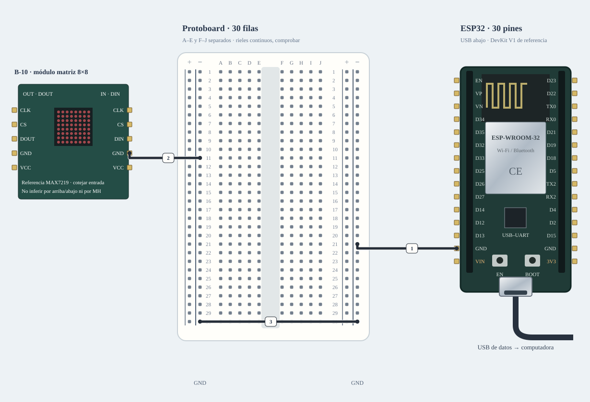

# M-08A · Matriz 8 × 8

Tras confirmar MAX7219/adaptador, enviar arm y pattern; para barrido, scan. stop apaga y desarma.

**Montaje parcial · no conectar cables marcados.** Diseño de referencia, sin ensayo físico nuevo.



[JSON de montaje importable](matriz-fisico.json) · [SVG físico](matriz-fisico.svg). ESP32 USB abajo; orientación de referencia, cotejar serigrafía. Terminales rotulados por función donde el conector aún no está identificado.

## Materiales

- esp1: A-01 · identificar antes de cargar
- matrix1: B-10 · matriz 8×8

Cables: 9 M–H + 1 M–M dibujados; cero H–H. 1 tramos de potencia por bornera. Se reutilizan entre bancos; no se exige montarlos todos simultáneamente. Preservar B-02/NFC; comprobar material libre en la otra placa.

## Conexiones funcionales

| Desde | Hasta | Vía | Estado |
|---|---|---|---|
| ESP32 · GND_L | Protoboard · RN21 | c1 · M–H | Referencia |
| ESP32 · VIN | Protoboard · LP26 | c2 · potencia | Pendiente; no conectar |
| Protoboard · LP12 | Matriz · VCC | c3 · M–H | Referencia |
| Protoboard · LN11 | Matriz · GND | c4 · M–H | Referencia |
| Protoboard · LN30 | Protoboard · RN30 | c5 · M–M | Referencia |
| ESP32 · GPIO13 | Protoboard · J9 | c6 · M–H | Referencia |
| Protoboard · H9 | Matriz · DIN | c7 · M–H | Pendiente; no conectar |
| ESP32 · GPIO14 | Protoboard · J5 | c8 · M–H | Referencia |
| Protoboard · H5 | Matriz · CLK | c9 · M–H | Pendiente; no conectar |
| ESP32 · GPIO27 | Protoboard · J7 | c10 · M–H | Referencia |
| Protoboard · H7 | Matriz · CS | c11 · M–H | Pendiente; no conectar |

## Armado cable por cable · USB desconectado

Referencia física, sin escala métrica. USB desconectado al armar. Usar A-01 solo tras identificar placa/puerto y preservar respaldo; B-02/NFC permanece conservado. Cables reutilizados entre ensayos; cero H–H.

| Nº | Color | Tipo | Origen | Destino | Condición |
|---|---|---|---|---|---|
| 1 | black | M–H | esp1:GND_L | bb:RN21 | Cable 1 · M–H · esp1:GND_L → bb:RN21. Conectar sin USB; comprobar etiquetas y agujeros. |
| 2 | orange | potencia | esp1:VIN | bb:LP26 | NO conectar: Usar como 5 V de USB únicamente después de identificar A-01 y confirmar que su pin VIN/5V está unido a VBUS; no es una fuente externa ni alimenta un fan. |
| 3 | orange | M–H | bb:LP12 | matrix1:VCC | Cable 3 · M–H · bb:LP12 → matrix1:VCC. Conectar sin USB; comprobar etiquetas y agujeros. |
| 4 | black | M–H | bb:LN11 | matrix1:GND | Cable 4 · M–H · bb:LN11 → matrix1:GND. Conectar sin USB; comprobar etiquetas y agujeros. |
| 5 | black | M–M | bb:LN30 | bb:RN30 | Cable 5 · M–M · bb:LN30 → bb:RN30. Conectar sin USB; comprobar etiquetas y agujeros. |
| 6 | green | M–H | esp1:GPIO13 | bb:J9 | Cable 6 · M–H · esp1:GPIO13 → bb:J9. Conectar sin USB; comprobar etiquetas y agujeros. |
| 7 | green | M–H | bb:H9 | matrix1:DIN | NO conectar: Confirmar entrada y compatibilidad 3,3 V del módulo. MAX7219 estándar: usar adaptación documentada; no conectar directo. |
| 8 | blue | M–H | esp1:GPIO14 | bb:J5 | Cable 8 · M–H · esp1:GPIO14 → bb:J5. Conectar sin USB; comprobar etiquetas y agujeros. |
| 9 | blue | M–H | bb:H5 | matrix1:CLK | NO conectar: Confirmar entrada y compatibilidad 3,3 V del módulo. MAX7219 estándar: usar adaptación documentada; no conectar directo. |
| 10 | yellow | M–H | esp1:GPIO27 | bb:J7 | Cable 10 · M–H · esp1:GPIO27 → bb:J7. Conectar sin USB; comprobar etiquetas y agujeros. |
| 11 | yellow | M–H | bb:H7 | matrix1:CS | NO conectar: Confirmar entrada y compatibilidad 3,3 V del módulo. MAX7219 estándar: usar adaptación documentada; no conectar directo. |

M–H: hembra al conector macho del módulo/ESP32 y macho al agujero. M–M: ambos extremos en agujeros distintos. Nunca dos puntas en un agujero.

LP/LN: riel izquierdo +/−; RP/RN: derecho +/−. A–E y F–J son tiras separadas por fila. Confirmar continuidad/cortes de la protoboard real; los rieles opuestos no están unidos. Patas colocadas: módulos externos, conectores por verificar.

Cruces no unen redes. Las condiciones de cada tramo aparecen en esta tabla; un cable por verificar no cuenta como continuidad confirmada aunque se dibuje continuo. Colores son identificadores del dibujo: elegir cables reales y anotar equivalencias. SVG no demuestra alcance físico.

## Compatibilidad eléctrica

[Montaje alternativo con adaptación](matriz-adaptado.md). No se muestra como material obligatorio del montaje principal; usarlo si los niveles o la carga exigen esa etapa.

## Antes de energizar

1. Identificar placa A-01/puerto, preservar respaldo y armar sin alimentación. B-02/NFC se conserva.
2. No se presupone una fuente externa: la ruta VIN/5V solo reutiliza el 5 V del USB si la placa A-01 coincide con una variante que lo expone y el presupuesto USB alcanza.
3. Entrada DIN y salida DOUT no se intercambian. MAX7219 estándar no garantiza HIGH con 3,3 V; usar la alternativa AHCT si corresponde.

Revisar agujero por agujero con USB retirado, polaridad y separación de fuentes. Sin multímetro, identificar por etiquetas y documentación exacta; una tensión o pin dudoso se mantiene desconectado. VIN no garantiza salida regulada de 5 V.

Firmware: firmware/matrix_bench; compilar sin carga; Serial 115200. Ver guía física.

## Compilar y cargar manualmente

Arduino CLI 1.5.1, ESP32 core 3.3.12; DHT sensor library 1.4.7 y Adafruit Unified Sensor 1.1.15 solo si el perfil utiliza DHT11. Actuadores usan ClassAIBench local y pantalla Adafruit GFX 1.12.6 + ST7735/ST7789 1.12.0.

```sh
arduino-cli compile --libraries firmware/libraries --fqbn esp32:esp32:esp32doit-devkit-v1 --jobs 2 --output-dir /tmp/classai-matriz-build firmware/matrix_bench
```

Antes de cargar: identificar A-01 y puerto explícito, comprobar su FQBN, registrar cableado real y conservar respaldo privado verificado. Desconectar módulos ajenos y cerrar cualquier monitor. Solo después de resolver TODOS los pendientes eléctricos de esta receta:

```sh
# Sustituir PUERTO_A01 por el puerto reidentificado; no usar el de B-02/NFC.
arduino-cli upload --fqbn esp32:esp32:esp32doit-devkit-v1 --port PUERTO_A01 --input-dir /tmp/classai-matriz-build firmware/matrix_bench
arduino-cli monitor --port PUERTO_A01 --config baudrate=115200
```

Cargar utiliza el binario del perfil recién compilado; no recompilar otro perfil entre compile/upload. Abrir Serial puede reiniciar la placa. No se ejecutaron estos comandos de carga/monitor durante esta entrega.

## Prueba guiada y fallos

Acción: Tras confirmar MAX7219/adaptador, enviar arm y pattern; para barrido, scan. stop apaga y desarma.

Aprobación esperada: Patrón de baja intensidad y un LED por paso; paro inmediato y sin otros periféricos inicializados.

Diagnóstico: Enviar stop ante un fallo. Desconectar ambas fuentes antes de revisar cada extremo, polaridad, masa común y material faltante; no cambiar pines en caliente.

Conflictos: Referencia MAX7219 con SN74AHCT125N a 5 V; GPIO13/14/27, CS27 evita el pin de arranque GPIO15; ensayo aislado de PIR/TFT. DOUT no recibe datos del ESP32.

Faltantes/confirmaciones:
- Identificar placa A-01/puerto, preservar respaldo y armar sin alimentación. B-02/NFC se conserva.
- No se presupone una fuente externa: la ruta VIN/5V solo reutiliza el 5 V del USB si la placa A-01 coincide con una variante que lo expone y el presupuesto USB alcanza.
- Entrada DIN y salida DOUT no se intercambian. MAX7219 estándar no garantiza HIGH con 3,3 V; usar la alternativa AHCT si corresponde.

## Registro de resultado

| Etapa | Resultado observado | Evidencia |
|---|---|---|
| Diseño | Referencia física; conservar condiciones | SVG/JSON y guía |
| Compilación | Consultar [resultados de esta entrega](../bancos-fisicos.md); no inferir PASS del comando | Log y tamaños por perfil |
| Simulación nueva | No ejecutada | — |
| Ensayo físico nuevo | Pendiente | Completar acción, salida, reinicios y evidencia tras ensayo |
| Desmontaje | Pendiente | Registrar qué cables/piezas quedan conectados |

- [Analog Devices · MAX7219](https://www.analog.com/media/en/technical-documentation/data-sheets/MAX7219-MAX7221.pdf)
- [Material de la U y criterios de armado](https://github.com/joaquinsalinas06/ClassAI/blob/codex/physical-benches/docs/hardware/circuitos-referencia.md)

[Índice](README.md). Generado desde missions.ts y sus registros físicos mediante web/scripts/export-hardware-missions.mjs.
