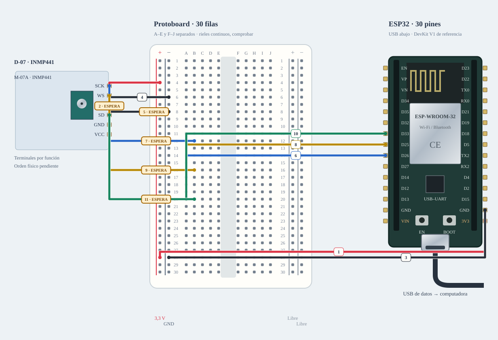

# M-07A · Micrófono digital

INMP441 captura audio digital. Se prueba separado del amplificador y del sensor de sonido analógico.

**Propuesta, sin ensayo físico. Propuesta de banco I²S.**

Mapa eléctrico por nombres: las posiciones se ordenan por función, no corresponden a una fotografía ni certifican el orden físico de los conectores. Las líneas representan redes o tramos, no cables H–H obligatorios. Los tramos discontinuos son pendientes.

## Materiales

- D-07: INMP441 ×1
- Cabecera y etiquetas reales por revisar
- B-01 o A-04: protoboard

Cables: Referencia: hasta 11 M–H + 1 M–M mediante tiras; revisar terminales; 0 H–H. No reservar material ya usado en otro banco.

## Conexiones

| Desde | Hasta | Vía / condición | Estado |
|---|---|---|---|
| ESP32 · 3V3 | INMP441 · VDD / VCC | 3,3 V | Propuesto |
| ESP32 · GND | INMP441 · GND | — | Propuesto |
| ESP32 · GPIO26 | INMP441 · SCK / BCLK | Propuesta aislada | Propuesto |
| ESP32 · GPIO25 | INMP441 · WS | — | Propuesto |
| INMP441 · SD | ESP32 · GPIO33 | — | Propuesto |
| INMP441 · L/R | ESP32 · GND | Canal izquierdo; no flotante | Propuesto |

## Antes de conectar

1. L/R fija canal, no es un dato GPIO ni salida hacia la bocina.
2. SD del micrófono es salida de datos; SD del amplificador tiene otra función.
3. Revisar desacoplo y tensión del módulo real; la ficha INMP441 no identifica su breakout.
4. Estos GPIO son propuesta nueva de ensayo, no integración I²S implementada.

Resultado esperado: Capturar muestras que cambien con voz/palmada y comprobar canal; no afirmar reconocimiento de voz ni dB calibrados.

Firmware: Sketch/driver de captura I²S pendiente.

Conflictos: GPIO25/26 coinciden con el banco de audio y otras funciones; no conectar ambos automáticamente.

- [TDK · INMP441](https://invensense.tdk.com/wp-content/uploads/2015/02/INMP441.pdf)

[Volver al índice](README.md). Generado por web/scripts/export-hardware-missions.mjs desde web/src/hardware/missions.ts.
