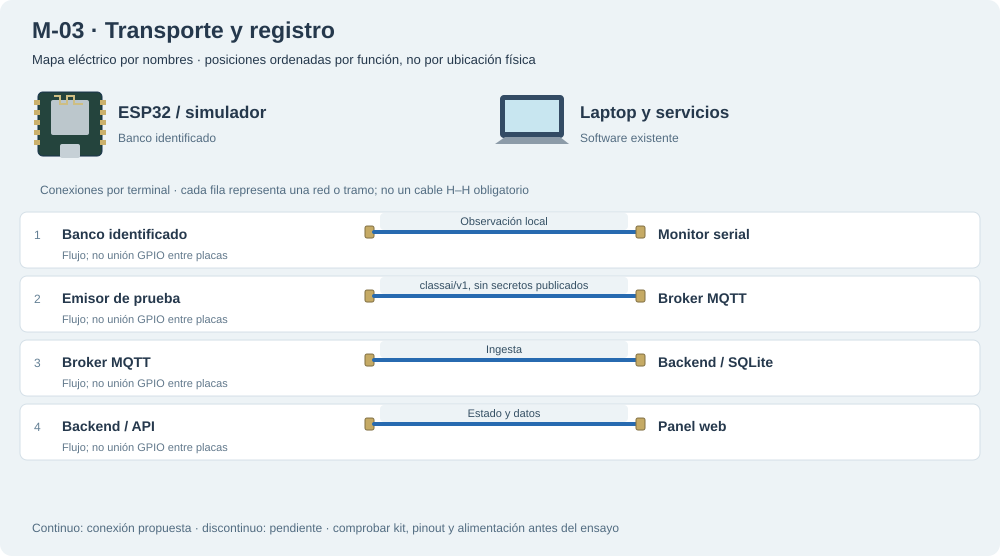

# M-03 · Transporte y registro

Comprobar serial → MQTT → backend → web sin presentar datos sintéticos como mediciones reales.

**Propuesta, sin ensayo físico. Flujo de software.**

Mapa eléctrico por nombres: las posiciones se ordenan por función, no corresponden a una fotografía ni certifican el orden físico de los conectores. Las líneas representan redes o tramos, no cables H–H obligatorios. Los tramos discontinuos son pendientes.

## Materiales

- Una placa identificada o simulador host
- Broker / backend / web de prueba

Cables: Sin jumpers entre ESP32; transporte por red. No reservar material ya usado en otro banco.

## Conexiones

| Desde | Hasta | Vía / condición | Estado |
|---|---|---|---|
| Banco identificado | Monitor serial | Observación local | Propuesto |
| Emisor de prueba | Broker MQTT | classai/v1, sin secretos publicados | Propuesto |
| Broker MQTT | Backend / SQLite | Ingesta | Propuesto |
| Backend / API | Panel web | Estado y datos | Propuesto |

## Antes de conectar

1. El firmware base no es perfil sin sensores: deshabilitar también salidas e inicializaciones incompatibles.
2. Dos nodos base con el mismo ROOM_ID colisionan en client ID; separar aulas de prueba o usar un emisor.
3. No unir GPIO entre placas. La sincronización de sesión multinodo no está implementada.

Resultado esperado: Comparar evento en cada tramo, config y reconexión; PubSubClient publica QoS 0, sin garantía de persistencia física.

Firmware: Perfil aislado de transporte pendiente; smoke de host existente no prueba hardware.

Conflictos: No habilita por sí solo tres nodos de una misma aula.

[Volver al índice](README.md). Generado por web/scripts/export-hardware-missions.mjs desde web/src/hardware/missions.ts.
