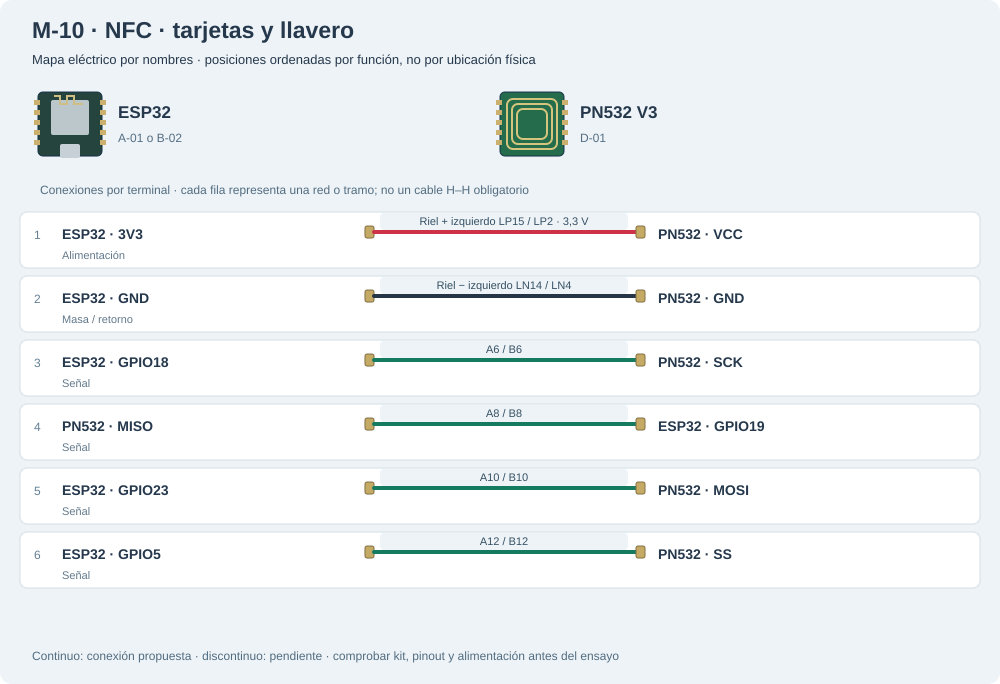

# M-10 · NFC · tarjetas y llavero

ESP32 B-02 y PN532 D-01: montaje con rieles usado en el ensayo HCE → MQTT → asistencia. Retirar y presentar puede requerir reintentos; regularidad RF pendiente.

**HCE y asistencia física comprobados; regularidad RF pendiente.** Referencia R-023: HCE físico y asistencia persistida, con RF intermitente. No hubo nuevo ensayo.

[JSON de montaje importable](nfc-fisico.json) · [SVG físico](nfc-fisico.svg). ESP32 USB abajo; orientación de referencia, cotejar serigrafía. Terminales rotulados por función donde el conector aún no está identificado.

## Materiales

- D-01: PN532 V3 ×1
- D-02: tarjeta ×1
- D-03: llavero ×1
- D-11: cabecera macho montada en el ensayo NFC
- B-01 o A-04: protoboard

Cables: 12 M–H + 0 M–M dibujados; cero H–H. Se reutilizan entre bancos; no se exige montarlos todos simultáneamente. Preservar B-02/NFC; comprobar material libre en la otra placa.

## Conexiones funcionales

| Desde | Hasta | Vía | Estado |
|---|---|---|---|
| ESP32 · 3V3 | PN532 · VCC | Riel + izquierdo LP15 / LP2 · 3,3 V | Referencia |
| ESP32 · GND | PN532 · GND | Riel − izquierdo LN14 / LN4 | Referencia |
| ESP32 · GPIO18 | PN532 · SCK | A6 / B6 | Referencia |
| PN532 · MISO | ESP32 · GPIO19 | A8 / B8 | Referencia |
| ESP32 · GPIO23 | PN532 · MOSI | A10 / B10 | Referencia |
| ESP32 · GPIO5 | PN532 · SS | A12 / B12 | Referencia |

## Armado cable por cable · USB desconectado

Referencia B-02/D-01 conservada: HCE físico y asistencia persistida R-023, con RF intermitente. 12 M–H, seis redes; no hubo nuevo ensayo ni carga. IRQ/RSTO libres. Ver banco-nfc.md.

| Nº | Color | Tipo | Origen | Destino | Condición |
|---|---|---|---|---|---|
| 1 | red | M–H | esp1:3V3 | bb:LP15 | Cable 1 · M–H: hembra a ESP32 3V3, macho a LP15. Montar sin USB. |
| 2 | red | M–H | bb:LP2 | nfc1:VCC | Cable 2 · M–H: macho a LP2, hembra a PN532 VCC. LP15/LP2 comparten riel + izquierdo, mitad superior; no puente adicional. |
| 3 | black | M–H | esp1:GND | bb:LN14 | Cable 3 · M–H: hembra a ESP32 GND, macho a LN14. Montar sin USB. |
| 4 | black | M–H | bb:LN4 | nfc1:GND | Cable 4 · M–H: macho a LN4, hembra a PN532 GND. LN14/LN4 comparten riel − izquierdo, mitad superior; no puente adicional. |
| 5 | blue | M–H | esp1:GPIO18 | bb:A6 | Cable 5 · M–H: hembra a ESP32 GPIO18, macho a A6. Montar sin USB. |
| 6 | blue | M–H | bb:B6 | nfc1:SCK | Cable 6 · M–H: macho a B6, hembra a PN532 SCK. A6/B6 comparten tira A–E; no puente adicional. |
| 7 | purple | M–H | esp1:GPIO19 | bb:A8 | Cable 7 · M–H: hembra a ESP32 GPIO19, macho a A8. Montar sin USB. |
| 8 | purple | M–H | bb:B8 | nfc1:MISO | Cable 8 · M–H: macho a B8, hembra a PN532 MISO. A8/B8 comparten tira A–E; no puente adicional. |
| 9 | green | M–H | esp1:GPIO23 | bb:A10 | Cable 9 · M–H: hembra a ESP32 GPIO23, macho a A10. Montar sin USB. |
| 10 | green | M–H | bb:B10 | nfc1:MOSI | Cable 10 · M–H: macho a B10, hembra a PN532 MOSI. A10/B10 comparten tira A–E; no puente adicional. |
| 11 | yellow | M–H | esp1:GPIO5 | bb:A12 | Cable 11 · M–H: hembra a ESP32 GPIO5, macho a A12. Montar sin USB. |
| 12 | yellow | M–H | bb:B12 | nfc1:SS | Cable 12 · M–H: macho a B12, hembra a PN532 SS. A12/B12 comparten tira A–E; no puente adicional. |

M–H: hembra al conector macho del módulo/ESP32 y macho al agujero. M–M: ambos extremos en agujeros distintos. Nunca dos puntas en un agujero.

LP/LN: riel izquierdo +/−; RP/RN: derecho +/−. A–E y F–J son tiras separadas por fila. Confirmar continuidad/cortes de la protoboard real; los rieles opuestos no están unidos. Patas colocadas: módulos externos, conectores por verificar.

Cruces no unen redes. Las líneas discontinuas están pendientes y no cuentan como continuidad confirmada. Colores son identificadores del dibujo: elegir cables reales y anotar equivalencias. SVG no demuestra alcance físico.

## Antes de energizar

1. DIP SPI, sin alimentación: canal 1 OFF / canal 2 ON; leer números, no copiar dirección de la foto.
2. Revisar soldadura: sin puentes, pines firmes y antena despejada. Confirmar cabecera macho/hembra para elegir M–H/M–M. IRQ/RSTO quedan sin conectar.
3. Potencia por rieles izquierdos: + LP15/LP2 y − LN14/LN4, solo mitad superior. Señales por A6/B6, A8/B8, A10/B10 y A12/B12. No unir + con −, A con F ni redes distintas.
4. Primer ensayo sin pantalla ni actuadores. No imprimir ni publicar tokens/UID completos.
5. Identificar A-01/puerto y preservar respaldo privado antes de cargar.
6. Comprobar protoboard real, tipos y alcance de jumpers, con USB desconectado.

Revisar agujero por agujero con USB retirado, polaridad y separación de fuentes. Sin multímetro, identificar por etiquetas y documentación exacta; una tensión o pin dudoso se mantiene desconectado. VIN no garantiza salida regulada de 5 V.

Firmware: firmware/classai_node, perfil NFC_ONLY: SPI 18/19/23/5, Serial 115200, status/start/stop. HCE y asistencia persistida probados (R-023). firmware/nfc_bench queda para diagnóstico de tarjetas.

## Prueba guiada y fallos

Acción: Conservar el montaje B-02/D-01 y el ensayo R-023.

Aprobación esperada: Referencia física existente; RF intermitente pendiente.

Diagnóstico: Consultar banco-nfc.md; no sustituir firmware operativo.

Conflictos: TFT comparte GPIO5/23 y usa otro SCK; no conectar ambas recetas como si fueran compatibles.

Faltantes/confirmaciones:
- Identificar A-01/puerto y preservar respaldo privado antes de cargar.
- Comprobar protoboard real, tipos y alcance de jumpers, con USB desconectado.

## Registro de resultado

| Etapa | Resultado observado | Evidencia |
|---|---|---|
| Diseño | Referencia física; conservar condiciones | SVG/JSON y guía |
| Compilación | Consultar [resultados de esta entrega](../bancos-fisicos.md); no inferir PASS del comando | Log y tamaños por perfil |
| Simulación nueva | No ejecutada | — |
| Ensayo físico nuevo | Pendiente | Completar acción, salida, reinicios y evidencia tras ensayo |
| Desmontaje | Pendiente | Registrar qué cables/piezas quedan conectados |

- [Elechouse · PN532 V3](https://www.elechouse.com/elechouse/images/product/PN532_module_V3/PN532_%20Manual_V3.pdf)

[Índice](README.md). Generado desde missions.ts y sus registros físicos mediante web/scripts/export-hardware-missions.mjs.
