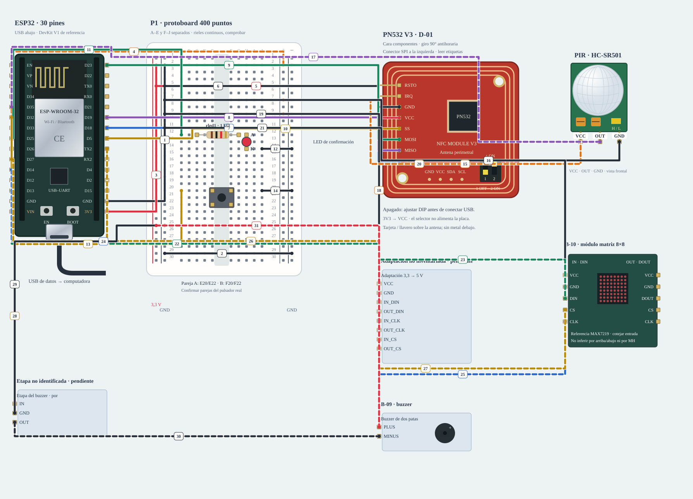

# N1 · Acceso · NFC y confirmación

Colocar componentes sin USB, después masas, rieles y señales siguiendo los pasos. Revisar los cables discontinuos aparte; el visor no energiza ni carga firmware.

**Propuesta integrada · ensayo conjunto pendiente.** Diseño de referencia, sin ensayo físico nuevo.

[JSON de montaje importable](nodo-acceso-fisico.json) · [SVG físico](nodo-acceso-fisico.svg). ESP32 USB abajo; orientación de referencia, cotejar serigrafía. Terminales rotulados por función donde el conector aún no está identificado.

## Materiales

- esp1: B-02 · universidad · acceso
- nfc1: D-01 · PN532 V3 · SPI
- matrix1: B-10 · matriz 8×8
- pir1: B-04 · movimiento en entrada
- adapt1: Adaptación no inventariada · pendiente
- drive1: Etapa no identificada · pendiente
- buzz1: B-09 · buzzer
- button1: C-04 · solicitar inicio/cierre
- rled1: Resistencia 1 kΩ · una por LED
- led1: LED de confirmación

Cables: 15 M–H + 3 M–M + 13 H–H. Incluye ramas condicionadas; cantidad y alcance reales por comprobar. Los tres nodos se montan simultáneamente sobre las cuatro protoboards existentes: P1 acceso, P2 ambiente y P3/P4 asistente. No duplicar cantidades de inventario.

## Conexiones funcionales

| Desde | Hasta | Vía | Estado |
|---|---|---|---|
| esp1:GND | bb:LN2 | c1 · M–H | Referencia |
| bb:LN29 | bb:RN29 | c2 · M–M | Referencia |
| esp1:3V3 | bb:LP2 | c3 · M–H | Referencia |
| esp1:VIN | bb:RP2 | c4 · M–H | Pendiente; no conectar |
| bb:LP5 | nfc1:VCC | c5 · M–H | Referencia |
| bb:LN5 | nfc1:GND | c6 · M–H | Referencia |
| esp1:GPIO18 | nfc1:SCK | c7 · H–H | Referencia |
| esp1:GPIO19 | nfc1:MISO | c8 · H–H | Referencia |
| esp1:GPIO23 | nfc1:MOSI | c9 · H–H | Referencia |
| esp1:GPIO5 | nfc1:SS | c10 · H–H | Referencia |
| esp1:GPIO25 | bb:A12 | c11 · M–H | Referencia |
| bb:J14 | bb:RN14 | c12 · M–M | Referencia |
| esp1:GPIO32 | bb:A20 | c13 · M–H | Referencia |
| bb:J20 | bb:RN20 | c14 · M–M | Referencia |
| bb:RP7 | pir1:VCC | c15 · M–H | Pendiente; no conectar |
| bb:LN7 | pir1:GND | c16 · M–H | Referencia |
| pir1:OUT | esp1:GPIO35 | c17 · H–H | Pendiente; no conectar |
| bb:RP9 | adapt1:VCC | c18 · M–H | Pendiente; no conectar |
| bb:LN9 | adapt1:GND | c19 · M–H | Referencia |
| bb:RP11 | matrix1:VCC | c20 · M–H | Pendiente; no conectar |
| bb:LN11 | matrix1:GND | c21 · M–H | Referencia |
| esp1:GPIO13 | adapt1:IN_DIN | c22 · H–H | Pendiente; no conectar |
| adapt1:OUT_DIN | matrix1:DIN | c23 · H–H | Pendiente; no conectar |
| esp1:GPIO14 | adapt1:IN_CLK | c24 · H–H | Pendiente; no conectar |
| adapt1:OUT_CLK | matrix1:CLK | c25 · H–H | Pendiente; no conectar |
| esp1:GPIO27 | adapt1:IN_CS | c26 · H–H | Pendiente; no conectar |
| adapt1:OUT_CS | matrix1:CS | c27 · H–H | Pendiente; no conectar |
| esp1:GPIO17 | drive1:IN | c28 · H–H | Pendiente; no conectar |
| bb:LN25 | drive1:GND | c29 · M–H | Referencia |
| drive1:OUT | buzz1:MINUS | c30 · H–H | Pendiente; no conectar |
| bb:LP25 | buzz1:PLUS | c31 · M–H | Pendiente; no conectar |

## Armado cable por cable · USB desconectado

Montaje integrado propuesto · Acceso · B-02 · P1. Cuatro protoboards entre los tres nodos; no duplicar inventario. M–M/M–H/H–H admitidos para este diseño; contar disponibilidad y alcance antes de armar. H–H une dos cabeceras macho. LP=3,3 V, RP=5 V condicionado, LN/RN=GND local. Alimentación USB propia; no unir fuentes de nodos distintos. Cables pendientes visibles como discontinuos; no colocar ni energizar esas ramas hasta resolver su condición.

| Nº | Color | Tipo | Origen | Destino | Condición |
|---|---|---|---|---|---|
| 1 | black | M–H | esp1:GND | bb:LN2 | 1. Masa común del nodo · M–H · esp1 · GND → P · LN2 · USB desconectado. |
| 2 | black | M–M | bb:LN29 | bb:RN29 | 2. Unir solo los dos rieles negativos · M–M · P · LN29 → P · RN29 · USB desconectado. |
| 3 | red | M–H | esp1:3V3 | bb:LP2 | 3. Riel positivo izquierdo: 3,3 V · M–H · esp1 · 3V3 → P · LP2 · USB desconectado. |
| 4 | orange | M–H | esp1:VIN | bb:RP2 | NO conectar: Confirmar ruta USB–VIN y capacidad de corriente de esta placa antes de conectar 5 V. |
| 5 | red | M–H | bb:LP5 | nfc1:VCC | 5. Alimentar nfc1 a 3.3 V · M–H · P · LP5 → nfc1 · VCC · USB desconectado. |
| 6 | black | M–H | bb:LN5 | nfc1:GND | 6. Retorno de nfc1 · M–H · P · LN5 → nfc1 · GND · USB desconectado. |
| 7 | blue | H–H | esp1:GPIO18 | nfc1:SCK | 7. PN532 SPI · SCK · H–H · esp1 · GPIO 18 → nfc1 · SCK · USB desconectado. |
| 8 | purple | H–H | esp1:GPIO19 | nfc1:MISO | 8. PN532 SPI · MISO · H–H · esp1 · GPIO 19 → nfc1 · MISO · USB desconectado. |
| 9 | green | H–H | esp1:GPIO23 | nfc1:MOSI | 9. PN532 SPI · MOSI · H–H · esp1 · GPIO 23 → nfc1 · MOSI · USB desconectado. |
| 10 | yellow | H–H | esp1:GPIO5 | nfc1:SS | 10. PN532 SPI · SS · H–H · esp1 · GPIO 5 → nfc1 · SS · USB desconectado. |
| 11 | green | M–H | esp1:GPIO25 | bb:A12 | 11. LED de confirmación: control con resistencia en serie · M–H · esp1 · GPIO 25 → P · A12 · USB desconectado. |
| 12 | black | M–M | bb:J14 | bb:RN14 | 12. LED de confirmación: cátodo a GND · M–M · P · J14 → P · RN14 · USB desconectado. |
| 13 | yellow | M–H | esp1:GPIO32 | bb:A20 | 13. Botón a entrada con pull-up interno · M–H · esp1 · GPIO 32 → P · A20 · USB desconectado. |
| 14 | black | M–M | bb:J20 | bb:RN20 | 14. Retorno del botón · M–M · P · J20 → P · RN20 · USB desconectado. |
| 15 | orange | M–H | bb:RP7 | pir1:VCC | NO conectar: Confirmar VCC/OUT/GND y nivel de salida de este PIR. |
| 16 | black | M–H | bb:LN7 | pir1:GND | 16. Retorno de pir1 · M–H · P · LN7 → pir1 · GND · USB desconectado. |
| 17 | purple | H–H | pir1:OUT | esp1:GPIO35 | NO conectar: Verificar salida del PIR; GPIO35 no tiene polarización interna. |
| 18 | orange | M–H | bb:RP9 | adapt1:VCC | NO conectar: Adaptación 3,3→5 V pendiente de disponer, identificar y verificar; no sustituirla con un cable. |
| 19 | black | M–H | bb:LN9 | adapt1:GND | 19. Retorno de adapt1 · M–H · P · LN9 → adapt1 · GND · USB desconectado. |
| 20 | orange | M–H | bb:RP11 | matrix1:VCC | NO conectar: Confirmar ruta USB–VIN y capacidad de corriente de esta placa antes de conectar 5 V. |
| 21 | black | M–H | bb:LN11 | matrix1:GND | 21. Retorno de matrix1 · M–H · P · LN11 → matrix1 · GND · USB desconectado. |
| 22 | green | H–H | esp1:GPIO13 | adapt1:IN_DIN | NO conectar: Adaptación 3,3→5 V pendiente de disponer, identificar y verificar; no sustituirla con un cable. |
| 23 | green | H–H | adapt1:OUT_DIN | matrix1:DIN | NO conectar: Adaptación 3,3→5 V pendiente de disponer, identificar y verificar; no sustituirla con un cable. |
| 24 | blue | H–H | esp1:GPIO14 | adapt1:IN_CLK | NO conectar: Adaptación 3,3→5 V pendiente de disponer, identificar y verificar; no sustituirla con un cable. |
| 25 | blue | H–H | adapt1:OUT_CLK | matrix1:CLK | NO conectar: Adaptación 3,3→5 V pendiente de disponer, identificar y verificar; no sustituirla con un cable. |
| 26 | yellow | H–H | esp1:GPIO27 | adapt1:IN_CS | NO conectar: Adaptación 3,3→5 V pendiente de disponer, identificar y verificar; no sustituirla con un cable. |
| 27 | yellow | H–H | adapt1:OUT_CS | matrix1:CS | NO conectar: Adaptación 3,3→5 V pendiente de disponer, identificar y verificar; no sustituirla con un cable. |
| 28 | yellow | H–H | esp1:GPIO17 | drive1:IN | NO conectar: Etapa de buzzer por identificar/validar; este bloque muestra funciones, no el pinout de un transistor recibido. |
| 29 | black | M–H | bb:LN25 | drive1:GND | 29. Masa de la etapa de buzzer · M–H · P · LN25 → drive1 · GND · USB desconectado. |
| 30 | black | H–H | drive1:OUT | buzz1:MINUS | NO conectar: Etapa de buzzer por identificar/validar; este bloque muestra funciones, no el pinout de un transistor recibido. |
| 31 | red | M–H | bb:LP25 | buzz1:PLUS | NO conectar: Etapa de buzzer por identificar/validar; este bloque muestra funciones, no el pinout de un transistor recibido. |

H–H: dos cabeceras macho directamente. M–H: cabecera macho hacia agujero de protoboard. M–M: dos agujeros. Los cables discontinuos NO se colocan hasta resolver su condición. Nunca dos puntas en un agujero.

LP/LN: riel izquierdo +/−; RP/RN: derecho +/−. A–E y F–J son tiras separadas por fila. Confirmar continuidad/cortes de la protoboard real; los rieles opuestos no están unidos. Patas colocadas: button1 (C-04 · solicitar inicio/cierre): A1→bb:E20, A2→bb:E22, B1→bb:F20, B2→bb:F22; rled1 (Resistencia 1 kΩ · una por LED): 1→bb:C12, 2→bb:G12; led1 (LED de confirmación): A→bb:H12, K→bb:H14.

Cruces no unen redes. Las condiciones de cada tramo aparecen en esta tabla; un cable por verificar no cuenta como continuidad confirmada aunque se dibuje continuo. Colores son identificadores del dibujo: elegir cables reales y anotar equivalencias. SVG no demuestra alcance físico.

## Antes de energizar

1. Reidentificar placa, puerto y respaldo antes de cargar. E-01 requiere cotejar pinout real de 38 contactos.
2. H–H autorizados para la propuesta; cantidad, longitud y recepción concreta sin contar.
3. 5 V USB, niveles y capacidad de matriz/relé/amplificador por validar; bloques de adaptación no son material recibido.
4. Dos LDR en total, una en ambiente y otra en asistente; no medir lux sin calibración.

Revisar agujero por agujero con USB retirado, polaridad y separación de fuentes. Sin multímetro, identificar por etiquetas y documentación exacta; una tensión o pin dudoso se mantiene desconectado. VIN no garantiza salida regulada de 5 V.

Firmware: firmware/classai_multinode · CLASSAI_ROLE=1; scripts/ci/multinode-build.sh. Sin carga automática.

## Preparar firmware

Perfil CLASSAI_ROLE=1; ejecutar desde raíz `scripts/ci/multinode-build.sh` para compilar con ejemplos sin cargar. Para binario propio, consultar [tres nodos](../tres-nodos.md) y preparar CA/credenciales privadas, biblioteca PN532 y FQBN de la placa real. No usar puerto histórico ni abrir monitor sobre el audio USB.

## Prueba guiada y fallos

Acción: Colocar componentes sin USB, después masas, rieles y señales siguiendo los pasos. Revisar los cables discontinuos aparte; el visor no energiza ni carga firmware.

Aprobación esperada: Montaje coherente con el perfil, sin redes de 3,3/5 V unidas y con ramas condicionadas sin habilitar. Después realizar el ensayo físico conjunto.

Diagnóstico: Ante fallo: stop/desarmar, retirar USB y cotejar extremo/etiqueta/red. No usar el dibujo como medición de tensión.

Conflictos: Roles en placas separadas; USB propio, MQTT común. No unir las salidas de alimentación entre nodos. Las conexiones discontinuas requieren resolver su condición antes de colocarlas.

Faltantes/confirmaciones:
- Reidentificar placa, puerto y respaldo antes de cargar. E-01 requiere cotejar pinout real de 38 contactos.
- H–H autorizados para la propuesta; cantidad, longitud y recepción concreta sin contar.
- 5 V USB, niveles y capacidad de matriz/relé/amplificador por validar; bloques de adaptación no son material recibido.
- Dos LDR en total, una en ambiente y otra en asistente; no medir lux sin calibración.

## Registro de resultado

| Etapa | Resultado observado | Evidencia |
|---|---|---|
| Diseño | Referencia física; conservar condiciones | SVG/JSON y guía |
| Compilación | Consultar [resultados de esta entrega](../bancos-fisicos.md); no inferir PASS del comando | Log y tamaños por perfil |
| Simulación nueva | No ejecutada | — |
| Ensayo físico nuevo | Pendiente | Completar acción, salida, reinicios y evidencia tras ensayo |
| Desmontaje | Pendiente | Registrar qué cables/piezas quedan conectados |

[Índice](README.md). Generado desde missions.ts y sus registros físicos mediante web/scripts/export-hardware-missions.mjs.
