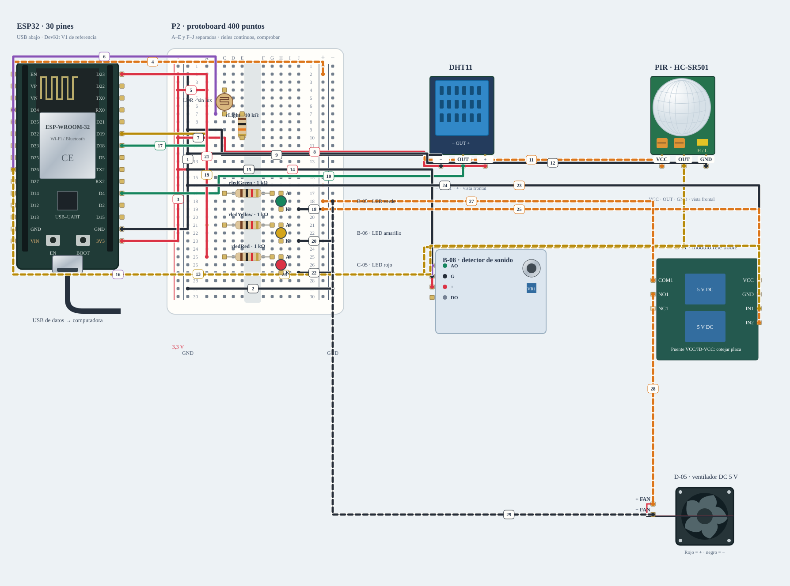

# N2 · Ambiente · sensado y ventilación

Colocar componentes sin USB, después masas, rieles y señales siguiendo los pasos. Revisar los cables discontinuos aparte; el visor no energiza ni carga firmware.

**Propuesta integrada · ensayo conjunto pendiente.** Diseño de referencia, sin ensayo físico nuevo.

[JSON de montaje importable](nodo-ambiente-fisico.json) · [SVG físico](nodo-ambiente-fisico.svg). ESP32 USB abajo; orientación de referencia, cotejar serigrafía. Terminales rotulados por función donde el conector aún no está identificado.

## Materiales

- esp1: A-01 · Adrián · ambiente
- dht1: B-03 · DHT11
- pir1: D-06 · movimiento del aula
- sound1: B-08 · ruido relativo AO
- relay1: B-11 · un canal; resto libre
- fan1: D-05 · ventilador 5 V
- ldr1: Fotoresistencia · una de las disponibles
- rLight: Resistencia 10 kΩ · caracterizar rango ADC
- rledGreen: Resistencia 1 kΩ · una por LED
- ledGreen: B-05 · LED verde
- rledYellow: Resistencia 1 kΩ · una por LED
- ledYellow: B-06 · LED amarillo
- rledRed: Resistencia 1 kΩ · una por LED
- ledRed: C-05 · LED rojo

Cables: 16 M–H + 6 M–M + 4 H–H + 3 potencia. Incluye ramas condicionadas; cantidad y alcance reales por comprobar. Los tres nodos se montan simultáneamente sobre las cuatro protoboards existentes: P1 acceso, P2 ambiente y P3/P4 asistente. No duplicar cantidades de inventario.

## Conexiones funcionales

| Desde | Hasta | Vía | Estado |
|---|---|---|---|
| esp1:GND | bb:LN2 | c1 · M–H | Referencia |
| bb:LN29 | bb:RN29 | c2 · M–M | Referencia |
| esp1:3V3 | bb:LP2 | c3 · M–H | Referencia |
| esp1:VIN | bb:RP2 | c4 · M–H | Pendiente; no conectar |
| bb:LP4 | bb:A4 | c5 · M–M | Referencia |
| esp1:GPIO35 | bb:B7 | c6 · M–H | Referencia |
| bb:A10 | bb:LN10 | c7 · M–M | Referencia |
| bb:LP10 | dht1:VCC | c8 · M–H | Referencia |
| bb:LN9 | dht1:GND | c9 · M–H | Referencia |
| esp1:GPIO4 | dht1:DATA | c10 · H–H | Referencia |
| bb:RP12 | pir1:VCC | c11 · M–H | Pendiente; no conectar |
| bb:LN12 | pir1:GND | c12 · M–H | Referencia |
| esp1:GPIO27 | pir1:OUT | c13 · H–H | Pendiente; no conectar |
| bb:LP14 | sound1:VCC | c14 · M–H | Referencia |
| bb:LN14 | sound1:G | c15 · M–H | Referencia |
| esp1:GPIO34 | sound1:AO | c16 · H–H | Referencia |
| esp1:GPIO18 | bb:A17 | c17 · M–H | Referencia |
| bb:J19 | bb:RN19 | c18 · M–M | Referencia |
| esp1:GPIO19 | bb:A21 | c19 · M–H | Referencia |
| bb:J23 | bb:RN23 | c20 · M–M | Referencia |
| esp1:GPIO23 | bb:A25 | c21 · M–H | Referencia |
| bb:J27 | bb:RN27 | c22 · M–M | Referencia |
| bb:RP16 | relay1:VCC | c23 · M–H | Pendiente; no conectar |
| bb:LN16 | relay1:GND | c24 · M–H | Referencia |
| bb:RP19 | relay1:IN2 | c25 · M–H | Pendiente; no conectar |
| esp1:GPIO26 | relay1:IN1 | c26 · H–H | Pendiente; no conectar |
| bb:RP18 | relay1:COM1 | c27 · potencia | Pendiente; no conectar |
| relay1:NO1 | fan1:PLUS | c28 · potencia | Pendiente; no conectar |
| fan1:MINUS | bb:RN18 | c29 · potencia | Pendiente; no conectar |

## Armado cable por cable · USB desconectado

Montaje integrado propuesto · Ambiente · A-01 · P2. Cuatro protoboards entre los tres nodos; no duplicar inventario. M–M/M–H/H–H admitidos para este diseño; contar disponibilidad y alcance antes de armar. H–H une dos cabeceras macho. LP=3,3 V, RP=5 V condicionado, LN/RN=GND local. Alimentación USB propia; no unir fuentes de nodos distintos. Cables pendientes visibles como discontinuos; no colocar ni energizar esas ramas hasta resolver su condición.

| Nº | Color | Tipo | Origen | Destino | Condición |
|---|---|---|---|---|---|
| 1 | black | M–H | esp1:GND | bb:LN2 | 1. Masa común del nodo · M–H · esp1 · GND → P · LN2 · USB desconectado. |
| 2 | black | M–M | bb:LN29 | bb:RN29 | 2. Unir solo los dos rieles negativos · M–M · P · LN29 → P · RN29 · USB desconectado. |
| 3 | red | M–H | esp1:3V3 | bb:LP2 | 3. Riel positivo izquierdo: 3,3 V · M–H · esp1 · 3V3 → P · LP2 · USB desconectado. |
| 4 | orange | M–H | esp1:VIN | bb:RP2 | NO conectar: Confirmar ruta USB–VIN y capacidad de corriente de esta placa antes de conectar 5 V. |
| 5 | red | M–M | bb:LP4 | bb:A4 | 5. Divisor LDR: extremo superior a 3,3 V · M–M · P · LP4 → P · A4 · USB desconectado. |
| 6 | purple | M–H | esp1:GPIO35 | bb:B7 | 6. Unión LDR/resistencia hacia ADC1 GPIO35 · M–H · esp1 · GPIO 35 → P · B7 · USB desconectado. |
| 7 | black | M–M | bb:A10 | bb:LN10 | 7. Divisor LDR: resistencia a GND · M–M · P · A10 → P · LN10 · USB desconectado. |
| 8 | red | M–H | bb:LP10 | dht1:VCC | 8. Alimentar dht1 a 3.3 V · M–H · P · LP10 → dht1 · VCC · USB desconectado. |
| 9 | black | M–H | bb:LN9 | dht1:GND | 9. Retorno de dht1 · M–H · P · LN9 → dht1 · GND · USB desconectado. |
| 10 | green | H–H | esp1:GPIO4 | dht1:DATA | 10. DHT11 · OUT con pull-up del módulo hacia 3,3 V · H–H · esp1 · GPIO 4 → dht1 · DATA · USB desconectado. |
| 11 | orange | M–H | bb:RP12 | pir1:VCC | NO conectar: Verificar alimentación y salida del PIR D-06. |
| 12 | black | M–H | bb:LN12 | pir1:GND | 12. Retorno de pir1 · M–H · P · LN12 → pir1 · GND · USB desconectado. |
| 13 | yellow | H–H | esp1:GPIO27 | pir1:OUT | NO conectar: Cotejar nivel de OUT del PIR. |
| 14 | red | M–H | bb:LP14 | sound1:VCC | 14. Alimentar sound1 a 3.3 V · M–H · P · LP14 → sound1 · VCC · USB desconectado. |
| 15 | black | M–H | bb:LN14 | sound1:G | 15. Retorno de sound1 · M–H · P · LN14 → sound1 · G · USB desconectado. |
| 16 | purple | H–H | esp1:GPIO34 | sound1:AO | 16. Ruido relativo · AO34; DO sin cable · H–H · esp1 · GPIO 34 → sound1 · AO · USB desconectado. |
| 17 | green | M–H | esp1:GPIO18 | bb:A17 | 17. B-05 · LED verde: control con resistencia en serie · M–H · esp1 · GPIO 18 → P · A17 · USB desconectado. |
| 18 | black | M–M | bb:J19 | bb:RN19 | 18. B-05 · LED verde: cátodo a GND · M–M · P · J19 → P · RN19 · USB desconectado. |
| 19 | yellow | M–H | esp1:GPIO19 | bb:A21 | 19. B-06 · LED amarillo: control con resistencia en serie · M–H · esp1 · GPIO 19 → P · A21 · USB desconectado. |
| 20 | black | M–M | bb:J23 | bb:RN23 | 20. B-06 · LED amarillo: cátodo a GND · M–M · P · J23 → P · RN23 · USB desconectado. |
| 21 | red | M–H | esp1:GPIO23 | bb:A25 | 21. C-05 · LED rojo: control con resistencia en serie · M–H · esp1 · GPIO 23 → P · A25 · USB desconectado. |
| 22 | black | M–M | bb:J27 | bb:RN27 | 22. C-05 · LED rojo: cátodo a GND · M–M · P · J27 → P · RN27 · USB desconectado. |
| 23 | orange | M–H | bb:RP16 | relay1:VCC | NO conectar: Confirmar ruta USB–VIN y capacidad de corriente de esta placa antes de conectar 5 V. |
| 24 | black | M–H | bb:LN16 | relay1:GND | 24. Retorno de relay1 · M–H · P · LN16 → relay1 · GND · USB desconectado. |
| 25 | orange | M–H | bb:RP19 | relay1:IN2 | NO conectar: Solo para la variante LOW-trigger ya identificada; confirmar IN2 y jumper. |
| 26 | yellow | H–H | esp1:GPIO26 | relay1:IN1 | NO conectar: Verificar compatibilidad 3,3 V, jumper, polaridad y estado OFF del relé. |
| 27 | orange | potencia | bb:RP18 | relay1:COM1 | NO conectar: Capacidad USB, arranque y cableado de potencia por verificar. |
| 28 | orange | potencia | relay1:NO1 | fan1:PLUS | NO conectar: No habilitar hasta validar fuente y corriente del fan. |
| 29 | black | potencia | fan1:MINUS | bb:RN18 | NO conectar: Retorno de potencia por verificar. |

H–H: dos cabeceras macho directamente. M–H: cabecera macho hacia agujero de protoboard. M–M: dos agujeros. Los cables discontinuos NO se colocan hasta resolver su condición. Nunca dos puntas en un agujero.

LP/LN: riel izquierdo +/−; RP/RN: derecho +/−. A–E y F–J son tiras separadas por fila. Confirmar continuidad/cortes de la protoboard real; los rieles opuestos no están unidos. Patas colocadas: ldr1 (Fotoresistencia · una de las disponibles): 1→bb:C4, 2→bb:C7; rLight (Resistencia 10 kΩ · caracterizar rango ADC): 1→bb:E7, 2→bb:E10; rledGreen (Resistencia 1 kΩ · una por LED): 1→bb:C17, 2→bb:G17; ledGreen (B-05 · LED verde): A→bb:H17, K→bb:H19; rledYellow (Resistencia 1 kΩ · una por LED): 1→bb:C21, 2→bb:G21; ledYellow (B-06 · LED amarillo): A→bb:H21, K→bb:H23; rledRed (Resistencia 1 kΩ · una por LED): 1→bb:C25, 2→bb:G25; ledRed (C-05 · LED rojo): A→bb:H25, K→bb:H27.

Cruces no unen redes. Las condiciones de cada tramo aparecen en esta tabla; un cable por verificar no cuenta como continuidad confirmada aunque se dibuje continuo. Colores son identificadores del dibujo: elegir cables reales y anotar equivalencias. SVG no demuestra alcance físico.

## Antes de energizar

1. Reidentificar placa, puerto y respaldo antes de cargar. E-01 requiere cotejar pinout real de 38 contactos.
2. H–H autorizados para la propuesta; cantidad, longitud y recepción concreta sin contar.
3. 5 V USB, niveles y capacidad de matriz/relé/amplificador por validar; bloques de adaptación no son material recibido.
4. Dos LDR en total, una en ambiente y otra en asistente; no medir lux sin calibración.

Revisar agujero por agujero con USB retirado, polaridad y separación de fuentes. Sin multímetro, identificar por etiquetas y documentación exacta; una tensión o pin dudoso se mantiene desconectado. VIN no garantiza salida regulada de 5 V.

Firmware: firmware/classai_multinode · CLASSAI_ROLE=2; scripts/ci/multinode-build.sh. Sin carga automática.

## Preparar firmware

Perfil CLASSAI_ROLE=2; ejecutar desde raíz `scripts/ci/multinode-build.sh` para compilar con ejemplos sin cargar. Para binario propio, consultar [tres nodos](../tres-nodos.md) y preparar CA/credenciales privadas, biblioteca PN532 y FQBN de la placa real. No usar puerto histórico ni abrir monitor sobre el audio USB.

## Prueba guiada y fallos

Acción: Colocar componentes sin USB, después masas, rieles y señales siguiendo los pasos. Revisar los cables discontinuos aparte; el visor no energiza ni carga firmware.

Aprobación esperada: Montaje coherente con el perfil, sin redes de 3,3/5 V unidas y con ramas condicionadas sin habilitar. Después realizar el ensayo físico conjunto.

Diagnóstico: Ante fallo: stop/desarmar, retirar USB y cotejar extremo/etiqueta/red. No usar el dibujo como medición de tensión.

Conflictos: Roles en placas separadas; USB propio, MQTT común. No unir las salidas de alimentación entre nodos. Las conexiones discontinuas requieren resolver su condición antes de colocarlas.

Faltantes/confirmaciones:
- Reidentificar placa, puerto y respaldo antes de cargar. E-01 requiere cotejar pinout real de 38 contactos.
- H–H autorizados para la propuesta; cantidad, longitud y recepción concreta sin contar.
- 5 V USB, niveles y capacidad de matriz/relé/amplificador por validar; bloques de adaptación no son material recibido.
- Dos LDR en total, una en ambiente y otra en asistente; no medir lux sin calibración.

## Registro de resultado

| Etapa | Resultado observado | Evidencia |
|---|---|---|
| Diseño | Referencia física; conservar condiciones | SVG/JSON y guía |
| Compilación | Consultar [resultados de esta entrega](../bancos-fisicos.md); no inferir PASS del comando | Log y tamaños por perfil |
| Simulación nueva | No ejecutada | — |
| Ensayo físico nuevo | Pendiente | Completar acción, salida, reinicios y evidencia tras ensayo |
| Desmontaje | Pendiente | Registrar qué cables/piezas quedan conectados |

[Índice](README.md). Generado desde missions.ts y sus registros físicos mediante web/scripts/export-hardware-missions.mjs.
