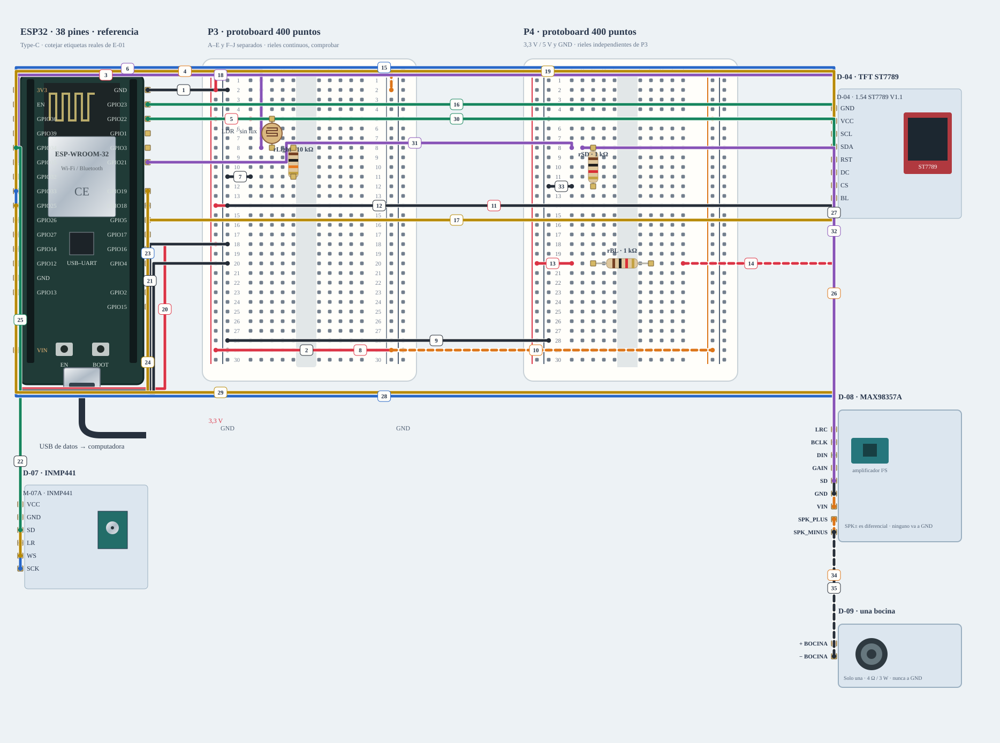

# N3 · Asistente · pantalla y audio

Colocar componentes sin USB, después masas, rieles y señales siguiendo los pasos. Revisar los cables discontinuos aparte; el visor no energiza ni carga firmware.

**Propuesta integrada · ensayo conjunto pendiente.** Diseño de referencia, sin ensayo físico nuevo.

[JSON de montaje importable](nodo-asistente-fisico.json) · [SVG físico](nodo-asistente-fisico.svg). ESP32 USB abajo; orientación de referencia, cotejar serigrafía. Terminales rotulados por función donde el conector aún no está identificado.

## Materiales

- esp1: E-01 · Joaquín · Type-C 38 pines
- p4: Segunda protoboard · audio y potencia
- tft1: D-04 · TFT ST7789
- mic1: D-07 · INMP441
- amp1: D-08 · MAX98357A
- speaker1: D-09 · una bocina
- rSD: Pull-down SD · 1 kΩ
- ldr1: Fotoresistencia · una de las disponibles
- rLight: Resistencia 10 kΩ · caracterizar rango ADC
- rBL: BL TFT · 1 kΩ en serie

Cables: 14 M–H + 8 M–M + 11 H–H + 2 altavoz. Incluye ramas condicionadas; cantidad y alcance reales por comprobar. Los tres nodos se montan simultáneamente sobre las cuatro protoboards existentes: P1 acceso, P2 ambiente y P3/P4 asistente. No duplicar cantidades de inventario.

## Conexiones funcionales

| Desde | Hasta | Vía | Estado |
|---|---|---|---|
| esp1:GND | bb:LN2 | c1 · M–H | Referencia |
| bb:LN29 | bb:RN29 | c2 · M–M | Referencia |
| esp1:3V3 | bb:LP2 | c3 · M–H | Referencia |
| esp1:VIN | bb:RP2 | c4 · M–H | Pendiente; no conectar |
| bb:LP5 | bb:A5 | c5 · M–M | Referencia |
| esp1:GPIO35 | bb:B8 | c6 · M–H | Referencia |
| bb:A11 | bb:LN11 | c7 · M–M | Referencia |
| bb:LP29 | p4:LP29 | c8 · M–M | Referencia |
| bb:LN28 | p4:LN28 | c9 · M–M | Referencia |
| bb:RP29 | p4:RP29 | c10 · M–M | Pendiente; no conectar |
| bb:LP14 | tft1:VCC | c11 · M–H | Referencia |
| bb:LN14 | tft1:GND | c12 · M–H | Referencia |
| p4:LP20 | p4:A20 | c13 · M–M | Referencia |
| p4:J20 | tft1:BL | c14 · M–H | Pendiente; no conectar |
| esp1:GPIO14 | tft1:SCL | c15 · H–H | Referencia |
| esp1:GPIO23 | tft1:SDA | c16 · H–H | Referencia |
| esp1:GPIO5 | tft1:CS | c17 · H–H | Referencia |
| esp1:GPIO27 | tft1:DC | c18 · H–H | Referencia |
| esp1:GPIO26 | tft1:RST | c19 · H–H | Referencia |
| bb:LP18 | mic1:VCC | c20 · M–H | Referencia |
| bb:LN18 | mic1:GND | c21 · M–H | Referencia |
| bb:LN20 | mic1:LR | c22 · M–H | Referencia |
| esp1:GPIO18 | mic1:SCK | c23 · H–H | Referencia |
| esp1:GPIO19 | mic1:WS | c24 · H–H | Referencia |
| esp1:GPIO34 | mic1:SD | c25 · H–H | Referencia |
| p4:RP5 | amp1:VIN | c26 · M–H | Pendiente; no conectar |
| p4:LN5 | amp1:GND | c27 · M–H | Referencia |
| esp1:GPIO33 | amp1:BCLK | c28 · H–H | Referencia |
| esp1:GPIO25 | amp1:LRC | c29 · H–H | Referencia |
| esp1:GPIO22 | amp1:DIN | c30 · H–H | Referencia |
| esp1:GPIO21 | p4:A8 | c31 · M–H | Referencia |
| p4:B8 | amp1:SD | c32 · M–H | Referencia |
| p4:A12 | p4:LN12 | c33 · M–M | Referencia |
| amp1:SPK_PLUS | speaker1:PLUS | c34 · altavoz | Pendiente; no conectar |
| amp1:SPK_MINUS | speaker1:MINUS | c35 · altavoz | Pendiente; no conectar |

## Armado cable por cable · USB desconectado

Montaje integrado propuesto · Asistente · E-01 · P3/P4. Cuatro protoboards entre los tres nodos; no duplicar inventario. M–M/M–H/H–H admitidos para este diseño; contar disponibilidad y alcance antes de armar. H–H une dos cabeceras macho. LP=3,3 V, RP=5 V condicionado, LN/RN=GND local. Alimentación USB propia; no unir fuentes de nodos distintos. Cables pendientes visibles como discontinuos; no colocar ni energizar esas ramas hasta resolver su condición.

| Nº | Color | Tipo | Origen | Destino | Condición |
|---|---|---|---|---|---|
| 1 | black | M–H | esp1:GND | bb:LN2 | 1. Masa común del nodo · M–H · esp1 · GND → P · LN2 · USB desconectado. |
| 2 | black | M–M | bb:LN29 | bb:RN29 | 2. Unir solo los dos rieles negativos · M–M · P · LN29 → P · RN29 · USB desconectado. |
| 3 | red | M–H | esp1:3V3 | bb:LP2 | 3. Riel positivo izquierdo: 3,3 V · M–H · esp1 · 3V3 → P · LP2 · USB desconectado. |
| 4 | orange | M–H | esp1:VIN | bb:RP2 | NO conectar: Confirmar ruta USB–VIN y capacidad de corriente de esta placa antes de conectar 5 V. |
| 5 | red | M–M | bb:LP5 | bb:A5 | 5. Divisor LDR: extremo superior a 3,3 V · M–M · P · LP5 → P · A5 · USB desconectado. |
| 6 | purple | M–H | esp1:GPIO35 | bb:B8 | 6. Unión LDR/resistencia hacia ADC1 GPIO35 · M–H · esp1 · GPIO 35 → P · B8 · USB desconectado. |
| 7 | black | M–M | bb:A11 | bb:LN11 | 7. Divisor LDR: resistencia a GND · M–M · P · A11 → P · LN11 · USB desconectado. |
| 8 | red | M–M | bb:LP29 | p4:LP29 | 8. Llevar 3,3 V desde P3 a P4 · M–M · P · LP29 → p4 · LP29 · USB desconectado. |
| 9 | black | M–M | bb:LN28 | p4:LN28 | 9. Masa P3/P4 del mismo nodo · M–M · P · LN28 → p4 · LN28 · USB desconectado. |
| 10 | orange | M–M | bb:RP29 | p4:RP29 | NO conectar: Confirmar ruta USB–VIN y capacidad de corriente de esta placa antes de conectar 5 V. |
| 11 | red | M–H | bb:LP14 | tft1:VCC | 11. Alimentar tft1 a 3.3 V · M–H · P · LP14 → tft1 · VCC · USB desconectado. |
| 12 | black | M–H | bb:LN14 | tft1:GND | 12. Retorno de tft1 · M–H · P · LN14 → tft1 · GND · USB desconectado. |
| 13 | red | M–M | p4:LP20 | p4:A20 | 13. Retroiluminación TFT: entrada a resistencia de 1 kΩ · M–M · p4 · LP20 → p4 · A20 · USB desconectado. |
| 14 | red | M–H | p4:J20 | tft1:BL | NO conectar: Confirmar conexión BL de esta variante; no puentear la resistencia por ensayo/error. |
| 15 | blue | H–H | esp1:GPIO14 | tft1:SCL | 15. TFT SPI · SCL · H–H · esp1 · GPIO 14 → tft1 · SCL · USB desconectado. |
| 16 | green | H–H | esp1:GPIO23 | tft1:SDA | 16. TFT SPI · SDA · H–H · esp1 · GPIO 23 → tft1 · SDA · USB desconectado. |
| 17 | yellow | H–H | esp1:GPIO5 | tft1:CS | 17. TFT SPI · CS · H–H · esp1 · GPIO 5 → tft1 · CS · USB desconectado. |
| 18 | purple | H–H | esp1:GPIO27 | tft1:DC | 18. TFT SPI · DC · H–H · esp1 · GPIO 27 → tft1 · DC · USB desconectado. |
| 19 | yellow | H–H | esp1:GPIO26 | tft1:RST | 19. TFT SPI · RST · H–H · esp1 · GPIO 26 → tft1 · RST · USB desconectado. |
| 20 | red | M–H | bb:LP18 | mic1:VCC | 20. Alimentar mic1 a 3.3 V · M–H · P · LP18 → mic1 · VCC · USB desconectado. |
| 21 | black | M–H | bb:LN18 | mic1:GND | 21. Retorno de mic1 · M–H · P · LN18 → mic1 · GND · USB desconectado. |
| 22 | black | M–H | bb:LN20 | mic1:LR | 22. Fijar micrófono en canal izquierdo · M–H · P · LN20 → mic1 · LR · USB desconectado. |
| 23 | blue | H–H | esp1:GPIO18 | mic1:SCK | 23. Micrófono I²S0 · SCK · H–H · esp1 · GPIO 18 → mic1 · SCK · USB desconectado. |
| 24 | yellow | H–H | esp1:GPIO19 | mic1:WS | 24. Micrófono I²S0 · WS · H–H · esp1 · GPIO 19 → mic1 · WS · USB desconectado. |
| 25 | green | H–H | esp1:GPIO34 | mic1:SD | 25. Micrófono I²S0 · SD · H–H · esp1 · GPIO 34 → mic1 · SD · USB desconectado. |
| 26 | orange | M–H | p4:RP5 | amp1:VIN | NO conectar: Confirmar ruta USB–VIN y capacidad de corriente de esta placa antes de conectar 5 V. |
| 27 | black | M–H | p4:LN5 | amp1:GND | 27. Retorno de amp1 · M–H · p4 · LN5 → amp1 · GND · USB desconectado. |
| 28 | blue | H–H | esp1:GPIO33 | amp1:BCLK | 28. Bocina I²S1 · BCLK · H–H · esp1 · GPIO 33 → amp1 · BCLK · USB desconectado. |
| 29 | yellow | H–H | esp1:GPIO25 | amp1:LRC | 29. Bocina I²S1 · LRC · H–H · esp1 · GPIO 25 → amp1 · LRC · USB desconectado. |
| 30 | green | H–H | esp1:GPIO22 | amp1:DIN | 30. Bocina I²S1 · DIN · H–H · esp1 · GPIO 22 → amp1 · DIN · USB desconectado. |
| 31 | purple | M–H | esp1:GPIO21 | p4:A8 | 31. Control SD21 y pull-down · M–H · esp1 · GPIO 21 → p4 · A8 · USB desconectado. |
| 32 | purple | M–H | p4:B8 | amp1:SD | 32. Unión SD21/pull-down hacia SD del amplificador · M–H · p4 · B8 → amp1 · SD · USB desconectado. |
| 33 | black | M–M | p4:A12 | p4:LN12 | 33. Pull-down SD hacia masa · M–M · p4 · A12 → p4 · LN12 · USB desconectado. |
| 34 | orange | altavoz | amp1:SPK_PLUS | speaker1:PLUS | NO conectar: Revisar bornera y una sola bocina antes de armar. |
| 35 | black | altavoz | amp1:SPK_MINUS | speaker1:MINUS | NO conectar: No conectar SPK− a masa. |

H–H: dos cabeceras macho directamente. M–H: cabecera macho hacia agujero de protoboard. M–M: dos agujeros. Los cables discontinuos NO se colocan hasta resolver su condición. Nunca dos puntas en un agujero.

LP/LN: riel izquierdo +/−; RP/RN: derecho +/−. A–E y F–J son tiras separadas por fila. Confirmar continuidad/cortes de la protoboard real; los rieles opuestos no están unidos. Patas colocadas: rSD (Pull-down SD · 1 kΩ): 1→p4:C8, 2→p4:C12; ldr1 (Fotoresistencia · una de las disponibles): 1→bb:C5, 2→bb:C8; rLight (Resistencia 10 kΩ · caracterizar rango ADC): 1→bb:E8, 2→bb:E11; rBL (BL TFT · 1 kΩ en serie): 1→p4:C20, 2→p4:G20.

Cruces no unen redes. Las condiciones de cada tramo aparecen en esta tabla; un cable por verificar no cuenta como continuidad confirmada aunque se dibuje continuo. Colores son identificadores del dibujo: elegir cables reales y anotar equivalencias. SVG no demuestra alcance físico.

## Antes de energizar

1. Reidentificar placa, puerto y respaldo antes de cargar. E-01 requiere cotejar pinout real de 38 contactos.
2. H–H autorizados para la propuesta; cantidad, longitud y recepción concreta sin contar.
3. 5 V USB, niveles y capacidad de matriz/relé/amplificador por validar; bloques de adaptación no son material recibido.
4. Dos LDR en total, una en ambiente y otra en asistente; no medir lux sin calibración.

Revisar agujero por agujero con USB retirado, polaridad y separación de fuentes. Sin multímetro, identificar por etiquetas y documentación exacta; una tensión o pin dudoso se mantiene desconectado. VIN no garantiza salida regulada de 5 V.

Firmware: firmware/classai_multinode · CLASSAI_ROLE=3; scripts/ci/multinode-build.sh. Sin carga automática.

## Preparar firmware

Perfil CLASSAI_ROLE=3; ejecutar desde raíz `scripts/ci/multinode-build.sh` para compilar con ejemplos sin cargar. Para binario propio, consultar [tres nodos](../tres-nodos.md) y preparar CA/credenciales privadas, biblioteca PN532 y FQBN de la placa real. No usar puerto histórico ni abrir monitor sobre el audio USB.

## Prueba guiada y fallos

Acción: Colocar componentes sin USB, después masas, rieles y señales siguiendo los pasos. Revisar los cables discontinuos aparte; el visor no energiza ni carga firmware.

Aprobación esperada: Montaje coherente con el perfil, sin redes de 3,3/5 V unidas y con ramas condicionadas sin habilitar. Después realizar el ensayo físico conjunto.

Diagnóstico: Ante fallo: stop/desarmar, retirar USB y cotejar extremo/etiqueta/red. No usar el dibujo como medición de tensión.

Conflictos: Roles en placas separadas; USB propio, MQTT común. No unir las salidas de alimentación entre nodos. Las conexiones discontinuas requieren resolver su condición antes de colocarlas.

Faltantes/confirmaciones:
- Reidentificar placa, puerto y respaldo antes de cargar. E-01 requiere cotejar pinout real de 38 contactos.
- H–H autorizados para la propuesta; cantidad, longitud y recepción concreta sin contar.
- 5 V USB, niveles y capacidad de matriz/relé/amplificador por validar; bloques de adaptación no son material recibido.
- Dos LDR en total, una en ambiente y otra en asistente; no medir lux sin calibración.

## Registro de resultado

| Etapa | Resultado observado | Evidencia |
|---|---|---|
| Diseño | Referencia física; conservar condiciones | SVG/JSON y guía |
| Compilación | Consultar [resultados de esta entrega](../bancos-fisicos.md); no inferir PASS del comando | Log y tamaños por perfil |
| Simulación nueva | No ejecutada | — |
| Ensayo físico nuevo | Pendiente | Completar acción, salida, reinicios y evidencia tras ensayo |
| Desmontaje | Pendiente | Registrar qué cables/piezas quedan conectados |

[Índice](README.md). Generado desde missions.ts y sus registros físicos mediante web/scripts/export-hardware-missions.mjs.
