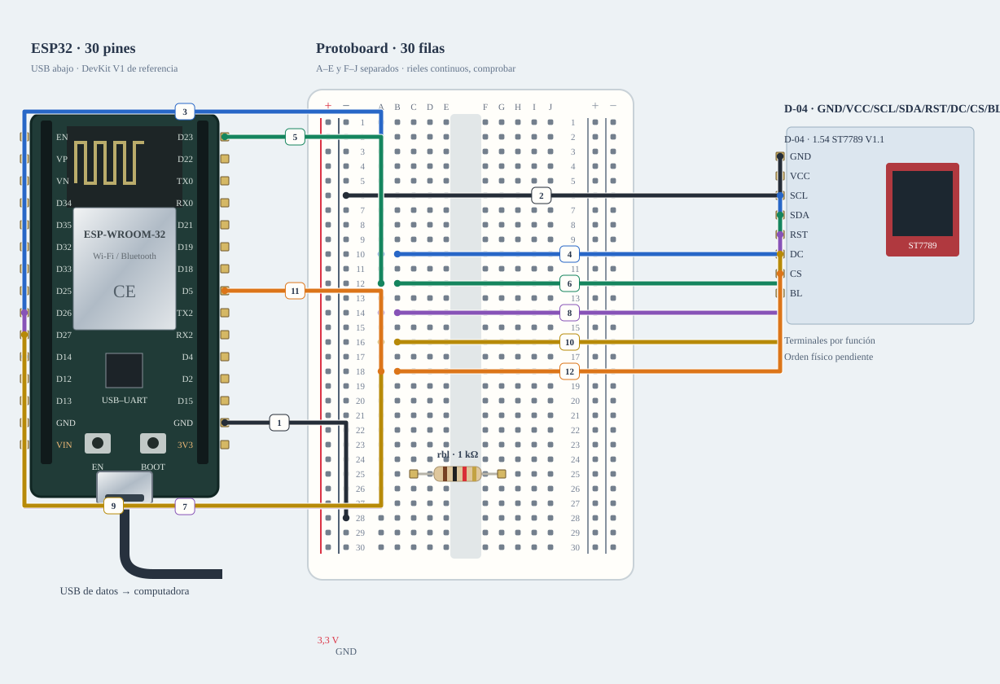

# M-02 · Pantalla · mascota

Enviar arm y pattern; probar rot0/rot1/rot2/rot3. stop apaga el contenido y desarma.

**Diseño y sketch · ensayo físico pendiente.** Diseño de referencia, sin ensayo físico nuevo.



[JSON de montaje importable](pantalla-fisico.json) · [SVG físico](pantalla-fisico.svg). ESP32 USB abajo; orientación de referencia, cotejar serigrafía. Terminales rotulados por función donde el conector aún no está identificado.

## Materiales

- esp1: A-01 · identificar antes de cargar
- tft1: D-04 · GND/VCC/SCL/SDA/RST/DC/CS/BL
- rbl: C-01 · 1 kΩ para BL

Cables: 15 M–H + 1 M–M dibujados; cero H–H. Se reutilizan entre bancos; no se exige montarlos todos simultáneamente. Preservar B-02/NFC; comprobar material libre en la otra placa.

## Conexiones funcionales

| Desde | Hasta | Vía | Estado |
|---|---|---|---|
| ESP32 · GND | Protoboard · LN28 | c1 · M–H | Referencia |
| Protoboard · LN6 | TFT · GND | c2 · M–H | Referencia |
| ESP32 · 3V3 | Protoboard · LP28 | c3 · M–H | Referencia |
| Protoboard · LP8 | TFT · VCC | c4 · M–H | Referencia |
| Protoboard · LP25 | Protoboard · A25 | c5 · M–M | Referencia |
| Protoboard · J25 | TFT · BL | c6 · M–H | Referencia |
| ESP32 · GPIO14 | Protoboard · A10 | c7 · M–H | Referencia |
| Protoboard · B10 | TFT · SCL | c8 · M–H | Referencia |
| ESP32 · GPIO23 | Protoboard · A12 | c9 · M–H | Referencia |
| Protoboard · B12 | TFT · SDA | c10 · M–H | Referencia |
| ESP32 · GPIO26 | Protoboard · A14 | c11 · M–H | Referencia |
| Protoboard · B14 | TFT · RST | c12 · M–H | Referencia |
| ESP32 · GPIO27 | Protoboard · A16 | c13 · M–H | Referencia |
| Protoboard · B16 | TFT · DC | c14 · M–H | Referencia |
| ESP32 · GPIO5 | Protoboard · A18 | c15 · M–H | Referencia |
| Protoboard · B18 | TFT · CS | c16 · M–H | Referencia |

## Armado cable por cable · USB desconectado

Referencia física, sin escala métrica. USB desconectado al armar. Usar A-01 solo tras identificar placa/puerto y preservar respaldo; B-02/NFC permanece conservado. Cables reutilizados entre ensayos; cero H–H.

| Nº | Color | Tipo | Origen | Destino | Condición |
|---|---|---|---|---|---|
| 1 | black | M–H | esp1:GND | bb:LN28 | Cable 1 · M–H · esp1:GND → bb:LN28. Conectar sin USB; comprobar etiquetas y agujeros. |
| 2 | black | M–H | bb:LN6 | tft1:GND | Cable 2 · M–H · bb:LN6 → tft1:GND. Conectar sin USB; comprobar etiquetas y agujeros. |
| 3 | red | M–H | esp1:3V3 | bb:LP28 | Cable 3 · M–H · esp1:3V3 → bb:LP28. Conectar sin USB; comprobar etiquetas y agujeros. |
| 4 | red | M–H | bb:LP8 | tft1:VCC | Cable 4 · M–H · bb:LP8 → tft1:VCC. Conectar sin USB; comprobar etiquetas y agujeros. |
| 5 | red | M–M | bb:LP25 | bb:A25 | Cable 5 · M–M · bb:LP25 → bb:A25. Conectar sin USB; comprobar etiquetas y agujeros. |
| 6 | red | M–H | bb:J25 | tft1:BL | Cable 6 · M–H · bb:J25 → tft1:BL. Conectar sin USB; comprobar etiquetas y agujeros. |
| 7 | blue | M–H | esp1:GPIO14 | bb:A10 | Cable 7 · M–H · esp1:GPIO14 → bb:A10. Conectar sin USB; comprobar etiquetas y agujeros. |
| 8 | blue | M–H | bb:B10 | tft1:SCL | Cable 8 · M–H · bb:B10 → tft1:SCL. Conectar sin USB; comprobar etiquetas y agujeros. |
| 9 | green | M–H | esp1:GPIO23 | bb:A12 | Cable 9 · M–H · esp1:GPIO23 → bb:A12. Conectar sin USB; comprobar etiquetas y agujeros. |
| 10 | green | M–H | bb:B12 | tft1:SDA | Cable 10 · M–H · bb:B12 → tft1:SDA. Conectar sin USB; comprobar etiquetas y agujeros. |
| 11 | purple | M–H | esp1:GPIO26 | bb:A14 | Cable 11 · M–H · esp1:GPIO26 → bb:A14. Conectar sin USB; comprobar etiquetas y agujeros. |
| 12 | purple | M–H | bb:B14 | tft1:RST | Cable 12 · M–H · bb:B14 → tft1:RST. Conectar sin USB; comprobar etiquetas y agujeros. |
| 13 | yellow | M–H | esp1:GPIO27 | bb:A16 | Cable 13 · M–H · esp1:GPIO27 → bb:A16. Conectar sin USB; comprobar etiquetas y agujeros. |
| 14 | yellow | M–H | bb:B16 | tft1:DC | Cable 14 · M–H · bb:B16 → tft1:DC. Conectar sin USB; comprobar etiquetas y agujeros. |
| 15 | orange | M–H | esp1:GPIO5 | bb:A18 | Cable 15 · M–H · esp1:GPIO5 → bb:A18. Conectar sin USB; comprobar etiquetas y agujeros. |
| 16 | orange | M–H | bb:B18 | tft1:CS | Cable 16 · M–H · bb:B18 → tft1:CS. Conectar sin USB; comprobar etiquetas y agujeros. |

M–H: hembra al conector macho del módulo/ESP32 y macho al agujero. M–M: ambos extremos en agujeros distintos. Nunca dos puntas en un agujero.

LP/LN: riel izquierdo +/−; RP/RN: derecho +/−. A–E y F–J son tiras separadas por fila. Confirmar continuidad/cortes de la protoboard real; los rieles opuestos no están unidos. Patas colocadas: rbl (C-01 · 1 kΩ para BL): 1→C25, 2→G25.

Cruces no unen redes. Las condiciones de cada tramo aparecen en esta tabla; un cable por verificar no cuenta como continuidad confirmada aunque se dibuje continuo. Colores son identificadores del dibujo: elegir cables reales y anotar equivalencias. SVG no demuestra alcance físico.

## Antes de energizar

1. A-01/puerto identificados y respaldo privado preservado; B-02/NFC conservado.
2. Confirmar VCC/BL reales y presupuesto USB/3V3. R de 1 kΩ limita BL; tenue no significa panel averiado.
3. Cabecera con orden GND/VCC/SCL/SDA/RST/DC/CS/BL reportado; cotejar cara/orientación. SPI SCL/SDA no es I²C.
4. Banco de patrón mínimo separado de la mascota de Lando; no inicializa audio, NFC, relé ni PIR.

Revisar agujero por agujero con USB retirado, polaridad y separación de fuentes. Sin multímetro, identificar por etiquetas y documentación exacta; una tensión o pin dudoso se mantiene desconectado. VIN no garantiza salida regulada de 5 V.

Firmware: firmware/display_bench; compilar sin carga; Serial 115200. Ver guía física.

## Compilar y cargar manualmente

Arduino CLI 1.5.1, ESP32 core 3.3.12; DHT sensor library 1.4.7 y Adafruit Unified Sensor 1.1.15 solo si el perfil utiliza DHT11. Actuadores usan ClassAIBench local y pantalla Adafruit GFX 1.12.6 + ST7735/ST7789 1.12.0.

```sh
arduino-cli compile --libraries firmware/libraries --fqbn esp32:esp32:esp32doit-devkit-v1 --jobs 2 --output-dir /tmp/classai-pantalla-build firmware/display_bench
```

Antes de cargar: identificar A-01 y puerto explícito, comprobar su FQBN, registrar cableado real y conservar respaldo privado verificado. Desconectar módulos ajenos y cerrar cualquier monitor. Solo después de resolver TODOS los pendientes eléctricos de esta receta:

```sh
# Sustituir PUERTO_A01 por el puerto reidentificado; no usar el de B-02/NFC.
arduino-cli upload --fqbn esp32:esp32:esp32doit-devkit-v1 --port PUERTO_A01 --input-dir /tmp/classai-pantalla-build firmware/display_bench
arduino-cli monitor --port PUERTO_A01 --config baudrate=115200
```

Cargar utiliza el binario del perfil recién compilado; no recompilar otro perfil entre compile/upload. Abrir Serial puede reiniciar la placa. No se ejecutaron estos comandos de carga/monitor durante esta entrega.

## Prueba guiada y fallos

Acción: Enviar arm y pattern; probar rot0/rot1/rot2/rot3. stop apaga el contenido y desarma.

Aprobación esperada: Franjas RGB, texto y borde legibles en 240×240; orientación ajustable. No valida mascota ni integración.

Diagnóstico: Enviar stop ante un fallo. Desconectar ambas fuentes antes de revisar cada extremo, polaridad, masa común y material faltante; no cambiar pines en caliente.

Conflictos: 5, 23, 26, 27 y bus SPI se solapan con otras recetas.

Faltantes/confirmaciones:
- A-01/puerto identificados y respaldo privado preservado; B-02/NFC conservado.
- Confirmar VCC/BL reales y presupuesto USB/3V3. R de 1 kΩ limita BL; tenue no significa panel averiado.
- Cabecera con orden GND/VCC/SCL/SDA/RST/DC/CS/BL reportado; cotejar cara/orientación. SPI SCL/SDA no es I²C.
- Banco de patrón mínimo separado de la mascota de Lando; no inicializa audio, NFC, relé ni PIR.

## Registro de resultado

| Etapa | Resultado observado | Evidencia |
|---|---|---|
| Diseño | Referencia física; conservar condiciones | SVG/JSON y guía |
| Compilación | Consultar [resultados de esta entrega](../bancos-fisicos.md); no inferir PASS del comando | Log y tamaños por perfil |
| Simulación nueva | No ejecutada | — |
| Ensayo físico nuevo | Pendiente | Completar acción, salida, reinicios y evidencia tras ensayo |
| Desmontaje | Pendiente | Registrar qué cables/piezas quedan conectados |

- [Espressif · ESP32](https://www.espressif.com/sites/default/files/documentation/esp32_datasheet_en.pdf)
- [Material de la U y criterios de armado](https://github.com/joaquinsalinas06/ClassAI/blob/codex/physical-benches/docs/hardware/circuitos-referencia.md)

[Índice](README.md). Generado desde missions.ts y sus registros físicos mediante web/scripts/export-hardware-missions.mjs.
