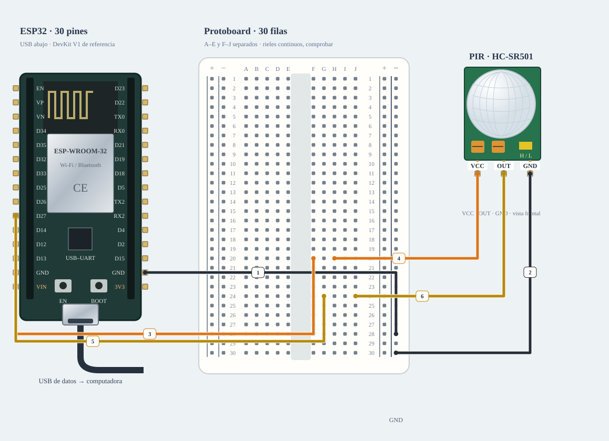

# M-05 · PIR aislado

Ensayo PIR aislado sin inicializar el otro sensor.

**Montaje parcial · no conectar cables marcados.** Diseño de referencia, sin ensayo físico nuevo.



[JSON de montaje importable](pir-fisico.json) · [SVG físico](pir-fisico.svg). ESP32 USB abajo; orientación de referencia, cotejar serigrafía. Terminales rotulados por función donde el conector aún no está identificado.

## Materiales

- B-04 o D-06: un PIR identificado
- Protoboard y jumpers recibidos
- Fuente compatible pendiente

Cables: 6 M–H + 0 M–M dibujados; cero H–H. Se reutilizan entre bancos; no se exige montarlos todos simultáneamente. Preservar B-02/NFC; comprobar material libre en la otra placa.

## Conexiones funcionales

| Desde | Hasta | Vía | Estado |
|---|---|---|---|
| ESP32 · VIN/5V | PIR · VCC | 5 V del USB solo si A-01 confirma ese pin | Pendiente; no conectar |
| PIR · GND | ESP32 · GND | — | Referencia |
| PIR · OUT | ESP32 · GPIO27 | Orden y nivel pendientes | Pendiente; no conectar |

## Armado cable por cable · USB desconectado

12 jumpers: 11 macho–hembra y 1 macho–macho. PIR se conecta por nodos independientes de la protoboard; sin empalmes ni H–H. ESP32 DEVKITV1 30 pines fotografiado, ID A/B por asociar; terminales PIR aún no legibles y VIN sin medir. Propuesta, no ensayo físico. R-027 elimina la fuente externa no disponible. PIR queda condicionado al pin VIN/5V alimentado por USB de una A-01 identificada.

| Nº | Color | Tipo | Origen | Destino | Condición |
|---|---|---|---|---|---|
| 1 | black | M–H | esp1:GND | bb:RN28 | GND derecho del ESP32 → RN28. Riel derecho − para ambos sensores; comprobar continuidad, USB apagado. |
| 2 | black | M–H | bb:RN30 | pir1:GND | NO conectar: Identificar PIR y VCC/OUT/GND reales, fuente y niveles. VIN USB no confirmado; no conectar aún. |
| 3 | orange | M–H | esp1:VIN | bb:F20 | NO conectar: A-01 no está identificada: confirmar que el pin serigrafiado VIN/5V expone los 5 V del USB antes de conectar el PIR. |
| 4 | orange | M–H | bb:H20 | pir1:VCC | NO conectar: Identificar PIR y VCC/OUT/GND reales, fuente y niveles. VIN USB no confirmado; no conectar aún. |
| 5 | yellow | M–H | esp1:GPIO27 | bb:G24 | D27 / GPIO27 → G24, M–H. Tira F24–J24 exclusiva de señal, separada de F20–J20. |
| 6 | yellow | M–H | bb:J24 | pir1:OUT | NO conectar: Identificar PIR y VCC/OUT/GND reales, fuente y niveles. VIN USB no confirmado; no conectar aún. |

M–H: hembra al conector macho del módulo/ESP32 y macho al agujero. M–M: ambos extremos en agujeros distintos. Nunca dos puntas en un agujero.

LP/LN: riel izquierdo +/−; RP/RN: derecho +/−. A–E y F–J son tiras separadas por fila. Confirmar continuidad/cortes de la protoboard real; los rieles opuestos no están unidos. Patas colocadas: módulos externos, conectores por verificar.

Cruces no unen redes. Las condiciones de cada tramo aparecen en esta tabla; un cable por verificar no cuenta como continuidad confirmada aunque se dibuje continuo. Colores son identificadores del dibujo: elegir cables reales y anotar equivalencias. SVG no demuestra alcance físico.

## Antes de energizar

1. Distribución física de ambiente: VCC PIR en F20/H20 y OUT en G24/J24; no confundir tiras.
2. Etiquetas del PIR no legibles en fotos: no inferir orden por lente o jumper amarillo.
3. DHT11 + a 3,3 V según propuesta; confirmar variante y pull-up incorporado. No subir a 5 V por ensayo/error.
4. Sin fuente externa: identificar A-01 y confirmar que VIN/5V expone VBUS antes de alimentar el PIR.
5. Identificar A-01/puerto y preservar respaldo privado antes de cargar.
6. Comprobar protoboard real, tipos y alcance de jumpers, con USB desconectado.
7. Identificar B-04 o D-06, VCC/OUT/GND, fuente y nivel OUT.
8. No hace falta una fuente externa para esta referencia; sí identificar A-01 y cotejar VCC/OUT/GND del PIR.

Revisar agujero por agujero con USB retirado, polaridad y separación de fuentes. Sin multímetro, identificar por etiquetas y documentación exacta; una tensión o pin dudoso se mantiene desconectado. VIN no garantiza salida regulada de 5 V.

Firmware: firmware/ambient_bench · perfil pir; compilar sin carga; Serial 115200. Ver guía física.

## Compilar y cargar manualmente

Arduino CLI 1.5.1, ESP32 core 3.3.12; DHT sensor library 1.4.7 y Adafruit Unified Sensor 1.1.15 solo si el perfil utiliza DHT11. Actuadores usan ClassAIBench local y pantalla Adafruit GFX 1.12.6 + ST7735/ST7789 1.12.0.

```sh
arduino-cli compile --libraries firmware/libraries --fqbn esp32:esp32:esp32doit-devkit-v1 --jobs 2 --build-property 'compiler.cpp.extra_flags=-DBENCH_PIR_ONLY=1' --output-dir /tmp/classai-pir-build firmware/ambient_bench
```

Antes de cargar: identificar A-01 y puerto explícito, comprobar su FQBN, registrar cableado real y conservar respaldo privado verificado. Desconectar módulos ajenos y cerrar cualquier monitor. Solo después de resolver TODOS los pendientes eléctricos de esta receta:

```sh
# Sustituir PUERTO_A01 por el puerto reidentificado; no usar el de B-02/NFC.
arduino-cli upload --fqbn esp32:esp32:esp32doit-devkit-v1 --port PUERTO_A01 --input-dir /tmp/classai-pir-build firmware/ambient_bench
arduino-cli monitor --port PUERTO_A01 --config baudrate=115200
```

Cargar utiliza el binario del perfil recién compilado; no recompilar otro perfil entre compile/upload. Abrir Serial puede reiniciar la placa. No se ejecutaron estos comandos de carga/monitor durante esta entrega.

## Prueba guiada y fallos

Acción: Esperar 60 s, moverse, retirarse y volver a entrar.

Aprobación esperada: Calentamiento motion:null; después cambios sin repetición continua.

Diagnóstico: HIGH fijo: esperar retardo, revisar H/L y sensibilidad apagado; no cambiar pines por apariencia.

Conflictos: PIR GPIO27 entra en conflicto con DC de la TFT.

Faltantes/confirmaciones:
- Identificar A-01/puerto y preservar respaldo privado antes de cargar.
- Comprobar protoboard real, tipos y alcance de jumpers, con USB desconectado.
- Identificar B-04 o D-06, VCC/OUT/GND, fuente y nivel OUT.
- No hace falta una fuente externa para esta referencia; sí identificar A-01 y cotejar VCC/OUT/GND del PIR.

## Registro de resultado

| Etapa | Resultado observado | Evidencia |
|---|---|---|
| Diseño | Referencia física; conservar condiciones | SVG/JSON y guía |
| Compilación | Consultar [resultados de esta entrega](../bancos-fisicos.md); no inferir PASS del comando | Log y tamaños por perfil |
| Simulación nueva | No ejecutada | — |
| Ensayo físico nuevo | Pendiente | Completar acción, salida, reinicios y evidencia tras ensayo |
| Desmontaje | Pendiente | Registrar qué cables/piezas quedan conectados |

- [Adafruit · DHT y pull-up](https://learn.adafruit.com/dht/connecting-to-a-dhtxx-sensor)
- [Joy-IT · HC-SR501](https://joy-it.net/en/products/SEN-HC-SR501)

[Índice](README.md). Generado desde missions.ts y sus registros físicos mediante web/scripts/export-hardware-missions.mjs.
