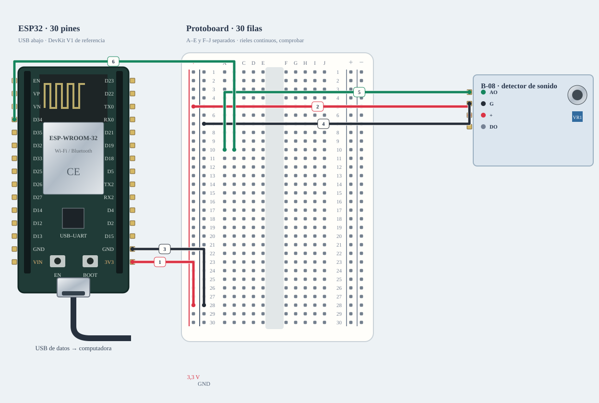

# M-06 · Sonido relativo · AO

B-08 tiene AO/G/+/DO fotografiados. Es una entrada analógica relativa, no un sonómetro.

**Montaje condicionado · revisar pendientes.** Diseño de referencia, sin ensayo físico nuevo.



[JSON de montaje importable](ruido-fisico.json) · [SVG físico](ruido-fisico.svg). ESP32 USB abajo; orientación de referencia, cotejar serigrafía. Terminales rotulados por función donde el conector aún no está identificado.

## Materiales

- B-08: detector ×1
- B-01 o A-04: protoboard
- Adaptación de señal si AO excede lógica admitida; no inventariada

Cables: 6 M–H + 0 M–M dibujados; cero H–H. Se reutilizan entre bancos; no se exige montarlos todos simultáneamente. Preservar B-02/NFC; comprobar material libre en la otra placa.

## Conexiones funcionales

| Desde | Hasta | Vía | Estado |
|---|---|---|---|
| Alimentación B-08 · pendiente | Detector · + | No asumir 5 V | Pendiente; no conectar |
| Detector · G | ESP32 · GND | — | Referencia |
| Detector · AO | ESP32 · GPIO34 / ADC1 | Solo tras validar nivel o adaptar | Pendiente; no conectar |

## Armado cable por cable · USB desconectado

Referencia física, sin escala métrica. USB desconectado al armar. Usar A-01 solo tras identificar placa/puerto y preservar respaldo; B-02/NFC permanece conservado. Cables reutilizados entre ensayos; cero H–H.

| Nº | Color | Tipo | Origen | Destino | Condición |
|---|---|---|---|---|---|
| 1 | red | M–H | esp1:3V3 | bb:LP28 | NO conectar: Confirmar alimentación de B-08 a 3,3 V; no adoptar la ficha de un KY-038 parecido. |
| 2 | red | M–H | bb:LP5 | module1:VCC | NO conectar: Confirmar variante y VCC de B-08. |
| 3 | black | M–H | esp1:GND | bb:LN28 | Cable 3 · M–H · esp1:GND → bb:LN28. Conectar sin USB; comprobar etiquetas y agujeros. |
| 4 | black | M–H | bb:LN7 | module1:G | Cable 4 · M–H · bb:LN7 → module1:G. Conectar sin USB; comprobar etiquetas y agujeros. |
| 5 | green | M–H | module1:AO | bb:A10 | NO conectar: Confirmar tensión AO compatible con ADC; dimensionar adaptación si hace falta. |
| 6 | green | M–H | esp1:GPIO34 | bb:B10 | Cable 6 · M–H · esp1:GPIO34 → bb:B10. Conectar sin USB; comprobar etiquetas y agujeros. |

M–H: hembra al conector macho del módulo/ESP32 y macho al agujero. M–M: ambos extremos en agujeros distintos. Nunca dos puntas en un agujero.

LP/LN: riel izquierdo +/−; RP/RN: derecho +/−. A–E y F–J son tiras separadas por fila. Confirmar continuidad/cortes de la protoboard real; los rieles opuestos no están unidos. Patas colocadas: módulos externos, conectores por verificar.

Cruces no unen redes. Las líneas discontinuas están pendientes y no cuentan como continuidad confirmada. Colores son identificadores del dibujo: elegir cables reales y anotar equivalencias. SVG no demuestra alcance físico.

## Antes de energizar

1. DO se deja sin conectar; no se le asigna GPIO por inferencia.
2. Si se alimenta a 5 V, AO/DO podrían exceder lo admitido por ESP32.
3. No sustituir este módulo por INMP441: interfaces distintas.
4. Identificar A-01/puerto y preservar respaldo privado antes de cargar.
5. Comprobar protoboard real, tipos y alcance de jumpers, con USB desconectado.
6. Modelo B-08, VCC y máximo AO sin confirmar; adaptación si procede.

Revisar agujero por agujero con USB retirado, polaridad y separación de fuentes. Sin multímetro, identificar por etiquetas y documentación exacta; una tensión o pin dudoso se mantiene desconectado. VIN no garantiza salida regulada de 5 V.

Firmware: firmware/sound_bench; compilar sin carga; Serial 115200. Ver guía física.

## Compilar y cargar manualmente

Arduino CLI 1.5.1, ESP32 core 3.3.12; DHT sensor library 1.4.7 y Adafruit Unified Sensor 1.1.15 solo si el perfil utiliza DHT11. Otros sketches nuevos usan el core sin bibliotecas adicionales.

```sh
arduino-cli compile --fqbn esp32:esp32:esp32doit-devkit-v1 --jobs 2 --output-dir /tmp/classai-ruido-build firmware/sound_bench
```

Antes de cargar: identificar A-01 y puerto explícito, comprobar su FQBN, registrar cableado real y conservar respaldo privado verificado. Desconectar módulos ajenos y cerrar cualquier monitor. Solo después de resolver TODOS los pendientes eléctricos de esta receta:

```sh
# Sustituir PUERTO_A01 por el puerto reidentificado; no usar el de B-02/NFC.
arduino-cli upload --fqbn esp32:esp32:esp32doit-devkit-v1 --port PUERTO_A01 --input-dir /tmp/classai-ruido-build firmware/sound_bench
arduino-cli monitor --port PUERTO_A01 --config baudrate=115200
```

Cargar utiliza el binario del perfil recién compilado; no recompilar otro perfil entre compile/upload. Abrir Serial puede reiniciar la placa. No se ejecutaron estos comandos de carga/monitor durante esta entrega.

## Prueba guiada y fallos

Acción: Comparar silencio relativo, conversación y palmada durante varias ventanas.

Aprobación esperada: min/max, pico a pico y noise_rel varían; no son dB ni garantizan tres niveles sin ensayo.

Diagnóstico: Saturación: desconectar, revisar alimentación/niveles; DO queda libre.

Conflictos: GPIO34 es solo entrada en ESP32 clásico; no usarlo como salida.

Faltantes/confirmaciones:
- Identificar A-01/puerto y preservar respaldo privado antes de cargar.
- Comprobar protoboard real, tipos y alcance de jumpers, con USB desconectado.
- Modelo B-08, VCC y máximo AO sin confirmar; adaptación si procede.

## Registro de resultado

| Etapa | Resultado observado | Evidencia |
|---|---|---|
| Diseño | Referencia física; conservar condiciones | SVG/JSON y guía |
| Compilación | Consultar [resultados de esta entrega](../bancos-fisicos.md); no inferir PASS del comando | Log y tamaños por perfil |
| Simulación nueva | No ejecutada | — |
| Ensayo físico nuevo | Pendiente | Completar acción, salida, reinicios y evidencia tras ensayo |
| Desmontaje | Pendiente | Registrar qué cables/piezas quedan conectados |

- [Joy-IT · referencia KY-038](https://sensorkit.joy-it.net/en/sensors/ky-038)
- [Espressif · ESP32](https://www.espressif.com/sites/default/files/documentation/esp32_datasheet_en.pdf)

[Índice](README.md). Generado desde missions.ts y sus registros físicos mediante web/scripts/export-hardware-missions.mjs.
