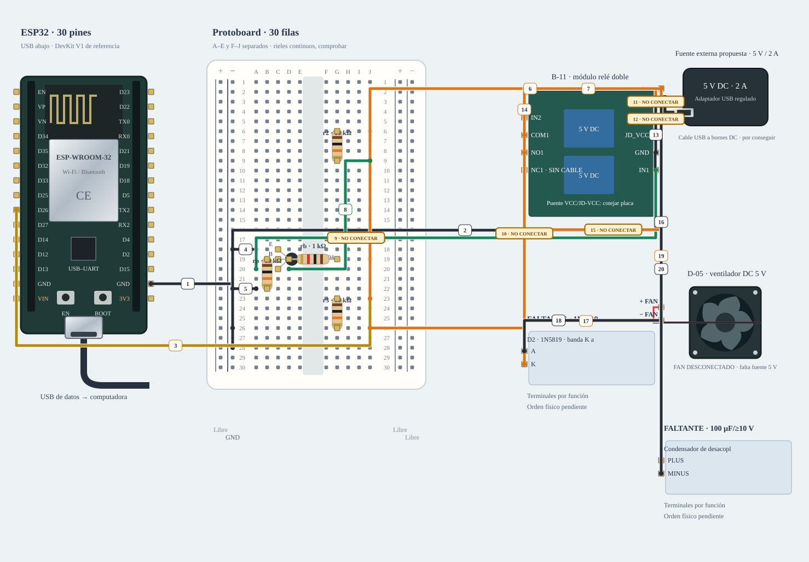

# M-09 · Ventilador + relé · adaptación condicional

Alternativa de compatibilidad; no es el montaje principal ni material ya recibido.

**Diseño y sketch · ensayo físico pendiente.** Diseño de referencia, sin ensayo físico nuevo.



[JSON de montaje importable](ventilador-adaptado-fisico.json) · [SVG físico](ventilador-adaptado-fisico.svg). ESP32 USB abajo; orientación de referencia, cotejar serigrafía. Terminales rotulados por función donde el conector aún no está identificado.

## Materiales

- esp1: A-01 · identificar antes de cargar
- relay1: B-11 · solo canal 1
- fan1: D-05 · DC 5 V
- d2: FALTANTE · 1N5819
- c1: FALTANTE · 100 µF/≥10 V
- ps1: PROPUESTA · fuente DC 5 V/2 A + distribuidor; no inventariada
- q1: FALTANTE · onsemi 2N3904
- rb: C-01 · 1 kΩ
- rp: C-02 · 10 kΩ
- r2: C-02 · 10 kΩ adicional
- r3: C-02 · 10 kΩ adicional

Cables: Consultar tabla completa de cables de esta alternativa.. Se reutilizan entre bancos; no se exige montarlos todos simultáneamente. Preservar B-02/NFC; comprobar material libre en la otra placa.

## Conexiones funcionales

| Desde | Hasta | Vía | Estado |
|---|---|---|---|


## Armado cable por cable · USB desconectado

Referencia física, sin escala métrica. USB desconectado al armar. Usar A-01 solo tras identificar placa/puerto y preservar respaldo; B-02/NFC permanece conservado. Cables reutilizados entre ensayos; cero H–H.

| Nº | Color | Tipo | Origen | Destino | Condición |
|---|---|---|---|---|---|
| 1 | black | M–H | esp1:GND | bb:LN28 | Cable 1 · M–H · esp1:GND → bb:LN28. Conectar sin USB; comprobar etiquetas y agujeros. |
| 2 | black | potencia | ps1:GND | bb:LN26 | Cable 2 · potencia DC por bornera, 22 AWG de referencia · ps1:GND → bb:LN26. Solo referencia de lógica; motor/altavoz retornan al distribuidor, no a la protoboard. |
| 3 | yellow | M–H | esp1:GPIO26 | bb:J19 | Cable 3 · M–H · esp1:GPIO26 → bb:J19. Conectar sin USB; comprobar etiquetas y agujeros. |
| 4 | black | M–M | bb:A18 | bb:LN18 | Cable 4 · M–M · bb:A18 → bb:LN18. Conectar sin USB; comprobar etiquetas y agujeros. |
| 5 | black | M–M | bb:A22 | bb:LN22 | Cable 5 · M–M · bb:A22 → bb:LN22. Conectar sin USB; comprobar etiquetas y agujeros. |
| 6 | orange | potencia | ps1:PLUS | bb:J6 | Cable 6 · potencia DC por bornera, 22 AWG de referencia · ps1:PLUS → bb:J6. 5 V solo para pull-ups de IN1/IN2. |
| 7 | orange | potencia | ps1:PLUS | bb:J23 | Cable 7 · potencia DC por bornera, 22 AWG de referencia · ps1:PLUS → bb:J23. 5 V solo para segundo pull-up. |
| 8 | green | M–M | bb:J9 | bb:D20 | Cable 8 · M–M · bb:J9 → bb:D20. Conectar sin USB; comprobar etiquetas y agujeros. |
| 9 | green | M–H | bb:A20 | relay1:IN1 | NO conectar: Confirmar disparo LOW, IN1 ≤10 mA y puente VCC/JD-VCC real. |
| 10 | orange | M–H | bb:J26 | relay1:IN2 | NO conectar: Referencia LOW-trigger: mantener canal 2 apagado a 5 V mediante 10 kΩ. |
| 11 | orange | potencia | ps1:PLUS | relay1:VCC | NO conectar: Fuente propuesta y configuración real del módulo por confirmar. |
| 12 | orange | potencia | ps1:PLUS | relay1:JD_VCC | NO conectar: Confirmar puente del módulo con alimentación retirada. |
| 13 | black | potencia | ps1:GND | relay1:GND | Cable 13 · potencia DC por bornera, 22 AWG de referencia · ps1:GND → relay1:GND. Retorno de bobinas directo al distribuidor. |
| 14 | orange | potencia | ps1:PLUS | relay1:COM1 | Cable 14 · potencia DC por bornera, 22 AWG de referencia · ps1:PLUS → relay1:COM1. Rama de carga 22 AWG y bornera, no riel de protoboard. |
| 15 | orange | potencia | relay1:NO1 | fan1:PLUS | NO conectar: Comprobar arranque/corriente y conector. Referencia de diseño: fan ≤1 A de pico, rama/fuente deben admitirlo. |
| 16 | black | potencia | fan1:MINUS | ps1:GND | Cable 16 · potencia DC por bornera, 22 AWG de referencia · fan1:MINUS → ps1:GND. Retorno motor directo al distribuidor. |
| 17 | orange | potencia | d2:K | fan1:PLUS | Cable 17 · potencia DC por bornera, 22 AWG de referencia · d2:K → fan1:PLUS. Banda del 1N5819 al + del fan. |
| 18 | black | potencia | d2:A | fan1:MINUS | Cable 18 · potencia DC por bornera, 22 AWG de referencia · d2:A → fan1:MINUS. Ánodo al − del fan. |
| 19 | orange | potencia | ps1:PLUS | c1:PLUS | Cable 19 · potencia DC por bornera, 22 AWG de referencia · ps1:PLUS → c1:PLUS. 100 µF/≥10 V cerca del módulo, positivo a +5 V. |
| 20 | black | potencia | ps1:GND | c1:MINUS | Cable 20 · potencia DC por bornera, 22 AWG de referencia · ps1:GND → c1:MINUS. Negativo a GND. |

M–H: hembra al conector macho del módulo/ESP32 y macho al agujero. M–M: ambos extremos en agujeros distintos. Nunca dos puntas en un agujero.

LP/LN: riel izquierdo +/−; RP/RN: derecho +/−. A–E y F–J son tiras separadas por fila. Confirmar continuidad/cortes de la protoboard real; los rieles opuestos no están unidos. Patas colocadas: q1 (FALTANTE · onsemi 2N3904): E→C18, B→C19, C→C20; rb (C-01 · 1 kΩ): 1→G19, 2→D19; rp (C-02 · 10 kΩ): 1→B19, 2→B22; r2 (C-02 · 10 kΩ adicional): 1→G6, 2→G9; r3 (C-02 · 10 kΩ adicional): 1→G23, 2→G26.

Cruces no unen redes. Las condiciones de cada tramo aparecen en esta tabla; un cable por verificar no cuenta como continuidad confirmada aunque se dibuje continuo. Colores son identificadores del dibujo: elegir cables reales y anotar equivalencias. SVG no demuestra alcance físico.

## Antes de energizar

1. A-01/puerto identificados y respaldo privado preservado; B-02/NFC conservado.
2. Fuente DC regulada 5 V/2 A y distribuidor son propuesta, no recepción ni capacidad medida. Presupuesto de referencia: fan pico ≤1 A y módulo relé ≤0,2 A; confirmar etiquetas/datos reales.
3. Faltan 2N3904, 1N5819, 100 µF/≥10 V, cable de potencia 22 AWG/borneras y adaptador del fan de paso confirmado; C-01 1 kΩ y tres C-02 10 kΩ libres.
4. Confirmar módulo LOW-trigger, IN1 ≤10 mA, puente y contactos COM1/NO1. Sin eso, no energizar; el sketch se entrega desarmado.

Revisar agujero por agujero con USB retirado, polaridad y separación de fuentes. Sin multímetro, identificar por etiquetas y documentación exacta; una tensión o pin dudoso se mantiene desconectado. VIN no garantiza salida regulada de 5 V.

Firmware: firmware/relay_fan_bench

## Compilar y cargar manualmente

Arduino CLI 1.5.1, ESP32 core 3.3.12; DHT sensor library 1.4.7 y Adafruit Unified Sensor 1.1.15 solo si el perfil utiliza DHT11. Actuadores usan ClassAIBench local y pantalla Adafruit GFX 1.12.6 + ST7735/ST7789 1.12.0.

```sh
arduino-cli compile --libraries firmware/libraries --fqbn esp32:esp32:esp32doit-devkit-v1 --jobs 2 --build-property 'compiler.cpp.extra_flags=-DBENCH_RELAY_NPN_ONLY=1' --output-dir /tmp/classai-ventilador-adaptado-build firmware/relay_fan_bench
```

Antes de cargar: identificar A-01 y puerto explícito, comprobar su FQBN, registrar cableado real y conservar respaldo privado verificado. Desconectar módulos ajenos y cerrar cualquier monitor. Solo después de resolver TODOS los pendientes eléctricos de esta receta:

```sh
# Sustituir PUERTO_A01 por el puerto reidentificado; no usar el de B-02/NFC.
arduino-cli upload --fqbn esp32:esp32:esp32doit-devkit-v1 --port PUERTO_A01 --input-dir /tmp/classai-ventilador-adaptado-build firmware/relay_fan_bench
arduino-cli monitor --port PUERTO_A01 --config baudrate=115200
```

Cargar utiliza el binario del perfil recién compilado; no recompilar otro perfil entre compile/upload. Abrir Serial puede reiniciar la placa. No se ejecutaron estos comandos de carga/monitor durante esta entrega.

## Prueba guiada y fallos

Acción: Primero sin fan: verificar que está apagado al arranque. Confirmado LOW-trigger, enviar arm y on; cada on dura como máximo 2 s. stop apaga y desarma.

Aprobación esperada: Canal 1 conmuta, canal 2 permanece apagado; fan gira y se detiene sin reset. No reanuda tras boot/desconexión.

Diagnóstico: Enviar stop ante un fallo. Desconectar ambas fuentes antes de revisar cada extremo, polaridad, masa común y material faltante; no cambiar pines en caliente.

Conflictos: GPIO26 coincide con RST TFT y propuesta BCLK I²S.

Faltantes/confirmaciones:
- A-01/puerto identificados y respaldo privado preservado; B-02/NFC conservado.
- Fuente DC regulada 5 V/2 A y distribuidor son propuesta, no recepción ni capacidad medida. Presupuesto de referencia: fan pico ≤1 A y módulo relé ≤0,2 A; confirmar etiquetas/datos reales.
- Faltan 2N3904, 1N5819, 100 µF/≥10 V, cable de potencia 22 AWG/borneras y adaptador del fan de paso confirmado; C-01 1 kΩ y tres C-02 10 kΩ libres.
- Confirmar módulo LOW-trigger, IN1 ≤10 mA, puente y contactos COM1/NO1. Sin eso, no energizar; el sketch se entrega desarmado.

## Registro de resultado

| Etapa | Resultado observado | Evidencia |
|---|---|---|
| Diseño | Referencia física; conservar condiciones | SVG/JSON y guía |
| Compilación | Consultar [resultados de esta entrega](../bancos-fisicos.md); no inferir PASS del comando | Log y tamaños por perfil |
| Simulación nueva | No ejecutada | — |
| Ensayo físico nuevo | Pendiente | Completar acción, salida, reinicios y evidencia tras ensayo |
| Desmontaje | Pendiente | Registrar qué cables/piezas quedan conectados |

- [TONG LING · familia relé](https://denkovi.com/Documents/JQC-3FF-S-Z.pdf)
- [Material de la U y criterios de armado](https://github.com/joaquinsalinas06/ClassAI/blob/codex/physical-benches/docs/hardware/circuitos-referencia.md)

[Índice](README.md). Generado desde missions.ts y sus registros físicos mediante web/scripts/export-hardware-missions.mjs.
