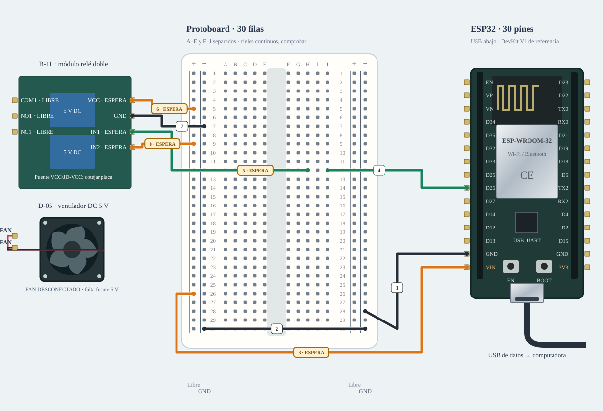

# M-09 · Ventilador + relé

Primero sin fan: verificar que está apagado al arranque. Confirmado LOW-trigger, enviar arm y on; cada on dura como máximo 2 s. stop apaga y desarma.

**Montaje condicionado · revisar pendientes.** Diseño de referencia, sin ensayo físico nuevo.



[JSON de montaje importable](ventilador-fisico.json) · [SVG físico](ventilador-fisico.svg). ESP32 USB abajo; orientación de referencia, cotejar serigrafía. Terminales rotulados por función donde el conector aún no está identificado.

## Materiales

- esp1: A-01 · identificar antes de cargar
- relay1: B-11 · módulo relé doble
- fan1: D-05 · ventilador 5 V
- ps1: PROPUESTA · 5 V DC / 2 A

Cables: 3 M–H + 0 M–M dibujados; cero H–H. 7 tramos de potencia por bornera. Se reutilizan entre bancos; no se exige montarlos todos simultáneamente. Preservar B-02/NFC; comprobar material libre en la otra placa.

## Conexiones funcionales

| Desde | Hasta | Vía | Estado |
|---|---|---|---|
| ESP32 · GND_L | Protoboard · LN28 | c1 · M–H | Referencia |
| Fuente 5 V DC · GND | Protoboard · LN26 | c2 · potencia | Referencia |
| ESP32 · GPIO26 | Protoboard · J12 | c3 · M–H | Referencia |
| Protoboard · H12 | Relé · IN1 | c4 · M–H | Pendiente; no conectar |
| Fuente 5 V DC · PLUS | Relé · VCC | c5 · potencia | Pendiente; no conectar |
| Fuente 5 V DC · GND | Relé · GND | c6 · potencia | Referencia |
| Fuente 5 V DC · PLUS | Relé · IN2 | c7 · potencia | Pendiente; no conectar |
| Fuente 5 V DC · PLUS | Relé · COM1 | c8 · potencia | Referencia |
| Relé · NO1 | Ventilador · PLUS | c9 · potencia | Pendiente; no conectar |
| Ventilador · MINUS | Fuente 5 V DC · GND | c10 · potencia | Referencia |

## Armado cable por cable · USB desconectado

Referencia física, sin escala métrica. USB desconectado al armar. Usar A-01 solo tras identificar placa/puerto y preservar respaldo; B-02/NFC permanece conservado. Cables reutilizados entre ensayos; cero H–H.

| Nº | Color | Tipo | Origen | Destino | Condición |
|---|---|---|---|---|---|
| 1 | black | M–H | esp1:GND_L | bb:LN28 | Cable 1 · M–H · esp1:GND_L → bb:LN28. Conectar sin USB; comprobar etiquetas y agujeros. |
| 2 | black | potencia | ps1:GND | bb:LN26 | Cable 2 · potencia DC por bornes · ps1:GND → bb:LN26. Conectar sin USB; comprobar etiquetas y agujeros. |
| 3 | green | M–H | esp1:GPIO26 | bb:J12 | Cable 3 · M–H · esp1:GPIO26 → bb:J12. Conectar sin USB; comprobar etiquetas y agujeros. |
| 4 | green | M–H | bb:H12 | relay1:IN1 | NO conectar: Confirmar módulo LOW-trigger con lógica 3,3 V, sin 5 V retornando a GPIO. Si no es compatible, usar la alternativa NPN. |
| 5 | orange | potencia | ps1:PLUS | relay1:VCC | NO conectar: Confirmar fuente y puente VCC/JD-VCC reales del módulo. |
| 6 | black | potencia | ps1:GND | relay1:GND | Cable 6 · potencia DC por bornes · ps1:GND → relay1:GND. Conectar sin USB; comprobar etiquetas y agujeros. |
| 7 | orange | potencia | ps1:PLUS | relay1:IN2 | NO conectar: Solo bajo referencia LOW-trigger: canal 2 apagado a VCC; confirmar lógica real. |
| 8 | orange | potencia | ps1:PLUS | relay1:COM1 | Cable 8 · potencia DC por bornes · ps1:PLUS → relay1:COM1. Conectar sin USB; comprobar etiquetas y agujeros. |
| 9 | orange | potencia | relay1:NO1 | fan1:PLUS | NO conectar: Polaridad, conector y capacidad de corriente por confirmar. |
| 10 | black | potencia | fan1:MINUS | ps1:GND | Cable 10 · potencia DC por bornes · fan1:MINUS → ps1:GND. Conectar sin USB; comprobar etiquetas y agujeros. |

M–H: hembra al conector macho del módulo/ESP32 y macho al agujero. M–M: ambos extremos en agujeros distintos. Nunca dos puntas en un agujero.

LP/LN: riel izquierdo +/−; RP/RN: derecho +/−. A–E y F–J son tiras separadas por fila. Confirmar continuidad/cortes de la protoboard real; los rieles opuestos no están unidos. Patas colocadas: módulos externos, conectores por verificar.

Cruces no unen redes. Las condiciones de cada tramo aparecen en esta tabla; un cable por verificar no cuenta como continuidad confirmada aunque se dibuje continuo. Colores son identificadores del dibujo: elegir cables reales y anotar equivalencias. SVG no demuestra alcance físico.

## Compatibilidad eléctrica

[Montaje alternativo con adaptación](ventilador-adaptado.md). No se muestra como material obligatorio del montaje principal; usarlo si los niveles o la carga exigen esa etapa.

## Antes de energizar

1. Identificar placa A-01/puerto, preservar respaldo y armar sin alimentación. B-02/NFC se conserva.
2. Fuente genérica externa 5 V/2 A propuesta; rama de potencia por borneras, no por GPIO/protoboard.
3. Confirmar LOW-trigger y compatibilidad eléctrica 3,3 V de IN1. Si no se confirma, no conectar directo: usar la alternativa con transistor.
4. El perfil por defecto usa control directo LOW-trigger; la alternativa NPN requiere BENCH_RELAY_NPN_ONLY. Revisar boot sin fan antes de cargar la rama de potencia.

Revisar agujero por agujero con USB retirado, polaridad y separación de fuentes. Sin multímetro, identificar por etiquetas y documentación exacta; una tensión o pin dudoso se mantiene desconectado. VIN no garantiza salida regulada de 5 V.

Firmware: firmware/relay_fan_bench; compilar sin carga; Serial 115200. Ver guía física.

## Compilar y cargar manualmente

Arduino CLI 1.5.1, ESP32 core 3.3.12; DHT sensor library 1.4.7 y Adafruit Unified Sensor 1.1.15 solo si el perfil utiliza DHT11. Actuadores usan ClassAIBench local y pantalla Adafruit GFX 1.12.6 + ST7735/ST7789 1.12.0.

```sh
arduino-cli compile --libraries firmware/libraries --fqbn esp32:esp32:esp32doit-devkit-v1 --jobs 2 --output-dir /tmp/classai-ventilador-build firmware/relay_fan_bench
```

Antes de cargar: identificar A-01 y puerto explícito, comprobar su FQBN, registrar cableado real y conservar respaldo privado verificado. Desconectar módulos ajenos y cerrar cualquier monitor. Solo después de resolver TODOS los pendientes eléctricos de esta receta:

```sh
# Sustituir PUERTO_A01 por el puerto reidentificado; no usar el de B-02/NFC.
arduino-cli upload --fqbn esp32:esp32:esp32doit-devkit-v1 --port PUERTO_A01 --input-dir /tmp/classai-ventilador-build firmware/relay_fan_bench
arduino-cli monitor --port PUERTO_A01 --config baudrate=115200
```

Cargar utiliza el binario del perfil recién compilado; no recompilar otro perfil entre compile/upload. Abrir Serial puede reiniciar la placa. No se ejecutaron estos comandos de carga/monitor durante esta entrega.

## Prueba guiada y fallos

Acción: Primero sin fan: verificar que está apagado al arranque. Confirmado LOW-trigger, enviar arm y on; cada on dura como máximo 2 s. stop apaga y desarma.

Aprobación esperada: Canal 1 conmuta, canal 2 permanece apagado; fan gira y se detiene sin reset. No reanuda tras boot/desconexión.

Diagnóstico: Enviar stop ante un fallo. Desconectar ambas fuentes antes de revisar cada extremo, polaridad, masa común y material faltante; no cambiar pines en caliente.

Conflictos: GPIO26 coincide con RST TFT y propuesta BCLK I²S.

Faltantes/confirmaciones:
- Identificar placa A-01/puerto, preservar respaldo y armar sin alimentación. B-02/NFC se conserva.
- Fuente genérica externa 5 V/2 A propuesta; rama de potencia por borneras, no por GPIO/protoboard.
- Confirmar LOW-trigger y compatibilidad eléctrica 3,3 V de IN1. Si no se confirma, no conectar directo: usar la alternativa con transistor.
- El perfil por defecto usa control directo LOW-trigger; la alternativa NPN requiere BENCH_RELAY_NPN_ONLY. Revisar boot sin fan antes de cargar la rama de potencia.

## Registro de resultado

| Etapa | Resultado observado | Evidencia |
|---|---|---|
| Diseño | Referencia física; conservar condiciones | SVG/JSON y guía |
| Compilación | Consultar [resultados de esta entrega](../bancos-fisicos.md); no inferir PASS del comando | Log y tamaños por perfil |
| Simulación nueva | No ejecutada | — |
| Ensayo físico nuevo | Pendiente | Completar acción, salida, reinicios y evidencia tras ensayo |
| Desmontaje | Pendiente | Registrar qué cables/piezas quedan conectados |

- [TONG LING · familia relé](https://denkovi.com/Documents/JQC-3FF-S-Z.pdf)
- [Material de la U y criterios de armado](https://github.com/joaquinsalinas06/ClassAI/blob/codex/physical-benches/docs/hardware/circuitos-referencia.md)

[Índice](README.md). Generado desde missions.ts y sus registros físicos mediante web/scripts/export-hardware-missions.mjs.
